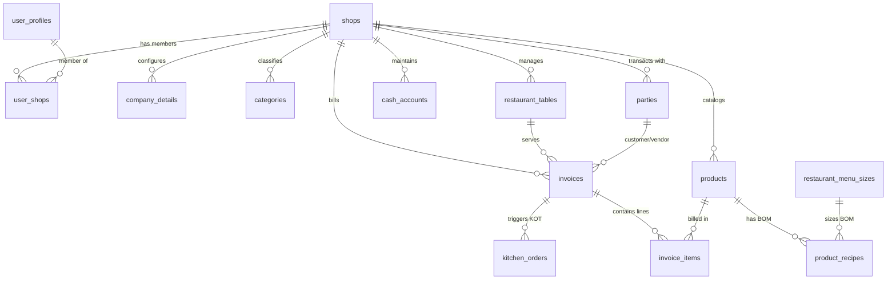

# Supabase PostgreSQL Database Schema Documentation

> **System:** The Accounts / Cafe Master ERP Database Architecture
> **Generated At:** 2026-11-07T07:42:29.467Z
> **Database Version:** PostgreSQL 17.6
> **Total Tables:** 98
> **Total Foreign Key Relationships:** 207

## Table of Contents

- [1. Core SaaS, Tenants & Authentication](#1-core-saas-tenants-authentication)
- [2. Restaurant & Food Service POS](#2-restaurant-food-service-pos)
- [3. Inventory, Catalog & Multi-Warehouse](#3-inventory-catalog-multi-warehouse)
- [4. Invoicing, Sales & Orders](#4-invoicing-sales-orders)
- [5. Accounting, General Ledger & Khata](#5-accounting-general-ledger-khata)
- [6. Purchasing & Supplier Management](#6-purchasing-supplier-management)
- [7. SaaS Platform Administration & Security](#7-saas-platform-administration-security)
- [8. Staff, HR & Payroll Management](#8-staff-hr-payroll-management)
- [9. Specialized Vertical: Pharmacy & Healthcare](#9-specialized-vertical-pharmacy-healthcare)
- [10. Specialized Vertical: Showroom, Automobile & EMI](#10-specialized-vertical-showroom-automobile-emi)
- [11. Specialized Vertical: Tailoring & Boutique](#11-specialized-vertical-tailoring-boutique)
- [12. Specialized Vertical: Fuel Station & Utilities](#12-specialized-vertical-fuel-station-utilities)
- [Complete Foreign Key Relationships Matrix](#complete-foreign-key-relationships-matrix)

## Entity Relationship Overview (Core Architecture)

---

## 1. Core SaaS, Tenants & Authentication

Multi-tenant shop management, user authentication profiles, shop memberships, company profile branding and print settings.

### Table: `shops`

| Column | Type | Nullable | Default | Key / Relation |
|---|---|:---:|---|---|
| **`id`** | `uuid` | No | `uuid_generate_v4()` | `PK`  |
| **`owner_id`** | `uuid` | Yes | - | - |
| **`name`** | `varchar(255)` | No | - | - |
| **`industry_type`** | `varchar(50)` | No | - | - |
| **`currency`** | `varchar(10)` | Yes | `'PKR'` | - |
| **`subscription_tier`** | `varchar(20)` | Yes | `'free'` | - |
| **`created_at`** | `timestamp with time zone` | Yes | `now()` | - |
| **`address`** | `text` | Yes | - | - |
| **`phone`** | `varchar(100)` | Yes | - | - |
| **`updated_at`** | `timestamp with time zone` | Yes | `now()` | - |
| **`allow_negative_stock`** | `boolean` | Yes | `false` | - |
| **`has_emi`** | `boolean` | Yes | `false` | - |
| **`has_payroll`** | `boolean` | Yes | `false` | - |
| **`has_tax`** | `boolean` | Yes | `false` | - |
| **`has_assets_rec`** | `boolean` | Yes | `false` | - |
| **`subscription_expires_at`** | `timestamp with time zone` | Yes | `(now() + '30 days')` | - |
| **`has_loyalty`** | `boolean` | Yes | `true` | - |
| **`default_tax_rate`** | `numeric` | Yes | `0` | - |
| **`default_tax_type`** | `text` | Yes | `'percentage'` | - |
| **`backup_enabled`** | `boolean` | Yes | `false` | - |
| **`backup_time`** | `varchar` | Yes | `'03:00'` | - |
| **`gdrive_refresh_token`** | `text` | Yes | - | - |
| **`gdrive_folder_id`** | `text` | Yes | - | - |
| **`referred_by_shop_id`** | `uuid` | Yes | - | FK -> `shops.id` (ON DELETE SET NULL) |
| **`referral_credits`** | `numeric` | Yes | `0` | - |
| **`has_gift_cards`** | `boolean` | Yes | `true` | - |
| **`has_ecommerce`** | `boolean` | Yes | `false` | - |
| **`store_slug`** | `varchar(100)` | Yes | - | - |
| **`store_banner_url`** | `text` | Yes | - | - |
| **`store_tagline`** | `text` | Yes | - | - |
| **`store_theme_color`** | `varchar(20)` | Yes | `'#059669'` | - |
| **`delivery_charges`** | `numeric` | Yes | `0` | - |
| **`min_order_amount`** | `numeric` | Yes | `0` | - |
| **`delivery_fee`** | `numeric` | Yes | `0` | - |

**Foreign Keys Outgoing:**
- `referred_by_shop_id` references [`shops.id`](#table-shops) (ON DELETE SET NULL, ON UPDATE NO ACTION)

**Referenced By (Incoming Relationships):**
- [`account_transactions.shop_id`](#table-account_transactions) -> `id`
- [`audit_logs.shop_id`](#table-audit_logs) -> `id`
- [`bank_statement_lines.shop_id`](#table-bank_statement_lines) -> `id`
- [`brands.shop_id`](#table-brands) -> `id`
- [`cash_accounts.shop_id`](#table-cash_accounts) -> `id`
- [`categories.shop_id`](#table-categories) -> `id`
- [`company_details.shop_id`](#table-company_details) -> `id`
- [`credit_transactions.shop_id`](#table-credit_transactions) -> `id`
- [`exchange_rates.shop_id`](#table-exchange_rates) -> `id`
- [`expenses.shop_id`](#table-expenses) -> `id`
- [`fixed_assets.shop_id`](#table-fixed_assets) -> `id`
- [`formulations.shop_id`](#table-formulations) -> `id`
- [`fuel_pumps.shop_id`](#table-fuel_pumps) -> `id`
- [`fuel_shift_readings.shop_id`](#table-fuel_shift_readings) -> `id`
- [`fuel_tanks.shop_id`](#table-fuel_tanks) -> `id`
- [`gift_cards.shop_id`](#table-gift_cards) -> `id`
- [`hardware_dimension_quotes.shop_id`](#table-hardware_dimension_quotes) -> `id`
- [`installment_plans.shop_id`](#table-installment_plans) -> `id`
- [`invoices.shop_id`](#table-invoices) -> `id`
- [`journal_entries.branch_id`](#table-journal_entries) -> `id`
- [`journal_entries.shop_id`](#table-journal_entries) -> `id`
- [`karigars.shop_id`](#table-karigars) -> `id`
- [`kitchen_orders.shop_id`](#table-kitchen_orders) -> `id`
- [`online_customers.shop_id`](#table-online_customers) -> `id`
- [`online_orders.shop_id`](#table-online_orders) -> `id`
- [`parties.shop_id`](#table-parties) -> `id`
- [`payment_submissions.shop_id`](#table-payment_submissions) -> `id`
- [`payroll_slips.shop_id`](#table-payroll_slips) -> `id`
- [`pending_payments.shop_id`](#table-pending_payments) -> `id`
- [`pharmacy_controlled_logs.shop_id`](#table-pharmacy_controlled_logs) -> `id`
- [`pharmacy_doctor_commissions.shop_id`](#table-pharmacy_doctor_commissions) -> `id`
- [`pharmacy_doctors.shop_id`](#table-pharmacy_doctors) -> `id`
- [`pharmacy_short_book.shop_id`](#table-pharmacy_short_book) -> `id`
- [`pharmacy_temperature_logs.shop_id`](#table-pharmacy_temperature_logs) -> `id`
- [`print_settings.shop_id`](#table-print_settings) -> `id`
- [`product_barcodes.shop_id`](#table-product_barcodes) -> `id`
- [`product_batches.shop_id`](#table-product_batches) -> `id`
- [`product_imeis.shop_id`](#table-product_imeis) -> `id`
- [`product_variants.shop_id`](#table-product_variants) -> `id`
- [`product_wastage.shop_id`](#table-product_wastage) -> `id`
- [`products.shop_id`](#table-products) -> `id`
- [`purchase_orders.shop_id`](#table-purchase_orders) -> `id`
- [`referral_transactions.referred_shop_id`](#table-referral_transactions) -> `id`
- [`referral_transactions.shop_id`](#table-referral_transactions) -> `id`
- [`register_sessions.shop_id`](#table-register_sessions) -> `id`
- [`repair_tickets.shop_id`](#table-repair_tickets) -> `id`
- [`restaurant_deals.shop_id`](#table-restaurant_deals) -> `id`
- [`restaurant_menu_sizes.shop_id`](#table-restaurant_menu_sizes) -> `id`
- [`restaurant_modifiers.shop_id`](#table-restaurant_modifiers) -> `id`
- [`restaurant_qr_orders.shop_id`](#table-restaurant_qr_orders) -> `id`
- [`restaurant_reservations.shop_id`](#table-restaurant_reservations) -> `id`
- [`restaurant_stations.shop_id`](#table-restaurant_stations) -> `id`
- [`restaurant_tables.shop_id`](#table-restaurant_tables) -> `id`
- [`restaurant_waiter_calls.shop_id`](#table-restaurant_waiter_calls) -> `id`
- [`returns.shop_id`](#table-returns) -> `id`
- [`sales.shop_id`](#table-sales) -> `id`
- [`seasonal_khata.shop_id`](#table-seasonal_khata) -> `id`
- [`shelves.shop_id`](#table-shelves) -> `id`
- [`showroom_installment_schedules.shop_id`](#table-showroom_installment_schedules) -> `id`
- [`showroom_installments.shop_id`](#table-showroom_installments) -> `id`
- [`showroom_investor_transactions.shop_id`](#table-showroom_investor_transactions) -> `id`
- [`showroom_investors.shop_id`](#table-showroom_investors) -> `id`
- [`showroom_parties.shop_id`](#table-showroom_parties) -> `id`
- [`showroom_rentals.shop_id`](#table-showroom_rentals) -> `id`
- [`showroom_sales.shop_id`](#table-showroom_sales) -> `id`
- [`stitching_orders.shop_id`](#table-stitching_orders) -> `id`
- [`stock.shop_id`](#table-stock) -> `id`
- [`stock_adjustments.shop_id`](#table-stock_adjustments) -> `id`
- [`supplier_expiry_claims.shop_id`](#table-supplier_expiry_claims) -> `id`
- [`support_tickets.shop_id`](#table-support_tickets) -> `id`
- [`tailor_measurements.shop_id`](#table-tailor_measurements) -> `id`
- [`units.shop_id`](#table-units) -> `id`
- [`used_mobile_purchases.shop_id`](#table-used_mobile_purchases) -> `id`
- [`user_profiles.shop_id`](#table-user_profiles) -> `id`
- [`user_shops.shop_id`](#table-user_shops) -> `id`
- [`warehouses.shop_id`](#table-warehouses) -> `id`

---

### Table: `user_profiles`

| Column | Type | Nullable | Default | Key / Relation |
|---|---|:---:|---|---|
| **`id`** | `uuid` | No | - | `PK`  |
| **`shop_id`** | `uuid` | Yes | - | FK -> `shops.id` (ON DELETE CASCADE) |
| **`name`** | `varchar(100)` | No | - | - |
| **`role`** | `varchar(50)` | Yes | `'salesman'` | - |
| **`created_at`** | `timestamp with time zone` | Yes | `now()` | - |
| **`permissions`** | `jsonb` | Yes | `'{"panels": {"pos": true, "khata": true, "sales": true, "staff": false, "backup": false, "returns": true, "accounts": true, "expenses": true, "products": true, "purchase": true, "dashboard": true, "registers": true}, "actions": {"edit_bill": false, "delete_bill": false, "edit_account": false, "delete_account": false}}'` | - |
| **`email`** | `varchar(255)` | Yes | - | - |
| **`attendance_records`** | `jsonb` | Yes | `'[]'` | - |
| **`loans`** | `jsonb` | Yes | `'[]'` | - |
| **`leaves`** | `jsonb` | Yes | `'[]'` | - |
| **`phone`** | `text` | Yes | - | - |

**Foreign Keys Outgoing:**
- `shop_id` references [`shops.id`](#table-shops) (ON DELETE CASCADE, ON UPDATE NO ACTION)

**Referenced By (Incoming Relationships):**
- [`invoices.rider_id`](#table-invoices) -> `id`
- [`invoices.waiter_id`](#table-invoices) -> `id`
- [`kitchen_orders.rider_id`](#table-kitchen_orders) -> `id`
- [`kitchen_orders.waiter_id`](#table-kitchen_orders) -> `id`
- [`payroll_slips.staff_id`](#table-payroll_slips) -> `id`

---

### Table: `user_shops`

| Column | Type | Nullable | Default | Key / Relation |
|---|---|:---:|---|---|
| **`id`** | `uuid` | No | `gen_random_uuid()` | `PK`  |
| **`user_id`** | `uuid` | Yes | - | - |
| **`shop_id`** | `uuid` | Yes | - | FK -> `shops.id` (ON DELETE CASCADE) |
| **`role`** | `varchar` | Yes | `'staff'` | - |
| **`created_at`** | `timestamp with time zone` | Yes | `now()` | - |

**Foreign Keys Outgoing:**
- `shop_id` references [`shops.id`](#table-shops) (ON DELETE CASCADE, ON UPDATE NO ACTION)

---

### Table: `company_details`

| Column | Type | Nullable | Default | Key / Relation |
|---|---|:---:|---|---|
| **`id`** | `uuid` | No | `gen_random_uuid()` | `PK`  |
| **`shop_id`** | `uuid` | Yes | - | FK -> `shops.id` (ON DELETE NO ACTION) |
| **`name`** | `varchar(100)` | No | - | - |
| **`address`** | `text` | Yes | - | - |
| **`phone`** | `varchar(100)` | Yes | - | - |
| **`email`** | `varchar(100)` | Yes | - | - |
| **`logo_path`** | `varchar(255)` | Yes | - | - |
| **`website`** | `text` | Yes | - | - |
| **`created_at`** | `timestamp with time zone` | Yes | `now()` | - |
| **`kitchen_printer_name`** | `varchar(255)` | Yes | - | - |
| **`customer_printer_name`** | `varchar(255)` | Yes | - | - |
| **`printer_name`** | `varchar(255)` | Yes | - | - |

**Foreign Keys Outgoing:**
- `shop_id` references [`shops.id`](#table-shops) (ON DELETE NO ACTION, ON UPDATE NO ACTION)

---

### Table: `print_settings`

| Column | Type | Nullable | Default | Key / Relation |
|---|---|:---:|---|---|
| **`id`** | `uuid` | No | `gen_random_uuid()` | `PK`  |
| **`shop_id`** | `uuid` | Yes | - | FK -> `shops.id` (ON DELETE NO ACTION) |
| **`receipt_page_size`** | `varchar(20)` | Yes | `'MM80'` | - |
| **`receipt_font`** | `varchar(100)` | Yes | `'Arial'` | - |
| **`receipt_font_size`** | `integer` | Yes | `12` | - |
| **`created_at`** | `timestamp with time zone` | Yes | `now()` | - |
| **`receipt_design_settings`** | `jsonb` | Yes | `'{}'` | - |

**Foreign Keys Outgoing:**
- `shop_id` references [`shops.id`](#table-shops) (ON DELETE NO ACTION, ON UPDATE NO ACTION)

---

## 2. Restaurant & Food Service POS

Restaurant tables, floors/sections, KDS kitchen orders, dual kitchen stations, menu sizes, combos/deals, modifiers, reservations, QR ordering and waiter call bells.

### Table: `restaurant_tables`

| Column | Type | Nullable | Default | Key / Relation |
|---|---|:---:|---|---|
| **`id`** | `uuid` | No | `gen_random_uuid()` | `PK`  |
| **`shop_id`** | `uuid` | Yes | - | FK -> `shops.id` (ON DELETE CASCADE) |
| **`name`** | `varchar(100)` | No | - | - |
| **`capacity`** | `integer` | Yes | `4` | - |
| **`status`** | `varchar(50)` | Yes | `'available'` | - |
| **`active_invoice_id`** | `uuid` | Yes | - | FK -> `invoices.id` (ON DELETE SET NULL) |
| **`created_at`** | `timestamp with time zone` | Yes | `now()` | - |
| **`floor_name`** | `varchar(50)` | Yes | `'Ground'` | - |
| **`section_name`** | `varchar(50)` | Yes | - | - |

**Foreign Keys Outgoing:**
- `active_invoice_id` references [`invoices.id`](#table-invoices) (ON DELETE SET NULL, ON UPDATE NO ACTION)
- `shop_id` references [`shops.id`](#table-shops) (ON DELETE CASCADE, ON UPDATE NO ACTION)

**Referenced By (Incoming Relationships):**
- [`invoices.table_id`](#table-invoices) -> `id`
- [`kitchen_orders.table_id`](#table-kitchen_orders) -> `id`
- [`restaurant_qr_orders.table_id`](#table-restaurant_qr_orders) -> `id`
- [`restaurant_reservations.table_id`](#table-restaurant_reservations) -> `id`
- [`restaurant_waiter_calls.table_id`](#table-restaurant_waiter_calls) -> `id`

---

### Table: `restaurant_stations`

| Column | Type | Nullable | Default | Key / Relation |
|---|---|:---:|---|---|
| **`id`** | `uuid` | No | `gen_random_uuid()` | `PK`  |
| **`shop_id`** | `uuid` | Yes | - | FK -> `shops.id` (ON DELETE CASCADE) |
| **`name`** | `varchar(80)` | No | - | - |
| **`kitchen_hub`** | `varchar(100)` | Yes | - | - |
| **`sort_order`** | `integer` | Yes | `0` | - |
| **`is_active`** | `boolean` | Yes | `true` | - |
| **`created_at`** | `timestamp with time zone` | Yes | `now()` | - |

**Foreign Keys Outgoing:**
- `shop_id` references [`shops.id`](#table-shops) (ON DELETE CASCADE, ON UPDATE NO ACTION)

**Referenced By (Incoming Relationships):**
- [`kitchen_orders.station_id`](#table-kitchen_orders) -> `id`

---

### Table: `restaurant_menu_sizes`

| Column | Type | Nullable | Default | Key / Relation |
|---|---|:---:|---|---|
| **`id`** | `uuid` | No | `gen_random_uuid()` | `PK`  |
| **`shop_id`** | `uuid` | Yes | - | FK -> `shops.id` (ON DELETE CASCADE) |
| **`product_id`** | `uuid` | Yes | - | FK -> `products.id` (ON DELETE CASCADE) |
| **`size_name`** | `varchar(30)` | No | - | - |
| **`size_description`** | `varchar(100)` | Yes | - | - |
| **`price`** | `numeric(15,2)` | No | `0` | - |
| **`is_available`** | `boolean` | Yes | `true` | - |
| **`sort_order`** | `integer` | Yes | `0` | - |
| **`created_at`** | `timestamp with time zone` | Yes | `now()` | - |
| **`crust_options`** | `text` | Yes | - | - |
| **`variant_label`** | `varchar(50)` | Yes | - | - |

**Foreign Keys Outgoing:**
- `product_id` references [`products.id`](#table-products) (ON DELETE CASCADE, ON UPDATE NO ACTION)
- `shop_id` references [`shops.id`](#table-shops) (ON DELETE CASCADE, ON UPDATE NO ACTION)

**Referenced By (Incoming Relationships):**
- [`invoice_items.menu_size_id`](#table-invoice_items) -> `id`
- [`product_recipes.menu_size_id`](#table-product_recipes) -> `id`

---

### Table: `restaurant_deals`

| Column | Type | Nullable | Default | Key / Relation |
|---|---|:---:|---|---|
| **`id`** | `uuid` | No | `gen_random_uuid()` | `PK`  |
| **`shop_id`** | `uuid` | Yes | - | FK -> `shops.id` (ON DELETE CASCADE) |
| **`name`** | `varchar(100)` | No | - | - |
| **`description`** | `text` | Yes | - | - |
| **`image_url`** | `text` | Yes | - | - |
| **`original_price`** | `numeric(15,2)` | No | `0` | - |
| **`deal_price`** | `numeric(15,2)` | No | `0` | - |
| **`discount_percentage`** | `numeric(5,2)` | Yes | `0` | - |
| **`is_active`** | `boolean` | Yes | `true` | - |
| **`valid_from`** | `timestamp with time zone` | Yes | - | - |
| **`valid_until`** | `timestamp with time zone` | Yes | - | - |
| **`max_uses`** | `integer` | Yes | - | - |
| **`current_uses`** | `integer` | Yes | `0` | - |
| **`created_at`** | `timestamp with time zone` | Yes | `now()` | - |

**Foreign Keys Outgoing:**
- `shop_id` references [`shops.id`](#table-shops) (ON DELETE CASCADE, ON UPDATE NO ACTION)

**Referenced By (Incoming Relationships):**
- [`restaurant_deal_items.deal_id`](#table-restaurant_deal_items) -> `id`

---

### Table: `restaurant_deal_items`

| Column | Type | Nullable | Default | Key / Relation |
|---|---|:---:|---|---|
| **`id`** | `uuid` | No | `gen_random_uuid()` | `PK`  |
| **`deal_id`** | `uuid` | Yes | - | FK -> `restaurant_deals.id` (ON DELETE CASCADE) |
| **`product_id`** | `uuid` | Yes | - | FK -> `products.id` (ON DELETE SET NULL) |
| **`item_type`** | `varchar(30)` | Yes | `'item'` | - |
| **`quantity`** | `numeric(15,2)` | No | `1` | - |
| **`size_name`** | `varchar(30)` | Yes | - | - |
| **`created_at`** | `timestamp with time zone` | Yes | `now()` | - |

**Foreign Keys Outgoing:**
- `deal_id` references [`restaurant_deals.id`](#table-restaurant_deals) (ON DELETE CASCADE, ON UPDATE NO ACTION)
- `product_id` references [`products.id`](#table-products) (ON DELETE SET NULL, ON UPDATE NO ACTION)

---

### Table: `restaurant_modifiers`

| Column | Type | Nullable | Default | Key / Relation |
|---|---|:---:|---|---|
| **`id`** | `uuid` | No | `gen_random_uuid()` | `PK`  |
| **`shop_id`** | `uuid` | Yes | - | FK -> `shops.id` (ON DELETE CASCADE) |
| **`name`** | `varchar(100)` | No | - | - |
| **`price_add`** | `numeric(15,2)` | No | `0` | - |
| **`is_active`** | `boolean` | Yes | `true` | - |
| **`sort_order`** | `integer` | Yes | `0` | - |
| **`applies_to`** | `varchar(50)` | Yes | `'all'` | - |
| **`created_at`** | `timestamp with time zone` | Yes | `now()` | - |

**Foreign Keys Outgoing:**
- `shop_id` references [`shops.id`](#table-shops) (ON DELETE CASCADE, ON UPDATE NO ACTION)

---

### Table: `restaurant_reservations`

| Column | Type | Nullable | Default | Key / Relation |
|---|---|:---:|---|---|
| **`id`** | `uuid` | No | `gen_random_uuid()` | `PK`  |
| **`shop_id`** | `uuid` | Yes | - | FK -> `shops.id` (ON DELETE CASCADE) |
| **`guest_name`** | `varchar(120)` | No | - | - |
| **`guest_phone`** | `varchar(40)` | Yes | - | - |
| **`party_size`** | `integer` | Yes | `2` | - |
| **`reserved_at`** | `timestamp with time zone` | No | - | - |
| **`table_id`** | `uuid` | Yes | - | FK -> `restaurant_tables.id` (ON DELETE SET NULL) |
| **`notes`** | `text` | Yes | - | - |
| **`status`** | `varchar(30)` | Yes | `'booked'` | - |
| **`created_at`** | `timestamp with time zone` | Yes | `now()` | - |

**Foreign Keys Outgoing:**
- `shop_id` references [`shops.id`](#table-shops) (ON DELETE CASCADE, ON UPDATE NO ACTION)
- `table_id` references [`restaurant_tables.id`](#table-restaurant_tables) (ON DELETE SET NULL, ON UPDATE NO ACTION)

---

### Table: `restaurant_qr_orders`

| Column | Type | Nullable | Default | Key / Relation |
|---|---|:---:|---|---|
| **`id`** | `uuid` | No | `gen_random_uuid()` | `PK`  |
| **`shop_id`** | `uuid` | Yes | - | FK -> `shops.id` (ON DELETE CASCADE) |
| **`table_id`** | `uuid` | Yes | - | FK -> `restaurant_tables.id` (ON DELETE SET NULL) |
| **`guest_name`** | `varchar(120)` | Yes | - | - |
| **`items_json`** | `text` | No | - | - |
| **`notes`** | `text` | Yes | - | - |
| **`status`** | `varchar(30)` | Yes | `'pending'` | - |
| **`created_at`** | `timestamp with time zone` | Yes | `now()` | - |

**Foreign Keys Outgoing:**
- `shop_id` references [`shops.id`](#table-shops) (ON DELETE CASCADE, ON UPDATE NO ACTION)
- `table_id` references [`restaurant_tables.id`](#table-restaurant_tables) (ON DELETE SET NULL, ON UPDATE NO ACTION)

---

### Table: `restaurant_waiter_calls`

| Column | Type | Nullable | Default | Key / Relation |
|---|---|:---:|---|---|
| **`id`** | `uuid` | No | `gen_random_uuid()` | `PK`  |
| **`shop_id`** | `uuid` | Yes | - | FK -> `shops.id` (ON DELETE CASCADE) |
| **`table_id`** | `uuid` | Yes | - | FK -> `restaurant_tables.id` (ON DELETE SET NULL) |
| **`invoice_id`** | `uuid` | Yes | - | FK -> `invoices.id` (ON DELETE SET NULL) |
| **`message`** | `varchar(255)` | Yes | `'Waiter requested'` | - |
| **`call_type`** | `varchar(30)` | Yes | `'help'` | - |
| **`status`** | `varchar(20)` | Yes | `'pending'` | - |
| **`waiter_id`** | `uuid` | Yes | - | - |
| **`acknowledged_at`** | `timestamp with time zone` | Yes | - | - |
| **`acknowledged_by`** | `uuid` | Yes | - | - |
| **`created_at`** | `timestamp with time zone` | Yes | `now()` | - |

**Foreign Keys Outgoing:**
- `invoice_id` references [`invoices.id`](#table-invoices) (ON DELETE SET NULL, ON UPDATE NO ACTION)
- `shop_id` references [`shops.id`](#table-shops) (ON DELETE CASCADE, ON UPDATE NO ACTION)
- `table_id` references [`restaurant_tables.id`](#table-restaurant_tables) (ON DELETE SET NULL, ON UPDATE NO ACTION)

---

### Table: `kitchen_orders`

| Column | Type | Nullable | Default | Key / Relation |
|---|---|:---:|---|---|
| **`id`** | `uuid` | No | `gen_random_uuid()` | `PK`  |
| **`shop_id`** | `uuid` | Yes | - | FK -> `shops.id` (ON DELETE CASCADE) |
| **`table_id`** | `uuid` | Yes | - | FK -> `restaurant_tables.id` (ON DELETE SET NULL) |
| **`status`** | `varchar(50)` | Yes | `'cooking'` | - |
| **`created_at`** | `timestamp with time zone` | Yes | `now()` | - |
| **`waiter_id`** | `uuid` | Yes | - | FK -> `user_profiles.id` (ON DELETE SET NULL) |
| **`rider_id`** | `uuid` | Yes | - | FK -> `user_profiles.id` (ON DELETE SET NULL) |
| **`invoice_id`** | `uuid` | Yes | - | FK -> `invoices.id` (ON DELETE SET NULL) |
| **`station_id`** | `uuid` | Yes | - | FK -> `restaurant_stations.id` (ON DELETE SET NULL) |
| **`kitchen_hub`** | `varchar(100)` | Yes | - | - |

**Foreign Keys Outgoing:**
- `invoice_id` references [`invoices.id`](#table-invoices) (ON DELETE SET NULL, ON UPDATE NO ACTION)
- `rider_id` references [`user_profiles.id`](#table-user_profiles) (ON DELETE SET NULL, ON UPDATE NO ACTION)
- `shop_id` references [`shops.id`](#table-shops) (ON DELETE CASCADE, ON UPDATE NO ACTION)
- `station_id` references [`restaurant_stations.id`](#table-restaurant_stations) (ON DELETE SET NULL, ON UPDATE NO ACTION)
- `table_id` references [`restaurant_tables.id`](#table-restaurant_tables) (ON DELETE SET NULL, ON UPDATE NO ACTION)
- `waiter_id` references [`user_profiles.id`](#table-user_profiles) (ON DELETE SET NULL, ON UPDATE NO ACTION)

**Referenced By (Incoming Relationships):**
- [`kitchen_order_items.kitchen_order_id`](#table-kitchen_order_items) -> `id`

---

### Table: `kitchen_order_items`

| Column | Type | Nullable | Default | Key / Relation |
|---|---|:---:|---|---|
| **`id`** | `uuid` | No | `gen_random_uuid()` | `PK`  |
| **`kitchen_order_id`** | `uuid` | Yes | - | FK -> `kitchen_orders.id` (ON DELETE CASCADE) |
| **`product_id`** | `uuid` | Yes | - | FK -> `products.id` (ON DELETE CASCADE) |
| **`quantity`** | `numeric(15,2)` | No | - | - |
| **`remarks`** | `varchar(255)` | Yes | - | - |
| **`created_at`** | `timestamp with time zone` | Yes | `now()` | - |

**Foreign Keys Outgoing:**
- `kitchen_order_id` references [`kitchen_orders.id`](#table-kitchen_orders) (ON DELETE CASCADE, ON UPDATE NO ACTION)
- `product_id` references [`products.id`](#table-products) (ON DELETE CASCADE, ON UPDATE NO ACTION)

---

## 3. Inventory, Catalog & Multi-Warehouse

Products, size-based BOM recipe costing, barcodes, batches, IMEIs, variants, categories, brands, units, warehouses, shelves, stock logs and wastage.

### Table: `products`

| Column | Type | Nullable | Default | Key / Relation |
|---|---|:---:|---|---|
| **`id`** | `uuid` | No | `uuid_generate_v4()` | `PK`  |
| **`shop_id`** | `uuid` | Yes | - | FK -> `shops.id` (ON DELETE CASCADE) |
| **`name`** | `varchar(255)` | No | - | - |
| **`barcode`** | `varchar(100)` | Yes | - | - |
| **`base_price`** | `numeric(10,2)` | Yes | `0.00` | - |
| **`unit`** | `varchar(20)` | Yes | - | - |
| **`current_stock`** | `numeric(10,2)` | Yes | `0.00` | - |
| **`created_at`** | `timestamp with time zone` | Yes | `now()` | - |
| **`category_id`** | `uuid` | Yes | - | FK -> `categories.id` (ON DELETE SET NULL) |
| **`formulation_id`** | `uuid` | Yes | - | FK -> `formulations.id` (ON DELETE SET NULL) |
| **`shelf_id`** | `uuid` | Yes | - | FK -> `shelves.id` (ON DELETE SET NULL) |
| **`code`** | `varchar(100)` | Yes | - | - |
| **`pack_size`** | `integer` | Yes | `1` | - |
| **`purchase_price_pack`** | `double precision` | Yes | `0` | - |
| **`sale_price_pack`** | `double precision` | Yes | `0` | - |
| **`purchase_price_single`** | `double precision` | Yes | `0` | - |
| **`sale_price_single`** | `double precision` | Yes | `0` | - |
| **`min_stock_level`** | `double precision` | Yes | `0` | - |
| **`updated_at`** | `timestamp with time zone` | Yes | `now()` | - |
| **`brand_id`** | `uuid` | Yes | - | FK -> `brands.id` (ON DELETE SET NULL) |
| **`address`** | `varchar(255)` | Yes | - | - |
| **`note`** | `text` | Yes | - | - |
| **`shelf_location`** | `varchar(255)` | Yes | - | - |
| **`measurement_type`** | `varchar(50)` | Yes | `'standard'` | - |
| **`warranty`** | `text` | Yes | - | - |
| **`has_imei`** | `boolean` | Yes | `false` | - |
| **`formula`** | `varchar(255)` | Yes | - | - |
| **`is_ingredient`** | `boolean` | Yes | `false` | - |
| **`translated_names`** | `jsonb` | Yes | `'{}'` | - |
| **`image_url`** | `text` | Yes | - | - |
| **`kitchen_station_id`** | `uuid` | Yes | - | - |
| **`not_discounted`** | `boolean` | Yes | `false` | - |
| **`show_in_restaurant_pos`** | `boolean` | Yes | `true` | - |

**Foreign Keys Outgoing:**
- `brand_id` references [`brands.id`](#table-brands) (ON DELETE SET NULL, ON UPDATE NO ACTION)
- `category_id` references [`categories.id`](#table-categories) (ON DELETE SET NULL, ON UPDATE NO ACTION)
- `formulation_id` references [`formulations.id`](#table-formulations) (ON DELETE SET NULL, ON UPDATE NO ACTION)
- `shelf_id` references [`shelves.id`](#table-shelves) (ON DELETE SET NULL, ON UPDATE NO ACTION)
- `shop_id` references [`shops.id`](#table-shops) (ON DELETE CASCADE, ON UPDATE NO ACTION)

**Referenced By (Incoming Relationships):**
- [`closing_stocks.product_id`](#table-closing_stocks) -> `id`
- [`invoice_items.product_id`](#table-invoice_items) -> `id`
- [`kitchen_order_items.product_id`](#table-kitchen_order_items) -> `id`
- [`product_barcodes.product_id`](#table-product_barcodes) -> `id`
- [`product_batches.product_id`](#table-product_batches) -> `id`
- [`product_imeis.product_id`](#table-product_imeis) -> `id`
- [`product_recipes.ingredient_product_id`](#table-product_recipes) -> `id`
- [`product_recipes.parent_product_id`](#table-product_recipes) -> `id`
- [`product_variants.product_id`](#table-product_variants) -> `id`
- [`product_wastage.product_id`](#table-product_wastage) -> `id`
- [`purchase_order_items.product_id`](#table-purchase_order_items) -> `id`
- [`restaurant_deal_items.product_id`](#table-restaurant_deal_items) -> `id`
- [`restaurant_menu_sizes.product_id`](#table-restaurant_menu_sizes) -> `id`
- [`return_items.product_id`](#table-return_items) -> `id`
- [`sale_items.product_id`](#table-sale_items) -> `id`
- [`stock.product_id`](#table-stock) -> `id`
- [`stock_adjustments.product_id`](#table-stock_adjustments) -> `id`
- [`supplier_expiry_claim_items.product_id`](#table-supplier_expiry_claim_items) -> `id`
- [`used_mobile_purchases.created_product_id`](#table-used_mobile_purchases) -> `id`

---

### Table: `product_recipes`

| Column | Type | Nullable | Default | Key / Relation |
|---|---|:---:|---|---|
| **`id`** | `uuid` | No | `gen_random_uuid()` | `PK`  |
| **`parent_product_id`** | `uuid` | Yes | - | FK -> `products.id` (ON DELETE CASCADE) |
| **`ingredient_product_id`** | `uuid` | Yes | - | FK -> `products.id` (ON DELETE CASCADE) |
| **`quantity`** | `numeric(15,4)` | No | - | - |
| **`created_at`** | `timestamp with time zone` | Yes | `now()` | - |
| **`menu_size_id`** | `uuid` | Yes | - | FK -> `restaurant_menu_sizes.id` (ON DELETE SET NULL) |

**Foreign Keys Outgoing:**
- `ingredient_product_id` references [`products.id`](#table-products) (ON DELETE CASCADE, ON UPDATE NO ACTION)
- `menu_size_id` references [`restaurant_menu_sizes.id`](#table-restaurant_menu_sizes) (ON DELETE SET NULL, ON UPDATE NO ACTION)
- `parent_product_id` references [`products.id`](#table-products) (ON DELETE CASCADE, ON UPDATE NO ACTION)

---

### Table: `product_variants`

| Column | Type | Nullable | Default | Key / Relation |
|---|---|:---:|---|---|
| **`id`** | `uuid` | No | `gen_random_uuid()` | `PK`  |
| **`product_id`** | `uuid` | Yes | - | FK -> `products.id` (ON DELETE CASCADE) |
| **`shop_id`** | `uuid` | Yes | - | FK -> `shops.id` (ON DELETE NO ACTION) |
| **`packing_name`** | `varchar(200)` | No | - | - |
| **`purchase_price`** | `double precision` | Yes | - | - |
| **`sale_price`** | `double precision` | Yes | - | - |
| **`created_at`** | `timestamp with time zone` | Yes | `now()` | - |
| **`stock_quantity`** | `double precision` | Yes | `0` | - |
| **`is_packing`** | `boolean` | Yes | `false` | - |
| **`pack_size`** | `integer` | Yes | `1` | - |

**Foreign Keys Outgoing:**
- `product_id` references [`products.id`](#table-products) (ON DELETE CASCADE, ON UPDATE NO ACTION)
- `shop_id` references [`shops.id`](#table-shops) (ON DELETE NO ACTION, ON UPDATE NO ACTION)

**Referenced By (Incoming Relationships):**
- [`closing_stocks.variant_id`](#table-closing_stocks) -> `id`
- [`invoice_items.variant_id`](#table-invoice_items) -> `id`
- [`product_barcodes.variant_id`](#table-product_barcodes) -> `id`
- [`product_batches.variant_id`](#table-product_batches) -> `id`
- [`purchase_order_items.variant_id`](#table-purchase_order_items) -> `id`
- [`return_items.variant_id`](#table-return_items) -> `id`
- [`sale_items.variant_id`](#table-sale_items) -> `id`
- [`stock_adjustments.variant_id`](#table-stock_adjustments) -> `id`
- [`supplier_expiry_claim_items.variant_id`](#table-supplier_expiry_claim_items) -> `id`

---

### Table: `product_batches`

| Column | Type | Nullable | Default | Key / Relation |
|---|---|:---:|---|---|
| **`id`** | `uuid` | No | `gen_random_uuid()` | `PK`  |
| **`shop_id`** | `uuid` | Yes | - | FK -> `shops.id` (ON DELETE NO ACTION) |
| **`product_id`** | `uuid` | Yes | - | FK -> `products.id` (ON DELETE CASCADE) |
| **`variant_id`** | `uuid` | Yes | - | FK -> `product_variants.id` (ON DELETE CASCADE) |
| **`batch_number`** | `varchar(100)` | Yes | - | - |
| **`expiry_date`** | `date` | Yes | - | - |
| **`stock_quantity`** | `double precision` | Yes | `0` | - |
| **`purchase_price`** | `double precision` | Yes | `0` | - |
| **`created_at`** | `timestamp with time zone` | Yes | `now()` | - |

**Foreign Keys Outgoing:**
- `product_id` references [`products.id`](#table-products) (ON DELETE CASCADE, ON UPDATE NO ACTION)
- `shop_id` references [`shops.id`](#table-shops) (ON DELETE NO ACTION, ON UPDATE NO ACTION)
- `variant_id` references [`product_variants.id`](#table-product_variants) (ON DELETE CASCADE, ON UPDATE NO ACTION)

**Referenced By (Incoming Relationships):**
- [`invoice_items.batch_id`](#table-invoice_items) -> `id`

---

### Table: `product_barcodes`

| Column | Type | Nullable | Default | Key / Relation |
|---|---|:---:|---|---|
| **`id`** | `uuid` | No | `gen_random_uuid()` | `PK`  |
| **`product_id`** | `uuid` | Yes | - | FK -> `products.id` (ON DELETE CASCADE) |
| **`variant_id`** | `uuid` | Yes | - | FK -> `product_variants.id` (ON DELETE CASCADE) |
| **`shop_id`** | `uuid` | Yes | - | FK -> `shops.id` (ON DELETE NO ACTION) |
| **`barcode`** | `varchar(100)` | No | - | - |
| **`pack_type`** | `varchar(20)` | Yes | `'single'` | - |
| **`created_at`** | `timestamp with time zone` | Yes | `now()` | - |

**Foreign Keys Outgoing:**
- `product_id` references [`products.id`](#table-products) (ON DELETE CASCADE, ON UPDATE NO ACTION)
- `shop_id` references [`shops.id`](#table-shops) (ON DELETE NO ACTION, ON UPDATE NO ACTION)
- `variant_id` references [`product_variants.id`](#table-product_variants) (ON DELETE CASCADE, ON UPDATE NO ACTION)

---

### Table: `product_imeis`

| Column | Type | Nullable | Default | Key / Relation |
|---|---|:---:|---|---|
| **`id`** | `uuid` | No | `gen_random_uuid()` | `PK`  |
| **`product_id`** | `uuid` | No | - | FK -> `products.id` (ON DELETE CASCADE) |
| **`shop_id`** | `uuid` | No | - | FK -> `shops.id` (ON DELETE CASCADE) |
| **`imei1`** | `varchar(100)` | No | - | - |
| **`imei2`** | `varchar(100)` | Yes | - | - |
| **`status`** | `varchar(20)` | Yes | `'available'` | - |
| **`sold_invoice_item_id`** | `uuid` | Yes | - | FK -> `invoice_items.id` (ON DELETE SET NULL) |
| **`created_at`** | `timestamp with time zone` | No | `timezone('utc', now())` | - |
| **`updated_at`** | `timestamp with time zone` | No | `timezone('utc', now())` | - |

**Foreign Keys Outgoing:**
- `product_id` references [`products.id`](#table-products) (ON DELETE CASCADE, ON UPDATE NO ACTION)
- `shop_id` references [`shops.id`](#table-shops) (ON DELETE CASCADE, ON UPDATE NO ACTION)
- `sold_invoice_item_id` references [`invoice_items.id`](#table-invoice_items) (ON DELETE SET NULL, ON UPDATE NO ACTION)

---

### Table: `product_wastage`

| Column | Type | Nullable | Default | Key / Relation |
|---|---|:---:|---|---|
| **`id`** | `uuid` | No | `gen_random_uuid()` | `PK`  |
| **`shop_id`** | `uuid` | Yes | - | FK -> `shops.id` (ON DELETE CASCADE) |
| **`product_id`** | `uuid` | Yes | - | FK -> `products.id` (ON DELETE CASCADE) |
| **`quantity`** | `numeric(15,4)` | No | - | - |
| **`reason`** | `varchar(255)` | Yes | - | - |
| **`cost_at_wastage`** | `numeric(15,2)` | No | - | - |
| **`created_at`** | `timestamp with time zone` | Yes | `now()` | - |

**Foreign Keys Outgoing:**
- `product_id` references [`products.id`](#table-products) (ON DELETE CASCADE, ON UPDATE NO ACTION)
- `shop_id` references [`shops.id`](#table-shops) (ON DELETE CASCADE, ON UPDATE NO ACTION)

---

### Table: `stock`

| Column | Type | Nullable | Default | Key / Relation |
|---|---|:---:|---|---|
| **`id`** | `uuid` | No | `gen_random_uuid()` | `PK`  |
| **`shop_id`** | `uuid` | Yes | - | FK -> `shops.id` (ON DELETE NO ACTION) |
| **`product_id`** | `uuid` | Yes | - | FK -> `products.id` (ON DELETE NO ACTION) |
| **`warehouse_id`** | `uuid` | Yes | - | FK -> `warehouses.id` (ON DELETE NO ACTION) |
| **`quantity_pack`** | `double precision` | Yes | `0` | - |
| **`quantity_single`** | `double precision` | Yes | `0` | - |
| **`batch_number`** | `varchar(100)` | Yes | - | - |
| **`expiry_date`** | `date` | Yes | - | - |
| **`created_at`** | `timestamp with time zone` | Yes | `now()` | - |

**Foreign Keys Outgoing:**
- `product_id` references [`products.id`](#table-products) (ON DELETE NO ACTION, ON UPDATE NO ACTION)
- `shop_id` references [`shops.id`](#table-shops) (ON DELETE NO ACTION, ON UPDATE NO ACTION)
- `warehouse_id` references [`warehouses.id`](#table-warehouses) (ON DELETE NO ACTION, ON UPDATE NO ACTION)

---

### Table: `stock_adjustments`

| Column | Type | Nullable | Default | Key / Relation |
|---|---|:---:|---|---|
| **`id`** | `uuid` | No | `uuid_generate_v4()` | `PK`  |
| **`shop_id`** | `uuid` | Yes | - | FK -> `shops.id` (ON DELETE CASCADE) |
| **`product_id`** | `uuid` | Yes | - | FK -> `products.id` (ON DELETE CASCADE) |
| **`variant_id`** | `uuid` | Yes | - | FK -> `product_variants.id` (ON DELETE SET NULL) |
| **`quantity`** | `numeric(10,2)` | No | - | - |
| **`reason`** | `varchar(50)` | No | - | - |
| **`notes`** | `text` | Yes | - | - |
| **`created_at`** | `timestamp with time zone` | Yes | `now()` | - |
| **`closing_book_id`** | `uuid` | Yes | - | FK -> `closing_books.id` (ON DELETE SET NULL) |

**Foreign Keys Outgoing:**
- `closing_book_id` references [`closing_books.id`](#table-closing_books) (ON DELETE SET NULL, ON UPDATE NO ACTION)
- `product_id` references [`products.id`](#table-products) (ON DELETE CASCADE, ON UPDATE NO ACTION)
- `shop_id` references [`shops.id`](#table-shops) (ON DELETE CASCADE, ON UPDATE NO ACTION)
- `variant_id` references [`product_variants.id`](#table-product_variants) (ON DELETE SET NULL, ON UPDATE NO ACTION)

---

### Table: `categories`

| Column | Type | Nullable | Default | Key / Relation |
|---|---|:---:|---|---|
| **`id`** | `uuid` | No | `gen_random_uuid()` | `PK`  |
| **`shop_id`** | `uuid` | Yes | - | FK -> `shops.id` (ON DELETE NO ACTION) |
| **`name`** | `varchar(100)` | No | - | - |
| **`description`** | `text` | Yes | - | - |
| **`created_at`** | `timestamp with time zone` | Yes | `now()` | - |

**Foreign Keys Outgoing:**
- `shop_id` references [`shops.id`](#table-shops) (ON DELETE NO ACTION, ON UPDATE NO ACTION)

**Referenced By (Incoming Relationships):**
- [`products.category_id`](#table-products) -> `id`

---

### Table: `brands`

| Column | Type | Nullable | Default | Key / Relation |
|---|---|:---:|---|---|
| **`id`** | `uuid` | No | `gen_random_uuid()` | `PK`  |
| **`shop_id`** | `uuid` | Yes | - | FK -> `shops.id` (ON DELETE CASCADE) |
| **`name`** | `varchar(100)` | No | - | - |
| **`created_at`** | `timestamp with time zone` | Yes | `now()` | - |

**Foreign Keys Outgoing:**
- `shop_id` references [`shops.id`](#table-shops) (ON DELETE CASCADE, ON UPDATE NO ACTION)

**Referenced By (Incoming Relationships):**
- [`products.brand_id`](#table-products) -> `id`

---

### Table: `units`

| Column | Type | Nullable | Default | Key / Relation |
|---|---|:---:|---|---|
| **`id`** | `uuid` | No | `gen_random_uuid()` | `PK`  |
| **`shop_id`** | `uuid` | Yes | - | FK -> `shops.id` (ON DELETE CASCADE) |
| **`name`** | `varchar(100)` | No | - | - |
| **`code`** | `varchar(50)` | No | - | - |
| **`parent_unit_id`** | `uuid` | Yes | - | FK -> `units.id` (ON DELETE SET NULL) |
| **`conversion_factor`** | `numeric` | Yes | `1` | - |
| **`created_at`** | `timestamp with time zone` | Yes | `now()` | - |
| **`updated_at`** | `timestamp with time zone` | Yes | `now()` | - |

**Foreign Keys Outgoing:**
- `parent_unit_id` references [`units.id`](#table-units) (ON DELETE SET NULL, ON UPDATE NO ACTION)
- `shop_id` references [`shops.id`](#table-shops) (ON DELETE CASCADE, ON UPDATE NO ACTION)

---

### Table: `warehouses`

| Column | Type | Nullable | Default | Key / Relation |
|---|---|:---:|---|---|
| **`id`** | `uuid` | No | `gen_random_uuid()` | `PK`  |
| **`shop_id`** | `uuid` | Yes | - | FK -> `shops.id` (ON DELETE NO ACTION) |
| **`name`** | `varchar(100)` | No | - | - |
| **`location`** | `text` | Yes | - | - |
| **`created_at`** | `timestamp with time zone` | Yes | `now()` | - |

**Foreign Keys Outgoing:**
- `shop_id` references [`shops.id`](#table-shops) (ON DELETE NO ACTION, ON UPDATE NO ACTION)

**Referenced By (Incoming Relationships):**
- [`journal_entries.warehouse_id`](#table-journal_entries) -> `id`
- [`stock.warehouse_id`](#table-stock) -> `id`

---

### Table: `shelves`

| Column | Type | Nullable | Default | Key / Relation |
|---|---|:---:|---|---|
| **`id`** | `uuid` | No | `gen_random_uuid()` | `PK`  |
| **`shop_id`** | `uuid` | Yes | - | FK -> `shops.id` (ON DELETE NO ACTION) |
| **`name`** | `varchar(100)` | No | - | - |
| **`created_at`** | `timestamp with time zone` | Yes | `now()` | - |

**Foreign Keys Outgoing:**
- `shop_id` references [`shops.id`](#table-shops) (ON DELETE NO ACTION, ON UPDATE NO ACTION)

**Referenced By (Incoming Relationships):**
- [`products.shelf_id`](#table-products) -> `id`

---

## 4. Invoicing, Sales & Orders

Sales invoices, invoice line items, retail sales, returns, customer/supplier parties, counter register sessions, online orders and rider delivery assignments.

### Table: `invoices`

| Column | Type | Nullable | Default | Key / Relation |
|---|---|:---:|---|---|
| **`id`** | `uuid` | No | `uuid_generate_v4()` | `PK`  |
| **`shop_id`** | `uuid` | Yes | - | FK -> `shops.id` (ON DELETE CASCADE) |
| **`party_id`** | `uuid` | Yes | - | FK -> `parties.id` (ON DELETE SET NULL) |
| **`total_amount`** | `numeric(12,2)` | No | - | - |
| **`tax_amount`** | `numeric(10,2)` | Yes | `0.00` | - |
| **`discount`** | `numeric(10,2)` | Yes | `0.00` | - |
| **`status`** | `varchar(20)` | Yes | `'paid'` | - |
| **`created_at`** | `timestamp with time zone` | Yes | `now()` | - |
| **`is_edited`** | `boolean` | Yes | `false` | - |
| **`paid_amount`** | `numeric(12,2)` | Yes | `0.00` | - |
| **`is_voided`** | `boolean` | Yes | `false` | - |
| **`edit_history`** | `jsonb` | Yes | `'[]'` | - |
| **`register_session_id`** | `uuid` | Yes | - | FK -> `register_sessions.id` (ON DELETE SET NULL) |
| **`payment_mode`** | `varchar(20)` | Yes | `'cash'` | - |
| **`account_id`** | `uuid` | Yes | - | FK -> `cash_accounts.id` (ON DELETE NO ACTION) |
| **`tax_rate`** | `numeric(5,2)` | Yes | `0` | - |
| **`subsidy_amount`** | `numeric(15,2)` | Yes | `0` | - |
| **`subsidy_voucher`** | `varchar(100)` | Yes | - | - |
| **`waiter_id`** | `uuid` | Yes | - | FK -> `user_profiles.id` (ON DELETE SET NULL) |
| **`rider_id`** | `uuid` | Yes | - | FK -> `user_profiles.id` (ON DELETE SET NULL) |
| **`remarks`** | `text` | Yes | - | - |
| **`closing_book_id`** | `uuid` | Yes | - | FK -> `closing_books.id` (ON DELETE SET NULL) |
| **`restaurant_order_status`** | `varchar(50)` | Yes | - | - |
| **`service_type`** | `varchar(50)` | Yes | - | - |
| **`table_id`** | `uuid` | Yes | - | FK -> `restaurant_tables.id` (ON DELETE SET NULL) |
| **`bill_printed_at`** | `timestamp with time zone` | Yes | - | - |
| **`order_number`** | `varchar(50)` | Yes | - | - |
| **`customer_name`** | `varchar(100)` | Yes | - | - |
| **`customer_phone`** | `varchar(30)` | Yes | - | - |
| **`customer_address`** | `text` | Yes | - | - |
| **`delivery_fee`** | `numeric(15,2)` | Yes | `0` | - |
| **`additional_charges`** | `numeric(15,2)` | Yes | `0` | - |
| **`special_instructions`** | `text` | Yes | - | - |
| **`discount_percentage`** | `numeric(5,2)` | Yes | `0` | - |
| **`void_reason`** | `text` | Yes | - | - |
| **`voided_at`** | `timestamp with time zone` | Yes | - | - |
| **`credit_amount`** | `numeric` | Yes | `0` | - |
| **`tip_amount`** | `numeric(15,2)` | Yes | `0` | - |
| **`guarantor_name`** | `varchar(150)` | Yes | - | - |
| **`guarantor_cnic`** | `varchar(50)` | Yes | - | - |
| **`guarantor_phone`** | `varchar(50)` | Yes | - | - |
| **`guarantor_relation`** | `varchar(50)` | Yes | - | - |
| **`guarantor_address`** | `text` | Yes | - | - |
| **`cost_amount`** | `numeric(15,2)` | Yes | `0` | - |
| **`profit_amount`** | `numeric(15,2)` | Yes | `0` | - |
| **`stock_deducted`** | `boolean` | Yes | `false` | - |

**Foreign Keys Outgoing:**
- `account_id` references [`cash_accounts.id`](#table-cash_accounts) (ON DELETE NO ACTION, ON UPDATE NO ACTION)
- `closing_book_id` references [`closing_books.id`](#table-closing_books) (ON DELETE SET NULL, ON UPDATE NO ACTION)
- `party_id` references [`parties.id`](#table-parties) (ON DELETE SET NULL, ON UPDATE NO ACTION)
- `register_session_id` references [`register_sessions.id`](#table-register_sessions) (ON DELETE SET NULL, ON UPDATE NO ACTION)
- `rider_id` references [`user_profiles.id`](#table-user_profiles) (ON DELETE SET NULL, ON UPDATE NO ACTION)
- `shop_id` references [`shops.id`](#table-shops) (ON DELETE CASCADE, ON UPDATE NO ACTION)
- `table_id` references [`restaurant_tables.id`](#table-restaurant_tables) (ON DELETE SET NULL, ON UPDATE NO ACTION)
- `waiter_id` references [`user_profiles.id`](#table-user_profiles) (ON DELETE SET NULL, ON UPDATE NO ACTION)

**Referenced By (Incoming Relationships):**
- [`credit_transactions.invoice_id`](#table-credit_transactions) -> `id`
- [`emi_schedules.invoice_id`](#table-emi_schedules) -> `id`
- [`invoice_items.invoice_id`](#table-invoice_items) -> `id`
- [`kitchen_orders.invoice_id`](#table-kitchen_orders) -> `id`
- [`online_orders.invoice_id`](#table-online_orders) -> `id`
- [`restaurant_tables.active_invoice_id`](#table-restaurant_tables) -> `id`
- [`restaurant_waiter_calls.invoice_id`](#table-restaurant_waiter_calls) -> `id`
- [`returns.invoice_id`](#table-returns) -> `id`
- [`stitching_orders.invoice_id`](#table-stitching_orders) -> `id`
- [`tailor_measurements.invoice_id`](#table-tailor_measurements) -> `id`

---

### Table: `invoice_items`

| Column | Type | Nullable | Default | Key / Relation |
|---|---|:---:|---|---|
| **`id`** | `uuid` | No | `uuid_generate_v4()` | `PK`  |
| **`invoice_id`** | `uuid` | Yes | - | FK -> `invoices.id` (ON DELETE CASCADE) |
| **`product_id`** | `uuid` | Yes | - | FK -> `products.id` (ON DELETE SET NULL) |
| **`quantity`** | `numeric(10,2)` | No | - | - |
| **`unit_price`** | `numeric(10,2)` | No | - | - |
| **`subtotal`** | `numeric(12,2)` | No | - | - |
| **`variant_id`** | `uuid` | Yes | - | FK -> `product_variants.id` (ON DELETE SET NULL) |
| **`packing_name`** | `varchar(255)` | Yes | `NULL` | - |
| **`warranty`** | `text` | Yes | - | - |
| **`sold_imeis`** | `text` | Yes | - | - |
| **`batch_id`** | `uuid` | Yes | - | FK -> `product_batches.id` (ON DELETE SET NULL) |
| **`batch_number`** | `varchar(100)` | Yes | - | - |
| **`purchase_price`** | `numeric` | Yes | `0` | - |
| **`expiry_date`** | `date` | Yes | - | - |
| **`shelf_location`** | `varchar(100)` | Yes | - | - |
| **`custom_name`** | `varchar(255)` | Yes | - | - |
| **`menu_size_id`** | `uuid` | Yes | - | FK -> `restaurant_menu_sizes.id` (ON DELETE SET NULL) |

**Foreign Keys Outgoing:**
- `batch_id` references [`product_batches.id`](#table-product_batches) (ON DELETE SET NULL, ON UPDATE NO ACTION)
- `invoice_id` references [`invoices.id`](#table-invoices) (ON DELETE CASCADE, ON UPDATE NO ACTION)
- `menu_size_id` references [`restaurant_menu_sizes.id`](#table-restaurant_menu_sizes) (ON DELETE SET NULL, ON UPDATE NO ACTION)
- `product_id` references [`products.id`](#table-products) (ON DELETE SET NULL, ON UPDATE NO ACTION)
- `variant_id` references [`product_variants.id`](#table-product_variants) (ON DELETE SET NULL, ON UPDATE NO ACTION)

**Referenced By (Incoming Relationships):**
- [`product_imeis.sold_invoice_item_id`](#table-product_imeis) -> `id`

---

### Table: `sales`

| Column | Type | Nullable | Default | Key / Relation |
|---|---|:---:|---|---|
| **`id`** | `uuid` | No | `gen_random_uuid()` | `PK`  |
| **`shop_id`** | `uuid` | Yes | - | FK -> `shops.id` (ON DELETE NO ACTION) |
| **`register_session_id`** | `uuid` | Yes | - | FK -> `register_sessions.id` (ON DELETE NO ACTION) |
| **`user_id`** | `uuid` | Yes | - | - |
| **`customer_name`** | `varchar(255)` | Yes | - | - |
| **`total_amount`** | `double precision` | No | - | - |
| **`discount_amount`** | `double precision` | Yes | `0` | - |
| **`net_amount`** | `double precision` | No | - | - |
| **`payment_method`** | `varchar(50)` | Yes | `'CASH'` | - |
| **`created_at`** | `timestamp with time zone` | Yes | `now()` | - |

**Foreign Keys Outgoing:**
- `register_session_id` references [`register_sessions.id`](#table-register_sessions) (ON DELETE NO ACTION, ON UPDATE NO ACTION)
- `shop_id` references [`shops.id`](#table-shops) (ON DELETE NO ACTION, ON UPDATE NO ACTION)

**Referenced By (Incoming Relationships):**
- [`installment_plans.sale_id`](#table-installment_plans) -> `id`
- [`sale_items.sale_id`](#table-sale_items) -> `id`

---

### Table: `sale_items`

| Column | Type | Nullable | Default | Key / Relation |
|---|---|:---:|---|---|
| **`id`** | `uuid` | No | `gen_random_uuid()` | `PK`  |
| **`sale_id`** | `uuid` | Yes | - | FK -> `sales.id` (ON DELETE CASCADE) |
| **`product_id`** | `uuid` | Yes | - | FK -> `products.id` (ON DELETE NO ACTION) |
| **`variant_id`** | `uuid` | Yes | - | FK -> `product_variants.id` (ON DELETE NO ACTION) |
| **`quantity`** | `double precision` | No | - | - |
| **`unit_price`** | `double precision` | No | - | - |
| **`subtotal`** | `double precision` | No | - | - |
| **`created_at`** | `timestamp with time zone` | Yes | `now()` | - |

**Foreign Keys Outgoing:**
- `product_id` references [`products.id`](#table-products) (ON DELETE NO ACTION, ON UPDATE NO ACTION)
- `sale_id` references [`sales.id`](#table-sales) (ON DELETE CASCADE, ON UPDATE NO ACTION)
- `variant_id` references [`product_variants.id`](#table-product_variants) (ON DELETE NO ACTION, ON UPDATE NO ACTION)

---

### Table: `returns`

| Column | Type | Nullable | Default | Key / Relation |
|---|---|:---:|---|---|
| **`id`** | `uuid` | No | `uuid_generate_v4()` | `PK`  |
| **`shop_id`** | `uuid` | Yes | - | FK -> `shops.id` (ON DELETE CASCADE) |
| **`invoice_id`** | `uuid` | Yes | - | FK -> `invoices.id` (ON DELETE SET NULL) |
| **`purchase_order_id`** | `uuid` | Yes | - | FK -> `purchase_orders.id` (ON DELETE SET NULL) |
| **`party_id`** | `uuid` | Yes | - | FK -> `parties.id` (ON DELETE SET NULL) |
| **`type`** | `varchar(20)` | No | - | - |
| **`total_amount`** | `numeric(12,2)` | No | - | - |
| **`notes`** | `text` | Yes | - | - |
| **`created_at`** | `timestamp with time zone` | Yes | `now()` | - |
| **`closing_book_id`** | `uuid` | Yes | - | FK -> `closing_books.id` (ON DELETE SET NULL) |

**Foreign Keys Outgoing:**
- `closing_book_id` references [`closing_books.id`](#table-closing_books) (ON DELETE SET NULL, ON UPDATE NO ACTION)
- `invoice_id` references [`invoices.id`](#table-invoices) (ON DELETE SET NULL, ON UPDATE NO ACTION)
- `party_id` references [`parties.id`](#table-parties) (ON DELETE SET NULL, ON UPDATE NO ACTION)
- `purchase_order_id` references [`purchase_orders.id`](#table-purchase_orders) (ON DELETE SET NULL, ON UPDATE NO ACTION)
- `shop_id` references [`shops.id`](#table-shops) (ON DELETE CASCADE, ON UPDATE NO ACTION)

**Referenced By (Incoming Relationships):**
- [`return_items.return_id`](#table-return_items) -> `id`

---

### Table: `return_items`

| Column | Type | Nullable | Default | Key / Relation |
|---|---|:---:|---|---|
| **`id`** | `uuid` | No | `uuid_generate_v4()` | `PK`  |
| **`return_id`** | `uuid` | Yes | - | FK -> `returns.id` (ON DELETE CASCADE) |
| **`product_id`** | `uuid` | Yes | - | FK -> `products.id` (ON DELETE SET NULL) |
| **`variant_id`** | `uuid` | Yes | - | FK -> `product_variants.id` (ON DELETE SET NULL) |
| **`quantity`** | `numeric(10,2)` | No | - | - |
| **`unit_price`** | `numeric(10,2)` | No | - | - |
| **`subtotal`** | `numeric(12,2)` | No | - | - |
| **`purchase_price`** | `numeric` | Yes | `0` | - |
| **`batch_number`** | `varchar(100)` | Yes | - | - |
| **`expiry_date`** | `date` | Yes | - | - |

**Foreign Keys Outgoing:**
- `product_id` references [`products.id`](#table-products) (ON DELETE SET NULL, ON UPDATE NO ACTION)
- `return_id` references [`returns.id`](#table-returns) (ON DELETE CASCADE, ON UPDATE NO ACTION)
- `variant_id` references [`product_variants.id`](#table-product_variants) (ON DELETE SET NULL, ON UPDATE NO ACTION)

---

### Table: `parties`

| Column | Type | Nullable | Default | Key / Relation |
|---|---|:---:|---|---|
| **`id`** | `uuid` | No | `uuid_generate_v4()` | `PK`  |
| **`shop_id`** | `uuid` | Yes | - | FK -> `shops.id` (ON DELETE CASCADE) |
| **`type`** | `varchar(20)` | Yes | `'customer'` | - |
| **`name`** | `varchar(150)` | No | - | - |
| **`phone`** | `varchar(20)` | Yes | - | - |
| **`current_balance`** | `numeric(12,2)` | Yes | `0.00` | - |
| **`created_at`** | `timestamp with time zone` | Yes | `now()` | - |
| **`address`** | `varchar(255)` | Yes | - | - |
| **`note`** | `text` | Yes | - | - |
| **`cnic_number`** | `text` | Yes | - | - |
| **`father_name`** | `text` | Yes | - | - |
| **`credit_limit`** | `numeric` | Yes | - | - |
| **`loyalty_points`** | `numeric` | Yes | `0` | - |
| **`is_deleted`** | `boolean` | Yes | `false` | - |

**Foreign Keys Outgoing:**
- `shop_id` references [`shops.id`](#table-shops) (ON DELETE CASCADE, ON UPDATE NO ACTION)

**Referenced By (Incoming Relationships):**
- [`closing_balances.party_id`](#table-closing_balances) -> `id`
- [`credit_transactions.customer_id`](#table-credit_transactions) -> `id`
- [`installment_plans.customer_id`](#table-installment_plans) -> `id`
- [`invoices.party_id`](#table-invoices) -> `id`
- [`pending_payments.customer_id`](#table-pending_payments) -> `id`
- [`purchase_orders.supplier_id`](#table-purchase_orders) -> `id`
- [`repair_tickets.party_id`](#table-repair_tickets) -> `id`
- [`returns.party_id`](#table-returns) -> `id`
- [`seasonal_khata.party_id`](#table-seasonal_khata) -> `id`
- [`stitching_orders.customer_id`](#table-stitching_orders) -> `id`
- [`supplier_expiry_claims.supplier_id`](#table-supplier_expiry_claims) -> `id`
- [`tailor_measurements.party_id`](#table-tailor_measurements) -> `id`
- [`used_mobile_purchases.customer_id`](#table-used_mobile_purchases) -> `id`

---

### Table: `register_sessions`

| Column | Type | Nullable | Default | Key / Relation |
|---|---|:---:|---|---|
| **`id`** | `uuid` | No | `gen_random_uuid()` | `PK`  |
| **`shop_id`** | `uuid` | Yes | - | FK -> `shops.id` (ON DELETE NO ACTION) |
| **`user_id`** | `uuid` | Yes | - | - |
| **`session_type`** | `varchar(50)` | Yes | `'DAILY'` | - |
| **`opening_balance`** | `double precision` | Yes | `0` | - |
| **`closing_balance`** | `double precision` | Yes | - | - |
| **`status`** | `varchar(50)` | Yes | `'OPEN'` | - |
| **`opened_at`** | `timestamp with time zone` | Yes | `now()` | - |
| **`closed_at`** | `timestamp with time zone` | Yes | - | - |

**Foreign Keys Outgoing:**
- `shop_id` references [`shops.id`](#table-shops) (ON DELETE NO ACTION, ON UPDATE NO ACTION)

**Referenced By (Incoming Relationships):**
- [`expenses.register_session_id`](#table-expenses) -> `id`
- [`invoices.register_session_id`](#table-invoices) -> `id`
- [`sales.register_session_id`](#table-sales) -> `id`
- [`shift_meter_readings.register_session_id`](#table-shift_meter_readings) -> `id`

---

### Table: `online_orders`

| Column | Type | Nullable | Default | Key / Relation |
|---|---|:---:|---|---|
| **`id`** | `uuid` | No | `gen_random_uuid()` | `PK`  |
| **`shop_id`** | `uuid` | No | - | FK -> `shops.id` (ON DELETE CASCADE) |
| **`customer_id`** | `uuid` | Yes | - | FK -> `online_customers.id` (ON DELETE SET NULL) |
| **`customer_name`** | `text` | No | - | - |
| **`customer_phone`** | `text` | No | - | - |
| **`delivery_address`** | `text` | No | - | - |
| **`city`** | `text` | Yes | - | - |
| **`total_amount`** | `numeric` | No | - | - |
| **`delivery_fee`** | `numeric` | Yes | `0` | - |
| **`payment_mode`** | `text` | Yes | `'cod'` | - |
| **`status`** | `text` | Yes | `'pending'` | - |
| **`items`** | `jsonb` | No | - | - |
| **`notes`** | `text` | Yes | - | - |
| **`invoice_id`** | `uuid` | Yes | - | FK -> `invoices.id` (ON DELETE SET NULL) |
| **`created_at`** | `timestamp with time zone` | Yes | `now()` | - |
| **`updated_at`** | `timestamp with time zone` | Yes | `now()` | - |

**Foreign Keys Outgoing:**
- `customer_id` references [`online_customers.id`](#table-online_customers) (ON DELETE SET NULL, ON UPDATE NO ACTION)
- `invoice_id` references [`invoices.id`](#table-invoices) (ON DELETE SET NULL, ON UPDATE NO ACTION)
- `shop_id` references [`shops.id`](#table-shops) (ON DELETE CASCADE, ON UPDATE NO ACTION)

---

### Table: `online_customers`

| Column | Type | Nullable | Default | Key / Relation |
|---|---|:---:|---|---|
| **`id`** | `uuid` | No | `gen_random_uuid()` | `PK`  |
| **`shop_id`** | `uuid` | Yes | - | FK -> `shops.id` (ON DELETE CASCADE) |
| **`name`** | `text` | No | - | - |
| **`phone`** | `text` | No | - | - |
| **`email`** | `text` | Yes | - | - |
| **`address`** | `text` | Yes | - | - |
| **`city`** | `text` | Yes | - | - |
| **`password_hash`** | `text` | Yes | - | - |
| **`created_at`** | `timestamp with time zone` | Yes | `now()` | - |

**Foreign Keys Outgoing:**
- `shop_id` references [`shops.id`](#table-shops) (ON DELETE CASCADE, ON UPDATE NO ACTION)

**Referenced By (Incoming Relationships):**
- [`online_orders.customer_id`](#table-online_orders) -> `id`

---

## 5. Accounting, General Ledger & Khata

Double-entry bookkeeping, chart of accounts, bank/cash balances, journal entries, credit transactions, daily books closing, operational expenses, fixed assets and post-dated cheques.

### Table: `cash_accounts`

| Column | Type | Nullable | Default | Key / Relation |
|---|---|:---:|---|---|
| **`id`** | `uuid` | No | `uuid_generate_v4()` | `PK`  |
| **`shop_id`** | `uuid` | Yes | - | FK -> `shops.id` (ON DELETE CASCADE) |
| **`name`** | `varchar(100)` | No | - | - |
| **`type`** | `varchar(50)` | No | - | - |
| **`current_balance`** | `numeric(12,2)` | Yes | `0.00` | - |
| **`created_at`** | `timestamp with time zone` | Yes | `now()` | - |

**Foreign Keys Outgoing:**
- `shop_id` references [`shops.id`](#table-shops) (ON DELETE CASCADE, ON UPDATE NO ACTION)

**Referenced By (Incoming Relationships):**
- [`account_transactions.account_id`](#table-account_transactions) -> `id`
- [`bank_statement_lines.account_id`](#table-bank_statement_lines) -> `id`
- [`credit_transactions.account_id`](#table-credit_transactions) -> `id`
- [`expenses.account_id`](#table-expenses) -> `id`
- [`invoices.account_id`](#table-invoices) -> `id`
- [`post_dated_cheques.account_id`](#table-post_dated_cheques) -> `id`
- [`purchase_orders.account_id`](#table-purchase_orders) -> `id`

---

### Table: `account_transactions`

| Column | Type | Nullable | Default | Key / Relation |
|---|---|:---:|---|---|
| **`id`** | `uuid` | No | `uuid_generate_v4()` | `PK`  |
| **`shop_id`** | `uuid` | Yes | - | FK -> `shops.id` (ON DELETE CASCADE) |
| **`account_id`** | `uuid` | Yes | - | FK -> `cash_accounts.id` (ON DELETE CASCADE) |
| **`type`** | `varchar(20)` | No | - | - |
| **`amount`** | `numeric(12,2)` | No | - | - |
| **`ref_type`** | `varchar(50)` | Yes | - | - |
| **`ref_id`** | `uuid` | Yes | - | - |
| **`remarks`** | `text` | Yes | - | - |
| **`created_at`** | `timestamp with time zone` | Yes | `now()` | - |
| **`closing_book_id`** | `uuid` | Yes | - | FK -> `closing_books.id` (ON DELETE SET NULL) |
| **`reconciled`** | `boolean` | Yes | `false` | - |

**Foreign Keys Outgoing:**
- `account_id` references [`cash_accounts.id`](#table-cash_accounts) (ON DELETE CASCADE, ON UPDATE NO ACTION)
- `closing_book_id` references [`closing_books.id`](#table-closing_books) (ON DELETE SET NULL, ON UPDATE NO ACTION)
- `shop_id` references [`shops.id`](#table-shops) (ON DELETE CASCADE, ON UPDATE NO ACTION)

**Referenced By (Incoming Relationships):**
- [`bank_statement_lines.matched_transaction_id`](#table-bank_statement_lines) -> `id`

---

### Table: `journal_entries`

| Column | Type | Nullable | Default | Key / Relation |
|---|---|:---:|---|---|
| **`id`** | `uuid` | No | `gen_random_uuid()` | `PK`  |
| **`shop_id`** | `uuid` | Yes | - | FK -> `shops.id` (ON DELETE CASCADE) |
| **`entry_date`** | `date` | No | `CURRENT_DATE` | - |
| **`ref_type`** | `varchar(100)` | Yes | - | - |
| **`ref_id`** | `varchar(255)` | Yes | - | - |
| **`narration`** | `text` | Yes | - | - |
| **`created_at`** | `timestamp with time zone` | Yes | `timezone('utc', now())` | - |
| **`currency_code`** | `varchar(10)` | Yes | `'PKR'` | FK -> `currencies.code` (ON DELETE NO ACTION) |
| **`exchange_rate`** | `numeric(15,6)` | Yes | `1.0` | - |
| **`branch_id`** | `uuid` | Yes | - | FK -> `shops.id` (ON DELETE SET NULL) |
| **`warehouse_id`** | `uuid` | Yes | - | FK -> `warehouses.id` (ON DELETE SET NULL) |
| **`closing_book_id`** | `uuid` | Yes | - | FK -> `closing_books.id` (ON DELETE SET NULL) |

**Foreign Keys Outgoing:**
- `branch_id` references [`shops.id`](#table-shops) (ON DELETE SET NULL, ON UPDATE NO ACTION)
- `closing_book_id` references [`closing_books.id`](#table-closing_books) (ON DELETE SET NULL, ON UPDATE NO ACTION)
- `currency_code` references [`currencies.code`](#table-currencies) (ON DELETE NO ACTION, ON UPDATE NO ACTION)
- `shop_id` references [`shops.id`](#table-shops) (ON DELETE CASCADE, ON UPDATE NO ACTION)
- `warehouse_id` references [`warehouses.id`](#table-warehouses) (ON DELETE SET NULL, ON UPDATE NO ACTION)

**Referenced By (Incoming Relationships):**
- [`journal_lines.entry_id`](#table-journal_lines) -> `id`

---

### Table: `journal_lines`

| Column | Type | Nullable | Default | Key / Relation |
|---|---|:---:|---|---|
| **`id`** | `uuid` | No | `gen_random_uuid()` | `PK`  |
| **`entry_id`** | `uuid` | Yes | - | FK -> `journal_entries.id` (ON DELETE CASCADE) |
| **`account_code`** | `varchar(50)` | No | - | - |
| **`account_name`** | `varchar(255)` | No | - | - |
| **`debit`** | `numeric(15,2)` | Yes | `0` | - |
| **`credit`** | `numeric(15,2)` | Yes | `0` | - |
| **`created_at`** | `timestamp with time zone` | Yes | `timezone('utc', now())` | - |
| **`foreign_debit`** | `numeric(15,2)` | Yes | `0` | - |
| **`foreign_credit`** | `numeric(15,2)` | Yes | `0` | - |

**Foreign Keys Outgoing:**
- `entry_id` references [`journal_entries.id`](#table-journal_entries) (ON DELETE CASCADE, ON UPDATE NO ACTION)

---

### Table: `credit_transactions`

| Column | Type | Nullable | Default | Key / Relation |
|---|---|:---:|---|---|
| **`id`** | `uuid` | No | `gen_random_uuid()` | `PK`  |
| **`shop_id`** | `uuid` | Yes | - | FK -> `shops.id` (ON DELETE NO ACTION) |
| **`customer_id`** | `uuid` | Yes | - | FK -> `parties.id` (ON DELETE CASCADE) |
| **`amount`** | `double precision` | No | - | - |
| **`transaction_type`** | `varchar(20)` | Yes | - | - |
| **`remarks`** | `text` | Yes | - | - |
| **`created_at`** | `timestamp with time zone` | Yes | `now()` | - |
| **`edit_history`** | `jsonb` | Yes | `'[]'` | - |
| **`account_id`** | `uuid` | Yes | - | FK -> `cash_accounts.id` (ON DELETE NO ACTION) |
| **`closing_book_id`** | `uuid` | Yes | - | FK -> `closing_books.id` (ON DELETE SET NULL) |
| **`invoice_id`** | `uuid` | Yes | - | FK -> `invoices.id` (ON DELETE SET NULL) |
| **`purchase_order_id`** | `uuid` | Yes | - | FK -> `purchase_orders.id` (ON DELETE SET NULL) |
| **`is_system_generated`** | `boolean` | Yes | `false` | - |

**Foreign Keys Outgoing:**
- `account_id` references [`cash_accounts.id`](#table-cash_accounts) (ON DELETE NO ACTION, ON UPDATE NO ACTION)
- `closing_book_id` references [`closing_books.id`](#table-closing_books) (ON DELETE SET NULL, ON UPDATE NO ACTION)
- `customer_id` references [`parties.id`](#table-parties) (ON DELETE CASCADE, ON UPDATE NO ACTION)
- `invoice_id` references [`invoices.id`](#table-invoices) (ON DELETE SET NULL, ON UPDATE NO ACTION)
- `purchase_order_id` references [`purchase_orders.id`](#table-purchase_orders) (ON DELETE SET NULL, ON UPDATE NO ACTION)
- `shop_id` references [`shops.id`](#table-shops) (ON DELETE NO ACTION, ON UPDATE NO ACTION)

---

### Table: `closing_balances`

| Column | Type | Nullable | Default | Key / Relation |
|---|---|:---:|---|---|
| **`id`** | `uuid` | No | `gen_random_uuid()` | `PK`  |
| **`closing_book_id`** | `uuid` | No | - | FK -> `closing_books.id` (ON DELETE CASCADE) |
| **`party_id`** | `uuid` | No | - | FK -> `parties.id` (ON DELETE CASCADE) |
| **`balance`** | `numeric` | No | `0` | - |
| **`created_at`** | `timestamp with time zone` | No | `timezone('utc', now())` | - |

**Foreign Keys Outgoing:**
- `closing_book_id` references [`closing_books.id`](#table-closing_books) (ON DELETE CASCADE, ON UPDATE NO ACTION)
- `party_id` references [`parties.id`](#table-parties) (ON DELETE CASCADE, ON UPDATE NO ACTION)

---

### Table: `closing_books`

| Column | Type | Nullable | Default | Key / Relation |
|---|---|:---:|---|---|
| **`id`** | `uuid` | No | `gen_random_uuid()` | `PK`  |
| **`shop_id`** | `uuid` | No | - | - |
| **`name`** | `text` | No | - | - |
| **`type`** | `text` | No | `'monthly'` | - |
| **`closed_at`** | `timestamp with time zone` | No | `timezone('utc', now())` | - |
| **`closed_by`** | `uuid` | Yes | - | - |
| **`remarks`** | `text` | Yes | - | - |
| **`created_at`** | `timestamp with time zone` | No | `timezone('utc', now())` | - |

**Referenced By (Incoming Relationships):**
- [`account_transactions.closing_book_id`](#table-account_transactions) -> `id`
- [`closing_balances.closing_book_id`](#table-closing_balances) -> `id`
- [`closing_stocks.closing_book_id`](#table-closing_stocks) -> `id`
- [`credit_transactions.closing_book_id`](#table-credit_transactions) -> `id`
- [`expenses.closing_book_id`](#table-expenses) -> `id`
- [`invoices.closing_book_id`](#table-invoices) -> `id`
- [`journal_entries.closing_book_id`](#table-journal_entries) -> `id`
- [`purchase_orders.closing_book_id`](#table-purchase_orders) -> `id`
- [`returns.closing_book_id`](#table-returns) -> `id`
- [`stock_adjustments.closing_book_id`](#table-stock_adjustments) -> `id`

---

### Table: `closing_stocks`

| Column | Type | Nullable | Default | Key / Relation |
|---|---|:---:|---|---|
| **`id`** | `uuid` | No | `gen_random_uuid()` | `PK`  |
| **`closing_book_id`** | `uuid` | No | - | FK -> `closing_books.id` (ON DELETE CASCADE) |
| **`product_id`** | `uuid` | No | - | FK -> `products.id` (ON DELETE CASCADE) |
| **`variant_id`** | `uuid` | Yes | - | FK -> `product_variants.id` (ON DELETE CASCADE) |
| **`quantity`** | `numeric` | No | `0` | - |
| **`purchase_price`** | `numeric` | No | `0` | - |
| **`sale_price`** | `numeric` | No | `0` | - |
| **`created_at`** | `timestamp with time zone` | No | `timezone('utc', now())` | - |

**Foreign Keys Outgoing:**
- `closing_book_id` references [`closing_books.id`](#table-closing_books) (ON DELETE CASCADE, ON UPDATE NO ACTION)
- `product_id` references [`products.id`](#table-products) (ON DELETE CASCADE, ON UPDATE NO ACTION)
- `variant_id` references [`product_variants.id`](#table-product_variants) (ON DELETE CASCADE, ON UPDATE NO ACTION)

---

### Table: `expenses`

| Column | Type | Nullable | Default | Key / Relation |
|---|---|:---:|---|---|
| **`id`** | `uuid` | No | `gen_random_uuid()` | `PK`  |
| **`shop_id`** | `uuid` | Yes | - | FK -> `shops.id` (ON DELETE NO ACTION) |
| **`register_session_id`** | `uuid` | Yes | - | FK -> `register_sessions.id` (ON DELETE NO ACTION) |
| **`user_id`** | `uuid` | Yes | - | - |
| **`name`** | `varchar(100)` | No | - | - |
| **`amount`** | `double precision` | No | - | - |
| **`expense_type`** | `varchar(50)` | Yes | `'VARIABLE'` | - |
| **`remarks`** | `text` | Yes | - | - |
| **`created_at`** | `timestamp with time zone` | Yes | `now()` | - |
| **`account_id`** | `uuid` | Yes | - | FK -> `cash_accounts.id` (ON DELETE NO ACTION) |
| **`closing_book_id`** | `uuid` | Yes | - | FK -> `closing_books.id` (ON DELETE SET NULL) |
| **`edit_history`** | `jsonb` | Yes | `'[]'` | - |

**Foreign Keys Outgoing:**
- `account_id` references [`cash_accounts.id`](#table-cash_accounts) (ON DELETE NO ACTION, ON UPDATE NO ACTION)
- `closing_book_id` references [`closing_books.id`](#table-closing_books) (ON DELETE SET NULL, ON UPDATE NO ACTION)
- `register_session_id` references [`register_sessions.id`](#table-register_sessions) (ON DELETE NO ACTION, ON UPDATE NO ACTION)
- `shop_id` references [`shops.id`](#table-shops) (ON DELETE NO ACTION, ON UPDATE NO ACTION)

---

### Table: `fixed_assets`

| Column | Type | Nullable | Default | Key / Relation |
|---|---|:---:|---|---|
| **`id`** | `uuid` | No | `uuid_generate_v4()` | `PK`  |
| **`shop_id`** | `uuid` | Yes | - | FK -> `shops.id` (ON DELETE CASCADE) |
| **`name`** | `varchar(255)` | No | - | - |
| **`asset_type`** | `varchar(100)` | No | - | - |
| **`purchase_date`** | `date` | No | - | - |
| **`purchase_price`** | `numeric(15,2)` | No | - | - |
| **`salvage_value`** | `numeric(15,2)` | Yes | `0` | - |
| **`useful_life_years`** | `integer` | No | - | - |
| **`current_value`** | `numeric(15,2)` | No | - | - |
| **`status`** | `varchar(50)` | Yes | `'active'` | - |
| **`created_at`** | `timestamp with time zone` | Yes | `timezone('utc', now())` | - |
| **`edit_history`** | `jsonb` | Yes | `'[]'` | - |

**Foreign Keys Outgoing:**
- `shop_id` references [`shops.id`](#table-shops) (ON DELETE CASCADE, ON UPDATE NO ACTION)

**Referenced By (Incoming Relationships):**
- [`asset_depreciation_logs.asset_id`](#table-asset_depreciation_logs) -> `id`

---

### Table: `asset_depreciation_logs`

| Column | Type | Nullable | Default | Key / Relation |
|---|---|:---:|---|---|
| **`id`** | `uuid` | No | `uuid_generate_v4()` | `PK`  |
| **`asset_id`** | `uuid` | Yes | - | FK -> `fixed_assets.id` (ON DELETE CASCADE) |
| **`depreciation_date`** | `date` | No | - | - |
| **`amount`** | `numeric(15,2)` | No | - | - |
| **`remarks`** | `text` | Yes | - | - |
| **`created_at`** | `timestamp with time zone` | Yes | `timezone('utc', now())` | - |

**Foreign Keys Outgoing:**
- `asset_id` references [`fixed_assets.id`](#table-fixed_assets) (ON DELETE CASCADE, ON UPDATE NO ACTION)

---

### Table: `seasonal_khata`

| Column | Type | Nullable | Default | Key / Relation |
|---|---|:---:|---|---|
| **`id`** | `uuid` | No | `gen_random_uuid()` | `PK`  |
| **`shop_id`** | `uuid` | Yes | - | FK -> `shops.id` (ON DELETE CASCADE) |
| **`party_id`** | `uuid` | Yes | - | FK -> `parties.id` (ON DELETE CASCADE) |
| **`crop_season`** | `varchar(100)` | No | - | - |
| **`credit_limit`** | `numeric(15,2)` | Yes | `0` | - |
| **`outstanding_balance`** | `numeric(15,2)` | Yes | `0` | - |
| **`expected_harvest_payback`** | `date` | Yes | - | - |
| **`status`** | `varchar(50)` | Yes | `'active'` | - |
| **`created_at`** | `timestamp with time zone` | Yes | `now()` | - |

**Foreign Keys Outgoing:**
- `party_id` references [`parties.id`](#table-parties) (ON DELETE CASCADE, ON UPDATE NO ACTION)
- `shop_id` references [`shops.id`](#table-shops) (ON DELETE CASCADE, ON UPDATE NO ACTION)

---

### Table: `post_dated_cheques`

| Column | Type | Nullable | Default | Key / Relation |
|---|---|:---:|---|---|
| **`id`** | `uuid` | No | `gen_random_uuid()` | `PK`  |
| **`shop_id`** | `uuid` | No | - | - |
| **`type`** | `varchar` | No | - | - |
| **`cheque_number`** | `varchar` | No | - | - |
| **`bank_name`** | `varchar` | No | - | - |
| **`amount`** | `numeric` | No | - | - |
| **`due_date`** | `date` | No | - | - |
| **`status`** | `varchar` | No | `'pending'` | - |
| **`party_name`** | `varchar` | Yes | - | - |
| **`account_id`** | `uuid` | Yes | - | FK -> `cash_accounts.id` (ON DELETE SET NULL) |
| **`remarks`** | `text` | Yes | - | - |
| **`created_at`** | `timestamp with time zone` | Yes | `now()` | - |
| **`cheque_type`** | `varchar(20)` | Yes | - | - |
| **`party_id`** | `uuid` | Yes | - | - |

**Foreign Keys Outgoing:**
- `account_id` references [`cash_accounts.id`](#table-cash_accounts) (ON DELETE SET NULL, ON UPDATE NO ACTION)

---

### Table: `currencies`

| Column | Type | Nullable | Default | Key / Relation |
|---|---|:---:|---|---|
| **`code`** | `varchar(10)` | No | - | `PK`  |
| **`name`** | `varchar(100)` | No | - | - |
| **`symbol`** | `varchar(10)` | No | - | - |
| **`created_at`** | `timestamp with time zone` | Yes | `timezone('utc', now())` | - |

**Referenced By (Incoming Relationships):**
- [`exchange_rates.from_currency`](#table-exchange_rates) -> `code`
- [`exchange_rates.to_currency`](#table-exchange_rates) -> `code`
- [`journal_entries.currency_code`](#table-journal_entries) -> `code`

---

### Table: `exchange_rates`

| Column | Type | Nullable | Default | Key / Relation |
|---|---|:---:|---|---|
| **`id`** | `uuid` | No | `gen_random_uuid()` | `PK`  |
| **`shop_id`** | `uuid` | Yes | - | FK -> `shops.id` (ON DELETE CASCADE) |
| **`from_currency`** | `varchar(10)` | Yes | - | FK -> `currencies.code` (ON DELETE CASCADE) |
| **`to_currency`** | `varchar(10)` | Yes | - | FK -> `currencies.code` (ON DELETE CASCADE) |
| **`rate`** | `numeric(15,6)` | No | - | - |
| **`effective_date`** | `timestamp with time zone` | Yes | `timezone('utc', now())` | - |

**Foreign Keys Outgoing:**
- `from_currency` references [`currencies.code`](#table-currencies) (ON DELETE CASCADE, ON UPDATE NO ACTION)
- `shop_id` references [`shops.id`](#table-shops) (ON DELETE CASCADE, ON UPDATE NO ACTION)
- `to_currency` references [`currencies.code`](#table-currencies) (ON DELETE CASCADE, ON UPDATE NO ACTION)

---

## 6. Purchasing & Supplier Management

Purchase orders from vendors, line-item receiving, and supplier expiry claims.

### Table: `purchase_orders`

| Column | Type | Nullable | Default | Key / Relation |
|---|---|:---:|---|---|
| **`id`** | `uuid` | No | `gen_random_uuid()` | `PK`  |
| **`shop_id`** | `uuid` | Yes | - | FK -> `shops.id` (ON DELETE NO ACTION) |
| **`supplier_id`** | `uuid` | Yes | - | FK -> `parties.id` (ON DELETE SET NULL) |
| **`total_amount`** | `double precision` | No | - | - |
| **`status`** | `varchar(20)` | Yes | `'PENDING'` | - |
| **`created_at`** | `timestamp with time zone` | Yes | `now()` | - |
| **`discount`** | `numeric` | Yes | `0` | - |
| **`tax_amount`** | `numeric` | Yes | `0` | - |
| **`paid_amount`** | `numeric` | Yes | `0` | - |
| **`payment_mode`** | `varchar(20)` | Yes | `'cash'` | - |
| **`notes`** | `text` | Yes | - | - |
| **`is_voided`** | `boolean` | Yes | `false` | - |
| **`invoice_number`** | `varchar(100)` | Yes | - | - |
| **`updated_at`** | `timestamp with time zone` | Yes | `now()` | - |
| **`account_id`** | `uuid` | Yes | - | FK -> `cash_accounts.id` (ON DELETE NO ACTION) |
| **`tax_rate`** | `numeric(5,2)` | Yes | `0` | - |
| **`closing_book_id`** | `uuid` | Yes | - | FK -> `closing_books.id` (ON DELETE SET NULL) |
| **`supplier_name`** | `text` | Yes | - | - |

**Foreign Keys Outgoing:**
- `account_id` references [`cash_accounts.id`](#table-cash_accounts) (ON DELETE NO ACTION, ON UPDATE NO ACTION)
- `closing_book_id` references [`closing_books.id`](#table-closing_books) (ON DELETE SET NULL, ON UPDATE NO ACTION)
- `shop_id` references [`shops.id`](#table-shops) (ON DELETE NO ACTION, ON UPDATE NO ACTION)
- `supplier_id` references [`parties.id`](#table-parties) (ON DELETE SET NULL, ON UPDATE NO ACTION)

**Referenced By (Incoming Relationships):**
- [`credit_transactions.purchase_order_id`](#table-credit_transactions) -> `id`
- [`purchase_order_items.purchase_order_id`](#table-purchase_order_items) -> `id`
- [`returns.purchase_order_id`](#table-returns) -> `id`
- [`supplier_expiry_claims.settled_in_purchase_id`](#table-supplier_expiry_claims) -> `id`

---

### Table: `purchase_order_items`

| Column | Type | Nullable | Default | Key / Relation |
|---|---|:---:|---|---|
| **`id`** | `uuid` | No | `gen_random_uuid()` | `PK`  |
| **`purchase_order_id`** | `uuid` | Yes | - | FK -> `purchase_orders.id` (ON DELETE CASCADE) |
| **`product_id`** | `uuid` | Yes | - | FK -> `products.id` (ON DELETE NO ACTION) |
| **`quantity`** | `double precision` | No | - | - |
| **`unit_price`** | `double precision` | No | - | - |
| **`subtotal`** | `double precision` | No | - | - |
| **`created_at`** | `timestamp with time zone` | Yes | `now()` | - |
| **`variant_id`** | `uuid` | Yes | - | FK -> `product_variants.id` (ON DELETE NO ACTION) |
| **`purchase_price`** | `numeric` | Yes | - | - |
| **`bonus_quantity`** | `double precision` | Yes | `0` | - |
| **`discount_amount`** | `double precision` | Yes | `0` | - |
| **`batch_number`** | `varchar(100)` | Yes | - | - |
| **`expiry_date`** | `date` | Yes | - | - |

**Foreign Keys Outgoing:**
- `product_id` references [`products.id`](#table-products) (ON DELETE NO ACTION, ON UPDATE NO ACTION)
- `purchase_order_id` references [`purchase_orders.id`](#table-purchase_orders) (ON DELETE CASCADE, ON UPDATE NO ACTION)
- `variant_id` references [`product_variants.id`](#table-product_variants) (ON DELETE NO ACTION, ON UPDATE NO ACTION)

---

### Table: `supplier_expiry_claims`

| Column | Type | Nullable | Default | Key / Relation |
|---|---|:---:|---|---|
| **`id`** | `uuid` | No | `gen_random_uuid()` | `PK`  |
| **`shop_id`** | `uuid` | No | - | FK -> `shops.id` (ON DELETE CASCADE) |
| **`claim_number`** | `varchar(100)` | No | - | - |
| **`supplier_id`** | `uuid` | Yes | - | FK -> `parties.id` (ON DELETE SET NULL) |
| **`supplier_name`** | `varchar(255)` | Yes | - | - |
| **`booker_name`** | `varchar(255)` | Yes | - | - |
| **`booker_phone`** | `varchar(50)` | Yes | - | - |
| **`status`** | `varchar(50)` | Yes | `'submitted'` | - |
| **`total_items`** | `integer` | Yes | `0` | - |
| **`total_claimed_amount`** | `numeric(12,2)` | Yes | `0` | - |
| **`approved_amount`** | `numeric(12,2)` | Yes | `0` | - |
| **`credit_note_number`** | `varchar(100)` | Yes | - | - |
| **`notes`** | `text` | Yes | - | - |
| **`return_reason`** | `varchar(100)` | Yes | `'Near Expiry / Expired'` | - |
| **`submitted_at`** | `timestamp with time zone` | Yes | `now()` | - |
| **`approved_at`** | `timestamp with time zone` | Yes | - | - |
| **`settled_at`** | `timestamp with time zone` | Yes | - | - |
| **`settled_in_purchase_id`** | `uuid` | Yes | - | FK -> `purchase_orders.id` (ON DELETE SET NULL) |
| **`created_at`** | `timestamp with time zone` | Yes | `now()` | - |

**Foreign Keys Outgoing:**
- `settled_in_purchase_id` references [`purchase_orders.id`](#table-purchase_orders) (ON DELETE SET NULL, ON UPDATE NO ACTION)
- `shop_id` references [`shops.id`](#table-shops) (ON DELETE CASCADE, ON UPDATE NO ACTION)
- `supplier_id` references [`parties.id`](#table-parties) (ON DELETE SET NULL, ON UPDATE NO ACTION)

**Referenced By (Incoming Relationships):**
- [`supplier_expiry_claim_items.claim_id`](#table-supplier_expiry_claim_items) -> `id`

---

### Table: `supplier_expiry_claim_items`

| Column | Type | Nullable | Default | Key / Relation |
|---|---|:---:|---|---|
| **`id`** | `uuid` | No | `gen_random_uuid()` | `PK`  |
| **`claim_id`** | `uuid` | No | - | FK -> `supplier_expiry_claims.id` (ON DELETE CASCADE) |
| **`product_id`** | `uuid` | No | - | FK -> `products.id` (ON DELETE CASCADE) |
| **`product_name`** | `varchar(255)` | Yes | - | - |
| **`variant_id`** | `uuid` | Yes | - | FK -> `product_variants.id` (ON DELETE SET NULL) |
| **`batch_number`** | `varchar(100)` | Yes | - | - |
| **`expiry_date`** | `date` | Yes | - | - |
| **`quantity`** | `numeric(10,2)` | No | - | - |
| **`pack_size`** | `integer` | Yes | - | - |
| **`unit`** | `varchar(50)` | Yes | - | - |
| **`purchase_price`** | `numeric(10,2)` | No | - | - |
| **`subtotal`** | `numeric(12,2)` | No | - | - |
| **`status`** | `varchar(50)` | Yes | `'pending'` | - |
| **`created_at`** | `timestamp with time zone` | Yes | `now()` | - |

**Foreign Keys Outgoing:**
- `claim_id` references [`supplier_expiry_claims.id`](#table-supplier_expiry_claims) (ON DELETE CASCADE, ON UPDATE NO ACTION)
- `product_id` references [`products.id`](#table-products) (ON DELETE CASCADE, ON UPDATE NO ACTION)
- `variant_id` references [`product_variants.id`](#table-product_variants) (ON DELETE SET NULL, ON UPDATE NO ACTION)

---

## 7. SaaS Platform Administration & Security

Payment gateway proofs, subscription settlements, referral partner tracking, customer support tickets and system audit activity logs.

### Table: `payment_submissions`

| Column | Type | Nullable | Default | Key / Relation |
|---|---|:---:|---|---|
| **`id`** | `uuid` | No | `gen_random_uuid()` | `PK`  |
| **`shop_id`** | `uuid` | Yes | - | FK -> `shops.id` (ON DELETE CASCADE) |
| **`plan_id`** | `text` | No | - | - |
| **`billing_period`** | `text` | No | `'monthly'` | - |
| **`amount`** | `numeric` | No | - | - |
| **`gateway`** | `text` | No | - | - |
| **`screenshot_url`** | `text` | Yes | - | - |
| **`transaction_ref`** | `text` | Yes | - | - |
| **`status`** | `text` | No | `'pending'` | - |
| **`admin_note`** | `text` | Yes | - | - |
| **`submitted_at`** | `timestamp with time zone` | Yes | `now()` | - |
| **`reviewed_at`** | `timestamp with time zone` | Yes | - | - |
| **`credits_applied`** | `numeric` | Yes | `0` | - |

**Foreign Keys Outgoing:**
- `shop_id` references [`shops.id`](#table-shops) (ON DELETE CASCADE, ON UPDATE NO ACTION)

---

### Table: `pending_payments`

| Column | Type | Nullable | Default | Key / Relation |
|---|---|:---:|---|---|
| **`id`** | `uuid` | No | `gen_random_uuid()` | `PK`  |
| **`shop_id`** | `uuid` | Yes | - | FK -> `shops.id` (ON DELETE NO ACTION) |
| **`customer_id`** | `uuid` | Yes | - | FK -> `parties.id` (ON DELETE CASCADE) |
| **`due_date`** | `date` | Yes | - | - |
| **`amount`** | `double precision` | No | - | - |
| **`status`** | `varchar(20)` | Yes | `'pending'` | - |
| **`created_at`** | `timestamp with time zone` | Yes | `now()` | - |

**Foreign Keys Outgoing:**
- `customer_id` references [`parties.id`](#table-parties) (ON DELETE CASCADE, ON UPDATE NO ACTION)
- `shop_id` references [`shops.id`](#table-shops) (ON DELETE NO ACTION, ON UPDATE NO ACTION)

---

### Table: `referral_transactions`

| Column | Type | Nullable | Default | Key / Relation |
|---|---|:---:|---|---|
| **`id`** | `uuid` | No | `gen_random_uuid()` | `PK`  |
| **`shop_id`** | `uuid` | Yes | - | FK -> `shops.id` (ON DELETE CASCADE) |
| **`referred_shop_id`** | `uuid` | Yes | - | FK -> `shops.id` (ON DELETE SET NULL) |
| **`type`** | `varchar(50)` | No | - | - |
| **`amount`** | `numeric` | No | - | - |
| **`description`** | `text` | Yes | - | - |
| **`created_at`** | `timestamp with time zone` | Yes | `now()` | - |

**Foreign Keys Outgoing:**
- `referred_shop_id` references [`shops.id`](#table-shops) (ON DELETE SET NULL, ON UPDATE NO ACTION)
- `shop_id` references [`shops.id`](#table-shops) (ON DELETE CASCADE, ON UPDATE NO ACTION)

---

### Table: `support_tickets`

| Column | Type | Nullable | Default | Key / Relation |
|---|---|:---:|---|---|
| **`id`** | `uuid` | No | `gen_random_uuid()` | `PK`  |
| **`shop_id`** | `uuid` | Yes | - | FK -> `shops.id` (ON DELETE CASCADE) |
| **`subject`** | `varchar(255)` | No | - | - |
| **`status`** | `varchar(50)` | Yes | `'open'` | - |
| **`created_at`** | `timestamp with time zone` | No | `timezone('utc', now())` | - |
| **`updated_at`** | `timestamp with time zone` | No | `timezone('utc', now())` | - |

**Foreign Keys Outgoing:**
- `shop_id` references [`shops.id`](#table-shops) (ON DELETE CASCADE, ON UPDATE NO ACTION)

**Referenced By (Incoming Relationships):**
- [`support_ticket_replies.ticket_id`](#table-support_ticket_replies) -> `id`

---

### Table: `support_ticket_replies`

| Column | Type | Nullable | Default | Key / Relation |
|---|---|:---:|---|---|
| **`id`** | `uuid` | No | `gen_random_uuid()` | `PK`  |
| **`ticket_id`** | `uuid` | Yes | - | FK -> `support_tickets.id` (ON DELETE CASCADE) |
| **`sender_role`** | `varchar(50)` | No | - | - |
| **`sender_name`** | `varchar(150)` | No | - | - |
| **`message`** | `text` | No | - | - |
| **`created_at`** | `timestamp with time zone` | No | `timezone('utc', now())` | - |
| **`attachment`** | `text` | Yes | - | - |

**Foreign Keys Outgoing:**
- `ticket_id` references [`support_tickets.id`](#table-support_tickets) (ON DELETE CASCADE, ON UPDATE NO ACTION)

---

### Table: `audit_logs`

| Column | Type | Nullable | Default | Key / Relation |
|---|---|:---:|---|---|
| **`id`** | `uuid` | No | `gen_random_uuid()` | `PK`  |
| **`shop_id`** | `uuid` | Yes | - | FK -> `shops.id` (ON DELETE NO ACTION) |
| **`user_id`** | `uuid` | Yes | - | - |
| **`action`** | `varchar(255)` | No | - | - |
| **`details`** | `jsonb` | Yes | - | - |
| **`ip_address`** | `varchar(45)` | Yes | - | - |
| **`created_at`** | `timestamp with time zone` | Yes | `now()` | - |
| **`table_name`** | `varchar(100)` | Yes | - | - |
| **`record_id`** | `uuid` | Yes | - | - |
| **`old_data`** | `jsonb` | Yes | - | - |
| **`new_data`** | `jsonb` | Yes | - | - |

**Foreign Keys Outgoing:**
- `shop_id` references [`shops.id`](#table-shops) (ON DELETE NO ACTION, ON UPDATE NO ACTION)

---

## 8. Staff, HR & Payroll Management

Staff monthly/daily salary payroll slips and individual compensation allowances/deduction items.

### Table: `payroll_slips`

| Column | Type | Nullable | Default | Key / Relation |
|---|---|:---:|---|---|
| **`id`** | `uuid` | No | `uuid_generate_v4()` | `PK`  |
| **`shop_id`** | `uuid` | Yes | - | FK -> `shops.id` (ON DELETE CASCADE) |
| **`staff_id`** | `uuid` | Yes | - | FK -> `user_profiles.id` (ON DELETE CASCADE) |
| **`month_year`** | `varchar(20)` | No | - | - |
| **`base_salary`** | `numeric(15,2)` | No | - | - |
| **`allowances`** | `numeric(15,2)` | Yes | `0` | - |
| **`deductions`** | `numeric(15,2)` | Yes | `0` | - |
| **`net_payable`** | `numeric(15,2)` | No | - | - |
| **`status`** | `varchar(50)` | Yes | `'unpaid'` | - |
| **`paid_date`** | `date` | Yes | - | - |
| **`created_at`** | `timestamp with time zone` | Yes | `timezone('utc', now())` | - |

**Foreign Keys Outgoing:**
- `shop_id` references [`shops.id`](#table-shops) (ON DELETE CASCADE, ON UPDATE NO ACTION)
- `staff_id` references [`user_profiles.id`](#table-user_profiles) (ON DELETE CASCADE, ON UPDATE NO ACTION)

**Referenced By (Incoming Relationships):**
- [`payroll_items.slip_id`](#table-payroll_items) -> `id`

---

### Table: `payroll_items`

| Column | Type | Nullable | Default | Key / Relation |
|---|---|:---:|---|---|
| **`id`** | `uuid` | No | `uuid_generate_v4()` | `PK`  |
| **`slip_id`** | `uuid` | Yes | - | FK -> `payroll_slips.id` (ON DELETE CASCADE) |
| **`type`** | `varchar(50)` | No | - | - |
| **`name`** | `varchar(100)` | No | - | - |
| **`amount`** | `numeric(15,2)` | No | - | - |
| **`created_at`** | `timestamp with time zone` | Yes | `timezone('utc', now())` | - |

**Foreign Keys Outgoing:**
- `slip_id` references [`payroll_slips.id`](#table-payroll_slips) (ON DELETE CASCADE, ON UPDATE NO ACTION)

---

## 9. Specialized Vertical: Pharmacy & Healthcare

Doctor commissions, drug catalog formulations, drug temperature monitoring, short book logs and narcotics/controlled substance registers.

### Table: `pharmacy_doctors`

| Column | Type | Nullable | Default | Key / Relation |
|---|---|:---:|---|---|
| **`id`** | `uuid` | No | `gen_random_uuid()` | `PK`  |
| **`shop_id`** | `uuid` | No | - | FK -> `shops.id` (ON DELETE CASCADE) |
| **`doctor_name`** | `text` | No | - | - |
| **`pmdc_no`** | `text` | Yes | - | - |
| **`speciality`** | `text` | Yes | - | - |
| **`clinic_hospital`** | `text` | Yes | - | - |
| **`phone`** | `text` | Yes | - | - |
| **`commission_type`** | `text` | Yes | `'percentage'` | - |
| **`commission_rate`** | `numeric` | Yes | `0` | - |
| **`total_prescriptions_count`** | `integer` | Yes | `0` | - |
| **`total_sales_generated`** | `numeric` | Yes | `0` | - |
| **`total_commission_earned`** | `numeric` | Yes | `0` | - |
| **`total_commission_paid`** | `numeric` | Yes | `0` | - |
| **`created_at`** | `timestamp with time zone` | Yes | `now()` | - |

**Foreign Keys Outgoing:**
- `shop_id` references [`shops.id`](#table-shops) (ON DELETE CASCADE, ON UPDATE NO ACTION)

**Referenced By (Incoming Relationships):**
- [`pharmacy_doctor_commissions.doctor_id`](#table-pharmacy_doctor_commissions) -> `id`

---

### Table: `pharmacy_doctor_commissions`

| Column | Type | Nullable | Default | Key / Relation |
|---|---|:---:|---|---|
| **`id`** | `uuid` | No | `gen_random_uuid()` | `PK`  |
| **`shop_id`** | `uuid` | No | - | FK -> `shops.id` (ON DELETE CASCADE) |
| **`doctor_id`** | `uuid` | Yes | - | FK -> `pharmacy_doctors.id` (ON DELETE SET NULL) |
| **`doctor_name`** | `text` | Yes | - | - |
| **`prescription_no`** | `text` | Yes | - | - |
| **`prescription_date`** | `text` | Yes | - | - |
| **`patient_name`** | `text` | Yes | - | - |
| **`medicine_total_amount`** | `numeric` | Yes | `0` | - |
| **`commission_amount`** | `numeric` | Yes | `0` | - |
| **`status`** | `text` | Yes | `'accrued'` | - |
| **`payment_date`** | `text` | Yes | - | - |
| **`payment_mode`** | `text` | Yes | - | - |
| **`created_at`** | `timestamp with time zone` | Yes | `now()` | - |

**Foreign Keys Outgoing:**
- `doctor_id` references [`pharmacy_doctors.id`](#table-pharmacy_doctors) (ON DELETE SET NULL, ON UPDATE NO ACTION)
- `shop_id` references [`shops.id`](#table-shops) (ON DELETE CASCADE, ON UPDATE NO ACTION)

---

### Table: `pharmacy_controlled_logs`

| Column | Type | Nullable | Default | Key / Relation |
|---|---|:---:|---|---|
| **`id`** | `text` | No | `(gen_random_uuid())` | `PK`  |
| **`shop_id`** | `uuid` | No | - | FK -> `shops.id` (ON DELETE CASCADE) |
| **`prescription_date`** | `date` | No | `CURRENT_DATE` | - |
| **`prescription_no`** | `varchar(100)` | No | - | - |
| **`doctor_name`** | `varchar(255)` | No | - | - |
| **`doctor_pmdc`** | `varchar(100)` | No | - | - |
| **`patient_name`** | `varchar(255)` | No | - | - |
| **`patient_cnic`** | `varchar(50)` | No | - | - |
| **`patient_phone`** | `varchar(50)` | Yes | - | - |
| **`patient_address`** | `text` | Yes | - | - |
| **`medicine_name`** | `varchar(255)` | No | - | - |
| **`generic_salt`** | `varchar(255)` | Yes | - | - |
| **`batch_number`** | `varchar(100)` | No | - | - |
| **`expiry_date`** | `date` | Yes | - | - |
| **`dispensed_qty`** | `numeric(10,2)` | No | `1` | - |
| **`unit`** | `varchar(50)` | Yes | `'Tablets'` | - |
| **`dosage_instruction`** | `text` | Yes | - | - |
| **`pharmacist_name`** | `varchar(255)` | No | - | - |
| **`notes`** | `text` | Yes | - | - |
| **`created_at`** | `timestamp with time zone` | Yes | `now()` | - |

**Foreign Keys Outgoing:**
- `shop_id` references [`shops.id`](#table-shops) (ON DELETE CASCADE, ON UPDATE NO ACTION)

---

### Table: `pharmacy_temperature_logs`

| Column | Type | Nullable | Default | Key / Relation |
|---|---|:---:|---|---|
| **`id`** | `uuid` | No | `gen_random_uuid()` | `PK`  |
| **`shop_id`** | `uuid` | No | - | FK -> `shops.id` (ON DELETE CASCADE) |
| **`log_date`** | `text` | No | - | - |
| **`shift`** | `text` | Yes | `'Morning'` | - |
| **`equipment_name`** | `text` | No | - | - |
| **`temperature`** | `numeric` | No | - | - |
| **`min_temp`** | `numeric` | Yes | - | - |
| **`max_temp`** | `numeric` | Yes | - | - |
| **`humidity_percent`** | `numeric` | Yes | - | - |
| **`power_cut_occurred`** | `boolean` | Yes | `false` | - |
| **`generator_backup_used`** | `boolean` | Yes | `false` | - |
| **`logged_by`** | `text` | Yes | - | - |
| **`remarks`** | `text` | Yes | - | - |
| **`created_at`** | `timestamp with time zone` | Yes | `now()` | - |

**Foreign Keys Outgoing:**
- `shop_id` references [`shops.id`](#table-shops) (ON DELETE CASCADE, ON UPDATE NO ACTION)

---

### Table: `pharmacy_short_book`

| Column | Type | Nullable | Default | Key / Relation |
|---|---|:---:|---|---|
| **`id`** | `uuid` | No | `gen_random_uuid()` | `PK`  |
| **`shop_id`** | `uuid` | No | - | FK -> `shops.id` (ON DELETE CASCADE) |
| **`medicine_name`** | `text` | No | - | - |
| **`generic_salt`** | `text` | Yes | - | - |
| **`company_distributor`** | `text` | Yes | - | - |
| **`pack_qty_demanded`** | `numeric` | Yes | `1` | - |
| **`priority`** | `text` | Yes | `'normal'` | - |
| **`customer_name`** | `text` | Yes | - | - |
| **`customer_phone`** | `text` | Yes | - | - |
| **`status`** | `text` | Yes | `'pending'` | - |
| **`demand_count`** | `integer` | Yes | `1` | - |
| **`notes`** | `text` | Yes | - | - |
| **`created_at`** | `timestamp with time zone` | Yes | `now()` | - |

**Foreign Keys Outgoing:**
- `shop_id` references [`shops.id`](#table-shops) (ON DELETE CASCADE, ON UPDATE NO ACTION)

---

### Table: `platform_drug_catalog`

| Column | Type | Nullable | Default | Key / Relation |
|---|---|:---:|---|---|
| **`id`** | `uuid` | No | `gen_random_uuid()` | `PK`  |
| **`item_code`** | `varchar(100)` | Yes | - | - |
| **`barcode`** | `varchar(100)` | Yes | - | - |
| **`name`** | `text` | No | - | - |
| **`generic_formula`** | `text` | Yes | - | - |
| **`category_name`** | `text` | Yes | - | - |
| **`brand_name`** | `text` | Yes | - | - |
| **`pack_size`** | `integer` | Yes | `1` | - |
| **`unit`** | `varchar(50)` | Yes | `'pcs'` | - |
| **`purchase_price_pack`** | `numeric(12,2)` | Yes | `0` | - |
| **`sale_price_pack`** | `numeric(12,2)` | Yes | `0` | - |
| **`purchase_price_single`** | `numeric(12,2)` | Yes | `0` | - |
| **`sale_price_single`** | `numeric(12,2)` | Yes | `0` | - |
| **`is_narcotic`** | `boolean` | Yes | `false` | - |
| **`requires_prescription`** | `boolean` | Yes | `false` | - |
| **`shelf_location`** | `varchar(100)` | Yes | - | - |
| **`created_at`** | `timestamp with time zone` | Yes | `now()` | - |
| **`updated_at`** | `timestamp with time zone` | Yes | `now()` | - |

---

### Table: `formulations`

| Column | Type | Nullable | Default | Key / Relation |
|---|---|:---:|---|---|
| **`id`** | `uuid` | No | `gen_random_uuid()` | `PK`  |
| **`shop_id`** | `uuid` | Yes | - | FK -> `shops.id` (ON DELETE NO ACTION) |
| **`name`** | `varchar(200)` | No | - | - |
| **`description`** | `text` | Yes | - | - |
| **`created_at`** | `timestamp with time zone` | Yes | `now()` | - |

**Foreign Keys Outgoing:**
- `shop_id` references [`shops.id`](#table-shops) (ON DELETE NO ACTION, ON UPDATE NO ACTION)

**Referenced By (Incoming Relationships):**
- [`products.formulation_id`](#table-products) -> `id`

---

## 10. Specialized Vertical: Showroom, Automobile & EMI

Showroom vehicle inventory, vehicle sales, rentals, external investor financing, installment contracts (EMI) and repair ticketing.

### Table: `showroom_vehicles`

| Column | Type | Nullable | Default | Key / Relation |
|---|---|:---:|---|---|
| **`id`** | `uuid` | No | `gen_random_uuid()` | `PK`  |
| **`shop_id`** | `uuid` | No | - | - |
| **`make`** | `text` | No | - | - |
| **`model`** | `text` | No | - | - |
| **`year`** | `varchar(30)` | No | `2024` | - |
| **`plate_number`** | `text` | No | - | - |
| **`price`** | `numeric(15,2)` | No | `0.00` | - |
| **`status`** | `text` | No | `'available'` | - |
| **`color`** | `text` | Yes | - | - |
| **`engine_cc`** | `integer` | Yes | - | - |
| **`excise_token_expiry`** | `date` | Yes | - | - |
| **`insurance_expiry`** | `date` | Yes | - | - |
| **`fitness_expiry`** | `date` | Yes | - | - |
| **`route_permit_expiry`** | `date` | Yes | - | - |
| **`created_at`** | `timestamp with time zone` | No | `now()` | - |
| **`chassis_number`** | `varchar(80)` | Yes | - | - |
| **`engine_number`** | `varchar(80)` | Yes | - | - |
| **`daily_rental_rate`** | `numeric(15,2)` | Yes | `0` | - |
| **`purpose`** | `varchar(20)` | Yes | `'sale'` | - |
| **`buyer_name`** | `varchar(120)` | Yes | - | - |
| **`buyer_phone`** | `varchar(40)` | Yes | - | - |
| **`sold_at`** | `timestamp with time zone` | Yes | - | - |
| **`sold_price`** | `numeric(15,2)` | Yes | - | - |
| **`notes`** | `text` | Yes | - | - |
| **`vehicle_type`** | `varchar(30)` | Yes | `'car'` | - |
| **`is_applied_for`** | `boolean` | Yes | `false` | - |
| **`purchase_party_id`** | `uuid` | Yes | - | FK -> `showroom_parties.id` (ON DELETE SET NULL) |
| **`purchase_cost`** | `numeric(15,2)` | Yes | `0` | - |
| **`purchase_date`** | `date` | Yes | `CURRENT_DATE` | - |
| **`purchase_payment_mode`** | `varchar(30)` | Yes | `'cash'` | - |
| **`cash_price`** | `numeric(15,2)` | Yes | `0` | - |
| **`installment_price`** | `numeric(15,2)` | Yes | `0` | - |
| **`photos`** | `jsonb` | Yes | `'[]'` | - |
| **`documents`** | `jsonb` | Yes | `'[]'` | - |
| **`drive_folder_id`** | `varchar(150)` | Yes | - | - |
| **`tracker_installed`** | `boolean` | Yes | `false` | - |
| **`tracker_company`** | `varchar(100)` | Yes | - | - |
| **`buyer_party_id`** | `uuid` | Yes | - | FK -> `showroom_parties.id` (ON DELETE SET NULL) |
| **`document_status`** | `varchar(50)` | Yes | `'in_showroom'` | - |
| **`document_location`** | `text` | Yes | - | - |
| **`document_notes`** | `text` | Yes | - | - |
| **`document_checklist`** | `jsonb` | Yes | `'{"smart_card": false, "return_file": false, "file_complete": false, "original_book": false, "biometric_letter": false}'` | - |
| **`investor_id`** | `uuid` | Yes | - | FK -> `showroom_investors.id` (ON DELETE SET NULL) |
| **`investor_share_type`** | `varchar(50)` | Yes | - | - |
| **`investor_share_value`** | `numeric(15,2)` | Yes | - | - |
| **`investor_investment_amount`** | `numeric(15,2)` | Yes | `0` | - |
| **`investor_profit_settled`** | `boolean` | Yes | `false` | - |
| **`investor_profit_amount`** | `numeric(15,2)` | Yes | `0` | - |
| **`bill_no`** | `varchar(60)` | Yes | - | - |
| **`manual_book_no`** | `varchar(60)` | Yes | - | - |
| **`manual_receipt_no`** | `varchar(60)` | Yes | - | - |
| **`witness_name`** | `varchar(150)` | Yes | - | - |
| **`witness_phone`** | `varchar(40)` | Yes | - | - |
| **`witness_cnic`** | `varchar(30)` | Yes | - | - |
| **`purchase_paid_amount`** | `numeric` | Yes | `0` | - |
| **`purchase_remaining_amount`** | `numeric` | Yes | `0` | - |
| **`sale_paid_amount`** | `numeric` | Yes | `0` | - |
| **`sale_remaining_amount`** | `numeric` | Yes | `0` | - |

**Foreign Keys Outgoing:**
- `buyer_party_id` references [`showroom_parties.id`](#table-showroom_parties) (ON DELETE SET NULL, ON UPDATE NO ACTION)
- `investor_id` references [`showroom_investors.id`](#table-showroom_investors) (ON DELETE SET NULL, ON UPDATE NO ACTION)
- `purchase_party_id` references [`showroom_parties.id`](#table-showroom_parties) (ON DELETE SET NULL, ON UPDATE NO ACTION)

**Referenced By (Incoming Relationships):**
- [`showroom_installments.vehicle_id`](#table-showroom_installments) -> `id`
- [`showroom_rentals.vehicle_id`](#table-showroom_rentals) -> `id`
- [`showroom_sales.vehicle_id`](#table-showroom_sales) -> `id`

---

### Table: `showroom_parties`

| Column | Type | Nullable | Default | Key / Relation |
|---|---|:---:|---|---|
| **`id`** | `uuid` | No | `gen_random_uuid()` | `PK`  |
| **`shop_id`** | `uuid` | Yes | - | FK -> `shops.id` (ON DELETE CASCADE) |
| **`party_type`** | `varchar(20)` | Yes | `'buyer'` | - |
| **`is_dealer_showroom`** | `boolean` | Yes | `false` | - |
| **`name`** | `varchar(150)` | No | - | - |
| **`father_name`** | `varchar(150)` | Yes | - | - |
| **`caste`** | `varchar(100)` | Yes | - | - |
| **`cnic`** | `varchar(30)` | Yes | - | - |
| **`phone`** | `varchar(40)` | No | - | - |
| **`whatsapp`** | `varchar(40)` | Yes | - | - |
| **`city`** | `varchar(100)` | Yes | `'Lahore'` | - |
| **`address`** | `text` | Yes | - | - |
| **`photo_url`** | `text` | Yes | - | - |
| **`cnic_front_url`** | `text` | Yes | - | - |
| **`cnic_back_url`** | `text` | Yes | - | - |
| **`opening_balance`** | `numeric(15,2)` | Yes | `0` | - |
| **`current_balance`** | `numeric(15,2)` | Yes | `0` | - |
| **`notes`** | `text` | Yes | - | - |
| **`created_at`** | `timestamp with time zone` | Yes | `now()` | - |
| **`is_deleted`** | `boolean` | Yes | `false` | - |

**Foreign Keys Outgoing:**
- `shop_id` references [`shops.id`](#table-shops) (ON DELETE CASCADE, ON UPDATE NO ACTION)

**Referenced By (Incoming Relationships):**
- [`showroom_installments.party_id`](#table-showroom_installments) -> `id`
- [`showroom_sales.buyer_party_id`](#table-showroom_sales) -> `id`
- [`showroom_vehicles.buyer_party_id`](#table-showroom_vehicles) -> `id`
- [`showroom_vehicles.purchase_party_id`](#table-showroom_vehicles) -> `id`

---

### Table: `showroom_investors`

| Column | Type | Nullable | Default | Key / Relation |
|---|---|:---:|---|---|
| **`id`** | `uuid` | No | `gen_random_uuid()` | `PK`  |
| **`shop_id`** | `uuid` | Yes | - | FK -> `shops.id` (ON DELETE CASCADE) |
| **`name`** | `varchar(150)` | No | - | - |
| **`father_name`** | `varchar(150)` | Yes | - | - |
| **`phone`** | `varchar(40)` | No | - | - |
| **`whatsapp`** | `varchar(40)` | Yes | - | - |
| **`cnic`** | `varchar(30)` | Yes | - | - |
| **`city`** | `varchar(100)` | Yes | `'Lahore'` | - |
| **`address`** | `text` | Yes | - | - |
| **`default_share_type`** | `varchar(30)` | Yes | `'profit_only'` | - |
| **`default_share_value`** | `numeric(15,2)` | Yes | `50` | - |
| **`total_invested`** | `numeric(15,2)` | Yes | `0` | - |
| **`total_profit_earned`** | `numeric(15,2)` | Yes | `0` | - |
| **`total_withdrawn`** | `numeric(15,2)` | Yes | `0` | - |
| **`current_balance`** | `numeric(15,2)` | Yes | `0` | - |
| **`notes`** | `text` | Yes | - | - |
| **`status`** | `varchar(20)` | Yes | `'active'` | - |
| **`created_at`** | `timestamp with time zone` | Yes | `now()` | - |

**Foreign Keys Outgoing:**
- `shop_id` references [`shops.id`](#table-shops) (ON DELETE CASCADE, ON UPDATE NO ACTION)

**Referenced By (Incoming Relationships):**
- [`showroom_investor_transactions.investor_id`](#table-showroom_investor_transactions) -> `id`
- [`showroom_vehicles.investor_id`](#table-showroom_vehicles) -> `id`

---

### Table: `showroom_investor_transactions`

| Column | Type | Nullable | Default | Key / Relation |
|---|---|:---:|---|---|
| **`id`** | `uuid` | No | `gen_random_uuid()` | `PK`  |
| **`shop_id`** | `uuid` | Yes | - | FK -> `shops.id` (ON DELETE CASCADE) |
| **`investor_id`** | `uuid` | Yes | - | FK -> `showroom_investors.id` (ON DELETE CASCADE) |
| **`vehicle_id`** | `uuid` | Yes | - | - |
| **`tx_type`** | `varchar(40)` | No | - | - |
| **`share_type`** | `varchar(30)` | Yes | - | - |
| **`share_percentage`** | `numeric(8,2)` | Yes | - | - |
| **`amount`** | `numeric(15,2)` | No | `0` | - |
| **`account_id`** | `uuid` | Yes | - | - |
| **`date`** | `date` | Yes | `CURRENT_DATE` | - |
| **`description`** | `text` | Yes | - | - |
| **`created_at`** | `timestamp with time zone` | Yes | `now()` | - |

**Foreign Keys Outgoing:**
- `investor_id` references [`showroom_investors.id`](#table-showroom_investors) (ON DELETE CASCADE, ON UPDATE NO ACTION)
- `shop_id` references [`shops.id`](#table-shops) (ON DELETE CASCADE, ON UPDATE NO ACTION)

---

### Table: `showroom_sales`

| Column | Type | Nullable | Default | Key / Relation |
|---|---|:---:|---|---|
| **`id`** | `uuid` | No | `gen_random_uuid()` | `PK`  |
| **`shop_id`** | `uuid` | Yes | - | FK -> `shops.id` (ON DELETE CASCADE) |
| **`vehicle_id`** | `uuid` | Yes | - | FK -> `showroom_vehicles.id` (ON DELETE SET NULL) |
| **`buyer_party_id`** | `uuid` | Yes | - | FK -> `showroom_parties.id` (ON DELETE SET NULL) |
| **`buyer_name`** | `varchar(150)` | No | - | - |
| **`buyer_father_name`** | `varchar(150)` | Yes | - | - |
| **`buyer_caste`** | `varchar(100)` | Yes | - | - |
| **`buyer_phone`** | `varchar(40)` | Yes | - | - |
| **`buyer_cnic`** | `varchar(30)` | Yes | - | - |
| **`buyer_address`** | `text` | Yes | - | - |
| **`sale_type`** | `varchar(30)` | Yes | `'cash'` | - |
| **`sale_price`** | `numeric(15,2)` | No | `0` | - |
| **`payment_mode`** | `varchar(30)` | Yes | `'cash'` | - |
| **`account_id`** | `uuid` | Yes | - | - |
| **`bill_no`** | `varchar(60)` | Yes | - | - |
| **`manual_book_no`** | `varchar(60)` | Yes | - | - |
| **`manual_receipt_no`** | `varchar(60)` | Yes | - | - |
| **`witness_name`** | `varchar(150)` | Yes | - | - |
| **`witness_phone`** | `varchar(40)` | Yes | - | - |
| **`witness_cnic`** | `varchar(30)` | Yes | - | - |
| **`sale_date`** | `date` | Yes | `CURRENT_DATE` | - |
| **`notes`** | `text` | Yes | - | - |
| **`created_at`** | `timestamp with time zone` | Yes | `now()` | - |
| **`paid_amount`** | `numeric` | Yes | `0` | - |
| **`remaining_amount`** | `numeric` | Yes | `0` | - |

**Foreign Keys Outgoing:**
- `buyer_party_id` references [`showroom_parties.id`](#table-showroom_parties) (ON DELETE SET NULL, ON UPDATE NO ACTION)
- `shop_id` references [`shops.id`](#table-shops) (ON DELETE CASCADE, ON UPDATE NO ACTION)
- `vehicle_id` references [`showroom_vehicles.id`](#table-showroom_vehicles) (ON DELETE SET NULL, ON UPDATE NO ACTION)

---

### Table: `showroom_rentals`

| Column | Type | Nullable | Default | Key / Relation |
|---|---|:---:|---|---|
| **`id`** | `uuid` | No | `gen_random_uuid()` | `PK`  |
| **`shop_id`** | `uuid` | Yes | - | FK -> `shops.id` (ON DELETE CASCADE) |
| **`vehicle_id`** | `uuid` | Yes | - | FK -> `showroom_vehicles.id` (ON DELETE SET NULL) |
| **`customer_name`** | `varchar(120)` | No | - | - |
| **`customer_phone`** | `varchar(40)` | Yes | - | - |
| **`customer_cnic`** | `varchar(30)` | Yes | - | - |
| **`start_date`** | `date` | No | - | - |
| **`end_date`** | `date` | No | - | - |
| **`returned_at`** | `timestamp with time zone` | Yes | - | - |
| **`daily_rate`** | `numeric(15,2)` | No | `0` | - |
| **`security_deposit`** | `numeric(15,2)` | No | `0` | - |
| **`deposit_returned`** | `numeric(15,2)` | Yes | `0` | - |
| **`late_fee_per_day`** | `numeric(15,2)` | Yes | `0` | - |
| **`late_fee_charged`** | `numeric(15,2)` | Yes | `0` | - |
| **`notes`** | `text` | Yes | - | - |
| **`status`** | `varchar(20)` | Yes | `'active'` | - |
| **`created_at`** | `timestamp with time zone` | Yes | `now()` | - |

**Foreign Keys Outgoing:**
- `shop_id` references [`shops.id`](#table-shops) (ON DELETE CASCADE, ON UPDATE NO ACTION)
- `vehicle_id` references [`showroom_vehicles.id`](#table-showroom_vehicles) (ON DELETE SET NULL, ON UPDATE NO ACTION)

---

### Table: `showroom_installments`

| Column | Type | Nullable | Default | Key / Relation |
|---|---|:---:|---|---|
| **`id`** | `uuid` | No | `gen_random_uuid()` | `PK`  |
| **`shop_id`** | `uuid` | Yes | - | FK -> `shops.id` (ON DELETE CASCADE) |
| **`vehicle_id`** | `uuid` | Yes | - | FK -> `showroom_vehicles.id` (ON DELETE SET NULL) |
| **`agreement_number`** | `varchar(60)` | No | - | - |
| **`customer_name`** | `varchar(150)` | No | - | - |
| **`customer_father_name`** | `varchar(150)` | Yes | - | - |
| **`customer_cnic`** | `varchar(30)` | Yes | - | - |
| **`customer_phone`** | `varchar(40)` | No | - | - |
| **`customer_phone_2`** | `varchar(40)` | Yes | - | - |
| **`customer_address`** | `text` | Yes | - | - |
| **`customer_city`** | `varchar(80)` | Yes | - | - |
| **`guarantor_1_name`** | `varchar(150)` | Yes | - | - |
| **`guarantor_1_father_name`** | `varchar(150)` | Yes | - | - |
| **`guarantor_1_cnic`** | `varchar(30)` | Yes | - | - |
| **`guarantor_1_phone`** | `varchar(40)` | Yes | - | - |
| **`guarantor_1_relation`** | `varchar(80)` | Yes | - | - |
| **`guarantor_1_address`** | `text` | Yes | - | - |
| **`guarantor_2_name`** | `varchar(150)` | Yes | - | - |
| **`guarantor_2_father_name`** | `varchar(150)` | Yes | - | - |
| **`guarantor_2_cnic`** | `varchar(30)` | Yes | - | - |
| **`guarantor_2_phone`** | `varchar(40)` | Yes | - | - |
| **`guarantor_2_relation`** | `varchar(80)` | Yes | - | - |
| **`guarantor_2_address`** | `text` | Yes | - | - |
| **`total_price`** | `numeric(15,2)` | No | `0` | - |
| **`down_payment`** | `numeric(15,2)` | No | `0` | - |
| **`remaining_balance`** | `numeric(15,2)` | No | `0` | - |
| **`total_installments`** | `integer` | No | `12` | - |
| **`monthly_installment`** | `numeric(15,2)` | No | `0` | - |
| **`frequency`** | `varchar(30)` | Yes | `'monthly'` | - |
| **`start_date`** | `date` | No | - | - |
| **`first_due_date`** | `date` | No | - | - |
| **`total_paid`** | `numeric(15,2)` | Yes | `0` | - |
| **`status`** | `varchar(30)` | Yes | `'active'` | - |
| **`witness_1_name`** | `varchar(120)` | Yes | - | - |
| **`witness_2_name`** | `varchar(120)` | Yes | - | - |
| **`notes`** | `text` | Yes | - | - |
| **`created_at`** | `timestamp with time zone` | Yes | `now()` | - |
| **`party_id`** | `uuid` | Yes | - | FK -> `showroom_parties.id` (ON DELETE SET NULL) |
| **`customer_caste`** | `varchar(100)` | Yes | - | - |
| **`customer_photo_url`** | `text` | Yes | - | - |
| **`guarantor_1_caste`** | `varchar(100)` | Yes | - | - |
| **`guarantor_1_photo_url`** | `text` | Yes | - | - |
| **`guarantor_2_caste`** | `varchar(100)` | Yes | - | - |
| **`guarantor_2_photo_url`** | `text` | Yes | - | - |
| **`cash_price`** | `numeric(15,2)` | Yes | `0` | - |
| **`markup_profit`** | `numeric(15,2)` | Yes | `0` | - |
| **`witness_1_cnic`** | `varchar(30)` | Yes | - | - |
| **`witness_1_phone`** | `varchar(40)` | Yes | - | - |
| **`witness_2_cnic`** | `varchar(30)` | Yes | - | - |
| **`witness_2_phone`** | `varchar(40)` | Yes | - | - |
| **`manual_book_no`** | `varchar(100)` | Yes | - | - |
| **`manual_file_no`** | `varchar(100)` | Yes | - | - |
| **`promises`** | `jsonb` | Yes | `'[]'` | - |

**Foreign Keys Outgoing:**
- `party_id` references [`showroom_parties.id`](#table-showroom_parties) (ON DELETE SET NULL, ON UPDATE NO ACTION)
- `shop_id` references [`shops.id`](#table-shops) (ON DELETE CASCADE, ON UPDATE NO ACTION)
- `vehicle_id` references [`showroom_vehicles.id`](#table-showroom_vehicles) (ON DELETE SET NULL, ON UPDATE NO ACTION)

**Referenced By (Incoming Relationships):**
- [`showroom_installment_schedules.installment_id`](#table-showroom_installment_schedules) -> `id`

---

### Table: `showroom_installment_schedules`

| Column | Type | Nullable | Default | Key / Relation |
|---|---|:---:|---|---|
| **`id`** | `uuid` | No | `gen_random_uuid()` | `PK`  |
| **`shop_id`** | `uuid` | Yes | - | FK -> `shops.id` (ON DELETE CASCADE) |
| **`installment_id`** | `uuid` | Yes | - | FK -> `showroom_installments.id` (ON DELETE CASCADE) |
| **`installment_no`** | `integer` | No | - | - |
| **`due_date`** | `date` | No | - | - |
| **`due_amount`** | `numeric(15,2)` | No | `0` | - |
| **`paid_amount`** | `numeric(15,2)` | Yes | `0` | - |
| **`paid_date`** | `timestamp with time zone` | Yes | - | - |
| **`late_fee`** | `numeric(15,2)` | Yes | `0` | - |
| **`discount`** | `numeric(15,2)` | Yes | `0` | - |
| **`payment_method`** | `varchar(50)` | Yes | `'cash'` | - |
| **`received_by`** | `varchar(120)` | Yes | - | - |
| **`receipt_no`** | `varchar(60)` | Yes | - | - |
| **`status`** | `varchar(20)` | Yes | `'unpaid'` | - |
| **`notes`** | `text` | Yes | - | - |
| **`created_at`** | `timestamp with time zone` | Yes | `now()` | - |
| **`manual_receipt_no`** | `varchar(100)` | Yes | - | - |
| **`manual_book_no`** | `varchar(100)` | Yes | - | - |
| **`is_promise`** | `boolean` | Yes | `false` | - |
| **`promise_title`** | `varchar(150)` | Yes | - | - |

**Foreign Keys Outgoing:**
- `installment_id` references [`showroom_installments.id`](#table-showroom_installments) (ON DELETE CASCADE, ON UPDATE NO ACTION)
- `shop_id` references [`shops.id`](#table-shops) (ON DELETE CASCADE, ON UPDATE NO ACTION)

---

### Table: `installment_plans`

| Column | Type | Nullable | Default | Key / Relation |
|---|---|:---:|---|---|
| **`id`** | `uuid` | No | `gen_random_uuid()` | `PK`  |
| **`shop_id`** | `uuid` | Yes | - | FK -> `shops.id` (ON DELETE NO ACTION) |
| **`sale_id`** | `uuid` | Yes | - | FK -> `sales.id` (ON DELETE NO ACTION) |
| **`customer_id`** | `uuid` | Yes | - | FK -> `parties.id` (ON DELETE CASCADE) |
| **`total_installments`** | `integer` | No | - | - |
| **`down_payment`** | `double precision` | No | - | - |
| **`installment_amount`** | `double precision` | No | - | - |
| **`status`** | `varchar(50)` | Yes | `'ACTIVE'` | - |
| **`created_at`** | `timestamp with time zone` | Yes | `now()` | - |

**Foreign Keys Outgoing:**
- `customer_id` references [`parties.id`](#table-parties) (ON DELETE CASCADE, ON UPDATE NO ACTION)
- `sale_id` references [`sales.id`](#table-sales) (ON DELETE NO ACTION, ON UPDATE NO ACTION)
- `shop_id` references [`shops.id`](#table-shops) (ON DELETE NO ACTION, ON UPDATE NO ACTION)

**Referenced By (Incoming Relationships):**
- [`installment_payments.plan_id`](#table-installment_payments) -> `id`

---

### Table: `installment_payments`

| Column | Type | Nullable | Default | Key / Relation |
|---|---|:---:|---|---|
| **`id`** | `uuid` | No | `gen_random_uuid()` | `PK`  |
| **`plan_id`** | `uuid` | Yes | - | FK -> `installment_plans.id` (ON DELETE CASCADE) |
| **`amount_paid`** | `double precision` | No | - | - |
| **`payment_date`** | `date` | No | - | - |
| **`created_at`** | `timestamp with time zone` | Yes | `now()` | - |

**Foreign Keys Outgoing:**
- `plan_id` references [`installment_plans.id`](#table-installment_plans) (ON DELETE CASCADE, ON UPDATE NO ACTION)

---

### Table: `emi_schedules`

| Column | Type | Nullable | Default | Key / Relation |
|---|---|:---:|---|---|
| **`id`** | `uuid` | No | `uuid_generate_v4()` | `PK`  |
| **`invoice_id`** | `uuid` | Yes | - | FK -> `invoices.id` (ON DELETE CASCADE) |
| **`due_date`** | `date` | No | - | - |
| **`installment_amount`** | `numeric(10,2)` | No | - | - |
| **`late_fee`** | `numeric(10,2)` | Yes | `0.00` | - |
| **`status`** | `varchar(20)` | Yes | `'unpaid'` | - |
| **`created_at`** | `timestamp with time zone` | Yes | `now()` | - |
| **`amount_paid`** | `numeric` | Yes | `0` | - |

**Foreign Keys Outgoing:**
- `invoice_id` references [`invoices.id`](#table-invoices) (ON DELETE CASCADE, ON UPDATE NO ACTION)

---

### Table: `used_mobile_purchases`

| Column | Type | Nullable | Default | Key / Relation |
|---|---|:---:|---|---|
| **`id`** | `uuid` | No | `gen_random_uuid()` | `PK`  |
| **`shop_id`** | `uuid` | Yes | - | FK -> `shops.id` (ON DELETE CASCADE) |
| **`customer_id`** | `uuid` | Yes | - | FK -> `parties.id` (ON DELETE SET NULL) |
| **`customer_name`** | `varchar(150)` | No | - | - |
| **`customer_cnic`** | `varchar(50)` | No | - | - |
| **`customer_father_name`** | `varchar(150)` | Yes | - | - |
| **`customer_phone`** | `varchar(50)` | No | - | - |
| **`customer_address`** | `text` | Yes | - | - |
| **`customer_photo_url`** | `text` | Yes | - | - |
| **`cnic_front_url`** | `text` | Yes | - | - |
| **`cnic_back_url`** | `text` | Yes | - | - |
| **`brand`** | `varchar(100)` | No | - | - |
| **`device_model`** | `varchar(150)` | No | - | - |
| **`color`** | `varchar(50)` | Yes | - | - |
| **`storage_capacity`** | `varchar(50)` | Yes | - | - |
| **`imei_1`** | `varchar(50)` | No | - | - |
| **`imei_2`** | `varchar(50)` | Yes | - | - |
| **`pta_status`** | `varchar(50)` | Yes | `'Official PTA Approved'` | - |
| **`battery_health`** | `integer` | Yes | - | - |
| **`condition_rating`** | `varchar(50)` | Yes | `'10/10 Condition'` | - |
| **`accessories_included`** | `jsonb` | Yes | `'[]'` | - |
| **`fault_notes`** | `text` | Yes | - | - |
| **`purchase_price`** | `numeric(12,2)` | No | `0` | - |
| **`payment_mode`** | `varchar(30)` | Yes | `'cash'` | - |
| **`affidavit_agreed`** | `boolean` | Yes | `true` | - |
| **`created_product_id`** | `uuid` | Yes | - | FK -> `products.id` (ON DELETE SET NULL) |
| **`status`** | `varchar(30)` | Yes | `'in_stock'` | - |
| **`created_at`** | `timestamp with time zone` | Yes | `now()` | - |
| **`updated_at`** | `timestamp with time zone` | Yes | `now()` | - |

**Foreign Keys Outgoing:**
- `created_product_id` references [`products.id`](#table-products) (ON DELETE SET NULL, ON UPDATE NO ACTION)
- `customer_id` references [`parties.id`](#table-parties) (ON DELETE SET NULL, ON UPDATE NO ACTION)
- `shop_id` references [`shops.id`](#table-shops) (ON DELETE CASCADE, ON UPDATE NO ACTION)

---

### Table: `repair_tickets`

| Column | Type | Nullable | Default | Key / Relation |
|---|---|:---:|---|---|
| **`id`** | `uuid` | No | `uuid_generate_v4()` | `PK`  |
| **`shop_id`** | `uuid` | Yes | - | FK -> `shops.id` (ON DELETE CASCADE) |
| **`party_id`** | `uuid` | Yes | - | FK -> `parties.id` (ON DELETE CASCADE) |
| **`device_model`** | `varchar(100)` | Yes | - | - |
| **`imei_number`** | `varchar(50)` | Yes | - | - |
| **`issue_description`** | `text` | Yes | - | - |
| **`estimated_cost`** | `numeric(10,2)` | Yes | - | - |
| **`status`** | `varchar(20)` | Yes | `'pending'` | - |
| **`created_at`** | `timestamp with time zone` | Yes | `now()` | - |
| **`pattern_lock`** | `text` | Yes | - | - |
| **`passcode`** | `varchar(50)` | Yes | - | - |
| **`advance_amount`** | `numeric(10,2)` | Yes | `0` | - |
| **`spare_parts`** | `jsonb` | Yes | `'[]'` | - |
| **`technician_name`** | `varchar(100)` | Yes | - | - |
| **`delivery_date`** | `timestamp with time zone` | Yes | - | - |
| **`customer_name`** | `varchar(150)` | Yes | - | - |
| **`customer_phone`** | `varchar(50)` | Yes | - | - |
| **`repair_cost`** | `numeric(10,2)` | Yes | `0` | - |
| **`technician_commission_type`** | `varchar(20)` | Yes | `'percent'` | - |
| **`technician_commission_value`** | `numeric` | Yes | `0` | - |
| **`technician_commission_amount`** | `numeric` | Yes | `0` | - |

**Foreign Keys Outgoing:**
- `party_id` references [`parties.id`](#table-parties) (ON DELETE CASCADE, ON UPDATE NO ACTION)
- `shop_id` references [`shops.id`](#table-shops) (ON DELETE CASCADE, ON UPDATE NO ACTION)

---

## 11. Specialized Vertical: Tailoring & Boutique

Customer bespoke measurements, tailoring stitching orders, and artisan (Karigar) task tracking.

### Table: `tailor_measurements`

| Column | Type | Nullable | Default | Key / Relation |
|---|---|:---:|---|---|
| **`id`** | `uuid` | No | `uuid_generate_v4()` | `PK`  |
| **`invoice_id`** | `uuid` | Yes | - | FK -> `invoices.id` (ON DELETE CASCADE) |
| **`party_id`** | `uuid` | Yes | - | FK -> `parties.id` (ON DELETE CASCADE) |
| **`length`** | `numeric(5,2)` | Yes | - | - |
| **`chest`** | `numeric(5,2)` | Yes | - | - |
| **`waist`** | `numeric(5,2)` | Yes | - | - |
| **`cloth_image_url`** | `text` | Yes | - | - |
| **`status`** | `varchar(20)` | Yes | `'cutting'` | - |
| **`created_at`** | `timestamp with time zone` | Yes | `now()` | - |
| **`shoulder`** | `numeric(15,2)` | Yes | - | - |
| **`collar`** | `numeric(15,2)` | Yes | - | - |
| **`shalwar`** | `numeric(15,2)` | Yes | - | - |
| **`paincha`** | `numeric(15,2)` | Yes | - | - |
| **`teera`** | `numeric(15,2)` | Yes | - | - |
| **`big_teera`** | `numeric(15,2)` | Yes | - | - |
| **`design_details`** | `text` | Yes | - | - |
| **`shop_id`** | `uuid` | Yes | - | FK -> `shops.id` (ON DELETE CASCADE) |
| **`custom_measurements`** | `jsonb` | Yes | `'[]'` | - |
| **`measurement_logs`** | `jsonb` | Yes | `'[]'` | - |

**Foreign Keys Outgoing:**
- `invoice_id` references [`invoices.id`](#table-invoices) (ON DELETE CASCADE, ON UPDATE NO ACTION)
- `party_id` references [`parties.id`](#table-parties) (ON DELETE CASCADE, ON UPDATE NO ACTION)
- `shop_id` references [`shops.id`](#table-shops) (ON DELETE CASCADE, ON UPDATE NO ACTION)

**Referenced By (Incoming Relationships):**
- [`stitching_orders.measurement_id`](#table-stitching_orders) -> `id`

---

### Table: `stitching_orders`

| Column | Type | Nullable | Default | Key / Relation |
|---|---|:---:|---|---|
| **`id`** | `uuid` | No | `gen_random_uuid()` | `PK`  |
| **`shop_id`** | `uuid` | Yes | - | FK -> `shops.id` (ON DELETE NO ACTION) |
| **`customer_id`** | `uuid` | Yes | - | FK -> `parties.id` (ON DELETE CASCADE) |
| **`karigar_id`** | `uuid` | Yes | - | FK -> `karigars.id` (ON DELETE NO ACTION) |
| **`delivery_date`** | `date` | Yes | - | - |
| **`status`** | `varchar(50)` | Yes | `'PENDING'` | - |
| **`total_amount`** | `double precision` | No | - | - |
| **`karigar_wage`** | `double precision` | No | - | - |
| **`created_at`** | `timestamp with time zone` | Yes | `now()` | - |
| **`garment_type`** | `varchar(150)` | Yes | - | - |
| **`fabric`** | `varchar(255)` | Yes | - | - |
| **`design_style`** | `text` | Yes | - | - |
| **`advance_payment`** | `numeric(15,2)` | Yes | `0` | - |
| **`payment_status`** | `varchar(50)` | Yes | `'unpaid'` | - |
| **`measurement_id`** | `uuid` | Yes | - | FK -> `tailor_measurements.id` (ON DELETE SET NULL) |
| **`suit_expense`** | `numeric(15,2)` | Yes | `0` | - |
| **`suit_code`** | `text` | Yes | - | - |
| **`suit_image_url`** | `text` | Yes | - | - |
| **`invoice_id`** | `uuid` | Yes | - | FK -> `invoices.id` (ON DELETE SET NULL) |

**Foreign Keys Outgoing:**
- `customer_id` references [`parties.id`](#table-parties) (ON DELETE CASCADE, ON UPDATE NO ACTION)
- `invoice_id` references [`invoices.id`](#table-invoices) (ON DELETE SET NULL, ON UPDATE NO ACTION)
- `karigar_id` references [`karigars.id`](#table-karigars) (ON DELETE NO ACTION, ON UPDATE NO ACTION)
- `measurement_id` references [`tailor_measurements.id`](#table-tailor_measurements) (ON DELETE SET NULL, ON UPDATE NO ACTION)
- `shop_id` references [`shops.id`](#table-shops) (ON DELETE NO ACTION, ON UPDATE NO ACTION)

---

### Table: `karigars`

| Column | Type | Nullable | Default | Key / Relation |
|---|---|:---:|---|---|
| **`id`** | `uuid` | No | `gen_random_uuid()` | `PK`  |
| **`shop_id`** | `uuid` | Yes | - | FK -> `shops.id` (ON DELETE NO ACTION) |
| **`name`** | `varchar(100)` | No | - | - |
| **`phone`** | `varchar(20)` | Yes | - | - |
| **`balance`** | `double precision` | Yes | `0` | - |
| **`created_at`** | `timestamp with time zone` | Yes | `now()` | - |

**Foreign Keys Outgoing:**
- `shop_id` references [`shops.id`](#table-shops) (ON DELETE NO ACTION, ON UPDATE NO ACTION)

**Referenced By (Incoming Relationships):**
- [`stitching_orders.karigar_id`](#table-stitching_orders) -> `id`

---

## 12. Specialized Vertical: Fuel Station & Utilities

Underground fuel tanks, dispensing pumps, meter shift closing readings, dimension quotes and gift cards.

### Table: `fuel_tanks`

| Column | Type | Nullable | Default | Key / Relation |
|---|---|:---:|---|---|
| **`id`** | `uuid` | No | `gen_random_uuid()` | `PK`  |
| **`shop_id`** | `uuid` | Yes | - | FK -> `shops.id` (ON DELETE NO ACTION) |
| **`fuel_type`** | `varchar(50)` | No | - | - |
| **`capacity`** | `double precision` | No | - | - |
| **`current_dip`** | `double precision` | Yes | `0` | - |
| **`created_at`** | `timestamp with time zone` | Yes | `now()` | - |

**Foreign Keys Outgoing:**
- `shop_id` references [`shops.id`](#table-shops) (ON DELETE NO ACTION, ON UPDATE NO ACTION)

**Referenced By (Incoming Relationships):**
- [`fuel_pumps.tank_id`](#table-fuel_pumps) -> `id`

---

### Table: `fuel_pumps`

| Column | Type | Nullable | Default | Key / Relation |
|---|---|:---:|---|---|
| **`id`** | `uuid` | No | `gen_random_uuid()` | `PK`  |
| **`shop_id`** | `uuid` | Yes | - | FK -> `shops.id` (ON DELETE NO ACTION) |
| **`tank_id`** | `uuid` | Yes | - | FK -> `fuel_tanks.id` (ON DELETE NO ACTION) |
| **`nozzle_name`** | `varchar(50)` | No | - | - |
| **`created_at`** | `timestamp with time zone` | Yes | `now()` | - |

**Foreign Keys Outgoing:**
- `shop_id` references [`shops.id`](#table-shops) (ON DELETE NO ACTION, ON UPDATE NO ACTION)
- `tank_id` references [`fuel_tanks.id`](#table-fuel_tanks) (ON DELETE NO ACTION, ON UPDATE NO ACTION)

**Referenced By (Incoming Relationships):**
- [`shift_meter_readings.pump_id`](#table-shift_meter_readings) -> `id`

---

### Table: `fuel_shift_readings`

| Column | Type | Nullable | Default | Key / Relation |
|---|---|:---:|---|---|
| **`id`** | `uuid` | No | `uuid_generate_v4()` | `PK`  |
| **`shop_id`** | `uuid` | Yes | - | FK -> `shops.id` (ON DELETE CASCADE) |
| **`user_id`** | `uuid` | Yes | - | - |
| **`nozzle_number`** | `integer` | No | - | - |
| **`fuel_type`** | `varchar(20)` | Yes | - | - |
| **`opening_reading`** | `numeric(12,2)` | No | - | - |
| **`closing_reading`** | `numeric(12,2)` | Yes | - | - |
| **`cash_collected`** | `numeric(12,2)` | Yes | - | - |
| **`shortage_amount`** | `numeric(10,2)` | Yes | - | - |
| **`shift_date`** | `date` | No | - | - |
| **`created_at`** | `timestamp with time zone` | Yes | `now()` | - |

**Foreign Keys Outgoing:**
- `shop_id` references [`shops.id`](#table-shops) (ON DELETE CASCADE, ON UPDATE NO ACTION)

---

### Table: `shift_meter_readings`

| Column | Type | Nullable | Default | Key / Relation |
|---|---|:---:|---|---|
| **`id`** | `uuid` | No | `gen_random_uuid()` | `PK`  |
| **`register_session_id`** | `uuid` | Yes | - | FK -> `register_sessions.id` (ON DELETE NO ACTION) |
| **`pump_id`** | `uuid` | Yes | - | FK -> `fuel_pumps.id` (ON DELETE NO ACTION) |
| **`opening_reading`** | `double precision` | No | - | - |
| **`closing_reading`** | `double precision` | Yes | - | - |
| **`total_liters_sold`** | `double precision` | Yes | - | - |
| **`created_at`** | `timestamp with time zone` | Yes | `now()` | - |

**Foreign Keys Outgoing:**
- `pump_id` references [`fuel_pumps.id`](#table-fuel_pumps) (ON DELETE NO ACTION, ON UPDATE NO ACTION)
- `register_session_id` references [`register_sessions.id`](#table-register_sessions) (ON DELETE NO ACTION, ON UPDATE NO ACTION)

---

### Table: `hardware_dimension_quotes`

| Column | Type | Nullable | Default | Key / Relation |
|---|---|:---:|---|---|
| **`id`** | `uuid` | No | `gen_random_uuid()` | `PK`  |
| **`shop_id`** | `uuid` | No | - | FK -> `shops.id` (ON DELETE CASCADE) |
| **`customer_name`** | `varchar(255)` | Yes | - | - |
| **`customer_phone`** | `varchar(50)` | Yes | - | - |
| **`item_name`** | `varchar(255)` | No | - | - |
| **`unit`** | `varchar(20)` | No | `'ft'` | - |
| **`length`** | `numeric(10,2)` | No | `1` | - |
| **`width`** | `numeric(10,2)` | No | `1` | - |
| **`area`** | `numeric(10,2)` | No | `1` | - |
| **`rate_per_sq_unit`** | `numeric(10,2)` | No | `0` | - |
| **`total_price`** | `numeric(12,2)` | No | `0` | - |
| **`notes`** | `text` | Yes | - | - |
| **`status`** | `varchar(50)` | Yes | `'quoted'` | - |
| **`created_at`** | `timestamp with time zone` | Yes | `now()` | - |

**Foreign Keys Outgoing:**
- `shop_id` references [`shops.id`](#table-shops) (ON DELETE CASCADE, ON UPDATE NO ACTION)

---

### Table: `gift_cards`

| Column | Type | Nullable | Default | Key / Relation |
|---|---|:---:|---|---|
| **`id`** | `uuid` | No | `gen_random_uuid()` | `PK`  |
| **`shop_id`** | `uuid` | Yes | - | FK -> `shops.id` (ON DELETE NO ACTION) |
| **`code`** | `varchar(50)` | No | - | - |
| **`balance`** | `double precision` | No | - | - |
| **`issued_to`** | `varchar(100)` | Yes | - | - |
| **`issued_by`** | `uuid` | Yes | - | - |
| **`expiry_date`** | `date` | Yes | - | - |
| **`created_at`** | `timestamp with time zone` | Yes | `now()` | - |

**Foreign Keys Outgoing:**
- `shop_id` references [`shops.id`](#table-shops) (ON DELETE NO ACTION, ON UPDATE NO ACTION)

**Referenced By (Incoming Relationships):**
- [`gift_card_transactions.gift_card_id`](#table-gift_card_transactions) -> `id`

---

### Table: `gift_card_transactions`

| Column | Type | Nullable | Default | Key / Relation |
|---|---|:---:|---|---|
| **`id`** | `uuid` | No | `gen_random_uuid()` | `PK`  |
| **`gift_card_id`** | `uuid` | Yes | - | FK -> `gift_cards.id` (ON DELETE CASCADE) |
| **`transaction_type`** | `varchar(50)` | No | - | - |
| **`amount`** | `double precision` | No | - | - |
| **`created_at`** | `timestamp with time zone` | Yes | `now()` | - |

**Foreign Keys Outgoing:**
- `gift_card_id` references [`gift_cards.id`](#table-gift_cards) (ON DELETE CASCADE, ON UPDATE NO ACTION)

---

### Table: `bank_statement_lines`

| Column | Type | Nullable | Default | Key / Relation |
|---|---|:---:|---|---|
| **`id`** | `uuid` | No | `uuid_generate_v4()` | `PK`  |
| **`shop_id`** | `uuid` | Yes | - | FK -> `shops.id` (ON DELETE CASCADE) |
| **`account_id`** | `uuid` | Yes | - | FK -> `cash_accounts.id` (ON DELETE CASCADE) |
| **`transaction_date`** | `date` | No | - | - |
| **`description`** | `text` | No | - | - |
| **`debit`** | `numeric(15,2)` | Yes | `0` | - |
| **`credit`** | `numeric(15,2)` | Yes | `0` | - |
| **`balance`** | `numeric(15,2)` | No | - | - |
| **`is_reconciled`** | `boolean` | Yes | `false` | - |
| **`matched_transaction_id`** | `uuid` | Yes | - | FK -> `account_transactions.id` (ON DELETE SET NULL) |
| **`created_at`** | `timestamp with time zone` | Yes | `timezone('utc', now())` | - |

**Foreign Keys Outgoing:**
- `account_id` references [`cash_accounts.id`](#table-cash_accounts) (ON DELETE CASCADE, ON UPDATE NO ACTION)
- `matched_transaction_id` references [`account_transactions.id`](#table-account_transactions) (ON DELETE SET NULL, ON UPDATE NO ACTION)
- `shop_id` references [`shops.id`](#table-shops) (ON DELETE CASCADE, ON UPDATE NO ACTION)

---

## Complete Foreign Key Relationships Matrix

Total relationships defined in database: **207**.

| Source Table | Source Column | Target Table | Target Column | On Delete | On Update | Constraint Name |
|---|---|---|---|:---:|:---:|---|
| `account_transactions` | `account_id` | `cash_accounts` | `id` | CASCADE | NO ACTION | `account_transactions_account_id_fkey` |
| `account_transactions` | `closing_book_id` | `closing_books` | `id` | SET NULL | NO ACTION | `account_transactions_closing_book_id_fkey` |
| `account_transactions` | `shop_id` | `shops` | `id` | CASCADE | NO ACTION | `account_transactions_shop_id_fkey` |
| `asset_depreciation_logs` | `asset_id` | `fixed_assets` | `id` | CASCADE | NO ACTION | `asset_depreciation_logs_asset_id_fkey` |
| `audit_logs` | `shop_id` | `shops` | `id` | NO ACTION | NO ACTION | `audit_logs_shop_id_fkey` |
| `bank_statement_lines` | `account_id` | `cash_accounts` | `id` | CASCADE | NO ACTION | `bank_statement_lines_account_id_fkey` |
| `bank_statement_lines` | `matched_transaction_id` | `account_transactions` | `id` | SET NULL | NO ACTION | `bank_statement_lines_matched_transaction_id_fkey` |
| `bank_statement_lines` | `shop_id` | `shops` | `id` | CASCADE | NO ACTION | `bank_statement_lines_shop_id_fkey` |
| `brands` | `shop_id` | `shops` | `id` | CASCADE | NO ACTION | `brands_shop_id_fkey` |
| `cash_accounts` | `shop_id` | `shops` | `id` | CASCADE | NO ACTION | `cash_accounts_shop_id_fkey` |
| `categories` | `shop_id` | `shops` | `id` | NO ACTION | NO ACTION | `categories_shop_id_fkey` |
| `closing_balances` | `closing_book_id` | `closing_books` | `id` | CASCADE | NO ACTION | `closing_balances_closing_book_id_fkey` |
| `closing_balances` | `party_id` | `parties` | `id` | CASCADE | NO ACTION | `closing_balances_party_id_fkey` |
| `closing_stocks` | `closing_book_id` | `closing_books` | `id` | CASCADE | NO ACTION | `closing_stocks_closing_book_id_fkey` |
| `closing_stocks` | `product_id` | `products` | `id` | CASCADE | NO ACTION | `closing_stocks_product_id_fkey` |
| `closing_stocks` | `variant_id` | `product_variants` | `id` | CASCADE | NO ACTION | `closing_stocks_variant_id_fkey` |
| `company_details` | `shop_id` | `shops` | `id` | NO ACTION | NO ACTION | `company_details_shop_id_fkey` |
| `credit_transactions` | `account_id` | `cash_accounts` | `id` | NO ACTION | NO ACTION | `credit_transactions_account_id_fkey` |
| `credit_transactions` | `closing_book_id` | `closing_books` | `id` | SET NULL | NO ACTION | `credit_transactions_closing_book_id_fkey` |
| `credit_transactions` | `customer_id` | `parties` | `id` | CASCADE | NO ACTION | `credit_transactions_customer_id_fkey` |
| `credit_transactions` | `invoice_id` | `invoices` | `id` | SET NULL | NO ACTION | `credit_transactions_invoice_id_fkey` |
| `credit_transactions` | `purchase_order_id` | `purchase_orders` | `id` | SET NULL | NO ACTION | `credit_transactions_purchase_order_id_fkey` |
| `credit_transactions` | `shop_id` | `shops` | `id` | NO ACTION | NO ACTION | `credit_transactions_shop_id_fkey` |
| `emi_schedules` | `invoice_id` | `invoices` | `id` | CASCADE | NO ACTION | `emi_schedules_invoice_id_fkey` |
| `exchange_rates` | `from_currency` | `currencies` | `code` | CASCADE | NO ACTION | `exchange_rates_from_currency_fkey` |
| `exchange_rates` | `shop_id` | `shops` | `id` | CASCADE | NO ACTION | `exchange_rates_shop_id_fkey` |
| `exchange_rates` | `to_currency` | `currencies` | `code` | CASCADE | NO ACTION | `exchange_rates_to_currency_fkey` |
| `expenses` | `account_id` | `cash_accounts` | `id` | NO ACTION | NO ACTION | `expenses_account_id_fkey` |
| `expenses` | `closing_book_id` | `closing_books` | `id` | SET NULL | NO ACTION | `expenses_closing_book_id_fkey` |
| `expenses` | `register_session_id` | `register_sessions` | `id` | NO ACTION | NO ACTION | `expenses_register_session_id_fkey` |
| `expenses` | `shop_id` | `shops` | `id` | NO ACTION | NO ACTION | `expenses_shop_id_fkey` |
| `fixed_assets` | `shop_id` | `shops` | `id` | CASCADE | NO ACTION | `fixed_assets_shop_id_fkey` |
| `formulations` | `shop_id` | `shops` | `id` | NO ACTION | NO ACTION | `formulations_shop_id_fkey` |
| `fuel_pumps` | `shop_id` | `shops` | `id` | NO ACTION | NO ACTION | `fuel_pumps_shop_id_fkey` |
| `fuel_pumps` | `tank_id` | `fuel_tanks` | `id` | NO ACTION | NO ACTION | `fuel_pumps_tank_id_fkey` |
| `fuel_shift_readings` | `shop_id` | `shops` | `id` | CASCADE | NO ACTION | `fuel_shift_readings_shop_id_fkey` |
| `fuel_tanks` | `shop_id` | `shops` | `id` | NO ACTION | NO ACTION | `fuel_tanks_shop_id_fkey` |
| `gift_card_transactions` | `gift_card_id` | `gift_cards` | `id` | CASCADE | NO ACTION | `gift_card_transactions_gift_card_id_fkey` |
| `gift_cards` | `shop_id` | `shops` | `id` | NO ACTION | NO ACTION | `gift_cards_shop_id_fkey` |
| `hardware_dimension_quotes` | `shop_id` | `shops` | `id` | CASCADE | NO ACTION | `hardware_dimension_quotes_shop_id_fkey` |
| `installment_payments` | `plan_id` | `installment_plans` | `id` | CASCADE | NO ACTION | `installment_payments_plan_id_fkey` |
| `installment_plans` | `customer_id` | `parties` | `id` | CASCADE | NO ACTION | `installment_plans_customer_id_fkey` |
| `installment_plans` | `sale_id` | `sales` | `id` | NO ACTION | NO ACTION | `installment_plans_sale_id_fkey` |
| `installment_plans` | `shop_id` | `shops` | `id` | NO ACTION | NO ACTION | `installment_plans_shop_id_fkey` |
| `invoice_items` | `batch_id` | `product_batches` | `id` | SET NULL | NO ACTION | `invoice_items_batch_id_fkey` |
| `invoice_items` | `invoice_id` | `invoices` | `id` | CASCADE | NO ACTION | `invoice_items_invoice_id_fkey` |
| `invoice_items` | `menu_size_id` | `restaurant_menu_sizes` | `id` | SET NULL | NO ACTION | `invoice_items_menu_size_id_fkey` |
| `invoice_items` | `product_id` | `products` | `id` | SET NULL | NO ACTION | `invoice_items_product_id_fkey` |
| `invoice_items` | `variant_id` | `product_variants` | `id` | SET NULL | NO ACTION | `invoice_items_variant_id_fkey` |
| `invoices` | `account_id` | `cash_accounts` | `id` | NO ACTION | NO ACTION | `invoices_account_id_fkey` |
| `invoices` | `closing_book_id` | `closing_books` | `id` | SET NULL | NO ACTION | `invoices_closing_book_id_fkey` |
| `invoices` | `party_id` | `parties` | `id` | SET NULL | NO ACTION | `invoices_party_id_fkey` |
| `invoices` | `register_session_id` | `register_sessions` | `id` | SET NULL | NO ACTION | `invoices_register_session_id_fkey` |
| `invoices` | `rider_id` | `user_profiles` | `id` | SET NULL | NO ACTION | `invoices_rider_id_fkey` |
| `invoices` | `shop_id` | `shops` | `id` | CASCADE | NO ACTION | `invoices_shop_id_fkey` |
| `invoices` | `table_id` | `restaurant_tables` | `id` | SET NULL | NO ACTION | `invoices_table_id_fkey` |
| `invoices` | `waiter_id` | `user_profiles` | `id` | SET NULL | NO ACTION | `invoices_waiter_id_fkey` |
| `journal_entries` | `branch_id` | `shops` | `id` | SET NULL | NO ACTION | `journal_entries_branch_id_fkey` |
| `journal_entries` | `closing_book_id` | `closing_books` | `id` | SET NULL | NO ACTION | `journal_entries_closing_book_id_fkey` |
| `journal_entries` | `currency_code` | `currencies` | `code` | NO ACTION | NO ACTION | `journal_entries_currency_code_fkey` |
| `journal_entries` | `shop_id` | `shops` | `id` | CASCADE | NO ACTION | `journal_entries_shop_id_fkey` |
| `journal_entries` | `warehouse_id` | `warehouses` | `id` | SET NULL | NO ACTION | `journal_entries_warehouse_id_fkey` |
| `journal_lines` | `entry_id` | `journal_entries` | `id` | CASCADE | NO ACTION | `journal_lines_entry_id_fkey` |
| `karigars` | `shop_id` | `shops` | `id` | NO ACTION | NO ACTION | `karigars_shop_id_fkey` |
| `kitchen_order_items` | `kitchen_order_id` | `kitchen_orders` | `id` | CASCADE | NO ACTION | `kitchen_order_items_kitchen_order_id_fkey` |
| `kitchen_order_items` | `product_id` | `products` | `id` | CASCADE | NO ACTION | `kitchen_order_items_product_id_fkey` |
| `kitchen_orders` | `invoice_id` | `invoices` | `id` | SET NULL | NO ACTION | `kitchen_orders_invoice_id_fkey` |
| `kitchen_orders` | `rider_id` | `user_profiles` | `id` | SET NULL | NO ACTION | `kitchen_orders_rider_id_fkey` |
| `kitchen_orders` | `shop_id` | `shops` | `id` | CASCADE | NO ACTION | `kitchen_orders_shop_id_fkey` |
| `kitchen_orders` | `station_id` | `restaurant_stations` | `id` | SET NULL | NO ACTION | `kitchen_orders_station_id_fkey` |
| `kitchen_orders` | `table_id` | `restaurant_tables` | `id` | SET NULL | NO ACTION | `kitchen_orders_table_id_fkey` |
| `kitchen_orders` | `waiter_id` | `user_profiles` | `id` | SET NULL | NO ACTION | `kitchen_orders_waiter_id_fkey` |
| `online_customers` | `shop_id` | `shops` | `id` | CASCADE | NO ACTION | `online_customers_shop_id_fkey` |
| `online_orders` | `customer_id` | `online_customers` | `id` | SET NULL | NO ACTION | `online_orders_customer_id_fkey` |
| `online_orders` | `invoice_id` | `invoices` | `id` | SET NULL | NO ACTION | `online_orders_invoice_id_fkey` |
| `online_orders` | `shop_id` | `shops` | `id` | CASCADE | NO ACTION | `online_orders_shop_id_fkey` |
| `parties` | `shop_id` | `shops` | `id` | CASCADE | NO ACTION | `parties_shop_id_fkey` |
| `payment_submissions` | `shop_id` | `shops` | `id` | CASCADE | NO ACTION | `payment_submissions_shop_id_fkey` |
| `payroll_items` | `slip_id` | `payroll_slips` | `id` | CASCADE | NO ACTION | `payroll_items_slip_id_fkey` |
| `payroll_slips` | `shop_id` | `shops` | `id` | CASCADE | NO ACTION | `payroll_slips_shop_id_fkey` |
| `payroll_slips` | `staff_id` | `user_profiles` | `id` | CASCADE | NO ACTION | `payroll_slips_staff_id_fkey` |
| `pending_payments` | `customer_id` | `parties` | `id` | CASCADE | NO ACTION | `pending_payments_customer_id_fkey` |
| `pending_payments` | `shop_id` | `shops` | `id` | NO ACTION | NO ACTION | `pending_payments_shop_id_fkey` |
| `pharmacy_controlled_logs` | `shop_id` | `shops` | `id` | CASCADE | NO ACTION | `pharmacy_controlled_logs_shop_id_fkey` |
| `pharmacy_doctor_commissions` | `doctor_id` | `pharmacy_doctors` | `id` | SET NULL | NO ACTION | `pharmacy_doctor_commissions_doctor_id_fkey` |
| `pharmacy_doctor_commissions` | `shop_id` | `shops` | `id` | CASCADE | NO ACTION | `pharmacy_doctor_commissions_shop_id_fkey` |
| `pharmacy_doctors` | `shop_id` | `shops` | `id` | CASCADE | NO ACTION | `pharmacy_doctors_shop_id_fkey` |
| `pharmacy_short_book` | `shop_id` | `shops` | `id` | CASCADE | NO ACTION | `pharmacy_short_book_shop_id_fkey` |
| `pharmacy_temperature_logs` | `shop_id` | `shops` | `id` | CASCADE | NO ACTION | `pharmacy_temperature_logs_shop_id_fkey` |
| `post_dated_cheques` | `account_id` | `cash_accounts` | `id` | SET NULL | NO ACTION | `post_dated_cheques_account_id_fkey` |
| `print_settings` | `shop_id` | `shops` | `id` | NO ACTION | NO ACTION | `print_settings_shop_id_fkey` |
| `product_barcodes` | `product_id` | `products` | `id` | CASCADE | NO ACTION | `product_barcodes_product_id_fkey` |
| `product_barcodes` | `shop_id` | `shops` | `id` | NO ACTION | NO ACTION | `product_barcodes_shop_id_fkey` |
| `product_barcodes` | `variant_id` | `product_variants` | `id` | CASCADE | NO ACTION | `product_barcodes_variant_id_fkey` |
| `product_batches` | `product_id` | `products` | `id` | CASCADE | NO ACTION | `product_batches_product_id_fkey` |
| `product_batches` | `shop_id` | `shops` | `id` | NO ACTION | NO ACTION | `product_batches_shop_id_fkey` |
| `product_batches` | `variant_id` | `product_variants` | `id` | CASCADE | NO ACTION | `product_batches_variant_id_fkey` |
| `product_imeis` | `product_id` | `products` | `id` | CASCADE | NO ACTION | `product_imeis_product_id_fkey` |
| `product_imeis` | `shop_id` | `shops` | `id` | CASCADE | NO ACTION | `product_imeis_shop_id_fkey` |
| `product_imeis` | `sold_invoice_item_id` | `invoice_items` | `id` | SET NULL | NO ACTION | `product_imeis_sold_invoice_item_id_fkey` |
| `product_recipes` | `ingredient_product_id` | `products` | `id` | CASCADE | NO ACTION | `product_recipes_ingredient_product_id_fkey` |
| `product_recipes` | `menu_size_id` | `restaurant_menu_sizes` | `id` | SET NULL | NO ACTION | `product_recipes_menu_size_id_fkey` |
| `product_recipes` | `parent_product_id` | `products` | `id` | CASCADE | NO ACTION | `product_recipes_parent_product_id_fkey` |
| `product_variants` | `product_id` | `products` | `id` | CASCADE | NO ACTION | `product_variants_product_id_fkey` |
| `product_variants` | `shop_id` | `shops` | `id` | NO ACTION | NO ACTION | `product_variants_shop_id_fkey` |
| `product_wastage` | `product_id` | `products` | `id` | CASCADE | NO ACTION | `product_wastage_product_id_fkey` |
| `product_wastage` | `shop_id` | `shops` | `id` | CASCADE | NO ACTION | `product_wastage_shop_id_fkey` |
| `products` | `brand_id` | `brands` | `id` | SET NULL | NO ACTION | `products_brand_id_fkey` |
| `products` | `category_id` | `categories` | `id` | SET NULL | NO ACTION | `products_category_id_fkey` |
| `products` | `formulation_id` | `formulations` | `id` | SET NULL | NO ACTION | `products_formulation_id_fkey` |
| `products` | `shelf_id` | `shelves` | `id` | SET NULL | NO ACTION | `products_shelf_id_fkey` |
| `products` | `shop_id` | `shops` | `id` | CASCADE | NO ACTION | `products_shop_id_fkey` |
| `purchase_order_items` | `product_id` | `products` | `id` | NO ACTION | NO ACTION | `purchase_order_items_product_id_fkey` |
| `purchase_order_items` | `purchase_order_id` | `purchase_orders` | `id` | CASCADE | NO ACTION | `purchase_order_items_purchase_order_id_fkey` |
| `purchase_order_items` | `variant_id` | `product_variants` | `id` | NO ACTION | NO ACTION | `purchase_order_items_variant_id_fkey` |
| `purchase_orders` | `account_id` | `cash_accounts` | `id` | NO ACTION | NO ACTION | `purchase_orders_account_id_fkey` |
| `purchase_orders` | `closing_book_id` | `closing_books` | `id` | SET NULL | NO ACTION | `purchase_orders_closing_book_id_fkey` |
| `purchase_orders` | `shop_id` | `shops` | `id` | NO ACTION | NO ACTION | `purchase_orders_shop_id_fkey` |
| `purchase_orders` | `supplier_id` | `parties` | `id` | SET NULL | NO ACTION | `purchase_orders_supplier_id_fkey` |
| `referral_transactions` | `referred_shop_id` | `shops` | `id` | SET NULL | NO ACTION | `referral_transactions_referred_shop_id_fkey` |
| `referral_transactions` | `shop_id` | `shops` | `id` | CASCADE | NO ACTION | `referral_transactions_shop_id_fkey` |
| `register_sessions` | `shop_id` | `shops` | `id` | NO ACTION | NO ACTION | `register_sessions_shop_id_fkey` |
| `repair_tickets` | `party_id` | `parties` | `id` | CASCADE | NO ACTION | `repair_tickets_party_id_fkey` |
| `repair_tickets` | `shop_id` | `shops` | `id` | CASCADE | NO ACTION | `repair_tickets_shop_id_fkey` |
| `restaurant_deal_items` | `deal_id` | `restaurant_deals` | `id` | CASCADE | NO ACTION | `restaurant_deal_items_deal_id_fkey` |
| `restaurant_deal_items` | `product_id` | `products` | `id` | SET NULL | NO ACTION | `restaurant_deal_items_product_id_fkey` |
| `restaurant_deals` | `shop_id` | `shops` | `id` | CASCADE | NO ACTION | `restaurant_deals_shop_id_fkey` |
| `restaurant_menu_sizes` | `product_id` | `products` | `id` | CASCADE | NO ACTION | `restaurant_menu_sizes_product_id_fkey` |
| `restaurant_menu_sizes` | `shop_id` | `shops` | `id` | CASCADE | NO ACTION | `restaurant_menu_sizes_shop_id_fkey` |
| `restaurant_modifiers` | `shop_id` | `shops` | `id` | CASCADE | NO ACTION | `restaurant_modifiers_shop_id_fkey` |
| `restaurant_qr_orders` | `shop_id` | `shops` | `id` | CASCADE | NO ACTION | `restaurant_qr_orders_shop_id_fkey` |
| `restaurant_qr_orders` | `table_id` | `restaurant_tables` | `id` | SET NULL | NO ACTION | `restaurant_qr_orders_table_id_fkey` |
| `restaurant_reservations` | `shop_id` | `shops` | `id` | CASCADE | NO ACTION | `restaurant_reservations_shop_id_fkey` |
| `restaurant_reservations` | `table_id` | `restaurant_tables` | `id` | SET NULL | NO ACTION | `restaurant_reservations_table_id_fkey` |
| `restaurant_stations` | `shop_id` | `shops` | `id` | CASCADE | NO ACTION | `restaurant_stations_shop_id_fkey` |
| `restaurant_tables` | `active_invoice_id` | `invoices` | `id` | SET NULL | NO ACTION | `restaurant_tables_active_invoice_id_fkey` |
| `restaurant_tables` | `shop_id` | `shops` | `id` | CASCADE | NO ACTION | `restaurant_tables_shop_id_fkey` |
| `restaurant_waiter_calls` | `invoice_id` | `invoices` | `id` | SET NULL | NO ACTION | `restaurant_waiter_calls_invoice_id_fkey` |
| `restaurant_waiter_calls` | `shop_id` | `shops` | `id` | CASCADE | NO ACTION | `restaurant_waiter_calls_shop_id_fkey` |
| `restaurant_waiter_calls` | `table_id` | `restaurant_tables` | `id` | SET NULL | NO ACTION | `restaurant_waiter_calls_table_id_fkey` |
| `return_items` | `product_id` | `products` | `id` | SET NULL | NO ACTION | `return_items_product_id_fkey` |
| `return_items` | `return_id` | `returns` | `id` | CASCADE | NO ACTION | `return_items_return_id_fkey` |
| `return_items` | `variant_id` | `product_variants` | `id` | SET NULL | NO ACTION | `return_items_variant_id_fkey` |
| `returns` | `closing_book_id` | `closing_books` | `id` | SET NULL | NO ACTION | `returns_closing_book_id_fkey` |
| `returns` | `invoice_id` | `invoices` | `id` | SET NULL | NO ACTION | `returns_invoice_id_fkey` |
| `returns` | `party_id` | `parties` | `id` | SET NULL | NO ACTION | `returns_party_id_fkey` |
| `returns` | `purchase_order_id` | `purchase_orders` | `id` | SET NULL | NO ACTION | `returns_purchase_order_id_fkey` |
| `returns` | `shop_id` | `shops` | `id` | CASCADE | NO ACTION | `returns_shop_id_fkey` |
| `sale_items` | `product_id` | `products` | `id` | NO ACTION | NO ACTION | `sale_items_product_id_fkey` |
| `sale_items` | `sale_id` | `sales` | `id` | CASCADE | NO ACTION | `sale_items_sale_id_fkey` |
| `sale_items` | `variant_id` | `product_variants` | `id` | NO ACTION | NO ACTION | `sale_items_variant_id_fkey` |
| `sales` | `register_session_id` | `register_sessions` | `id` | NO ACTION | NO ACTION | `sales_register_session_id_fkey` |
| `sales` | `shop_id` | `shops` | `id` | NO ACTION | NO ACTION | `sales_shop_id_fkey` |
| `seasonal_khata` | `party_id` | `parties` | `id` | CASCADE | NO ACTION | `seasonal_khata_party_id_fkey` |
| `seasonal_khata` | `shop_id` | `shops` | `id` | CASCADE | NO ACTION | `seasonal_khata_shop_id_fkey` |
| `shelves` | `shop_id` | `shops` | `id` | NO ACTION | NO ACTION | `shelves_shop_id_fkey` |
| `shift_meter_readings` | `pump_id` | `fuel_pumps` | `id` | NO ACTION | NO ACTION | `shift_meter_readings_pump_id_fkey` |
| `shift_meter_readings` | `register_session_id` | `register_sessions` | `id` | NO ACTION | NO ACTION | `shift_meter_readings_register_session_id_fkey` |
| `shops` | `referred_by_shop_id` | `shops` | `id` | SET NULL | NO ACTION | `shops_referred_by_shop_id_fkey` |
| `showroom_installment_schedules` | `installment_id` | `showroom_installments` | `id` | CASCADE | NO ACTION | `showroom_installment_schedules_installment_id_fkey` |
| `showroom_installment_schedules` | `shop_id` | `shops` | `id` | CASCADE | NO ACTION | `showroom_installment_schedules_shop_id_fkey` |
| `showroom_installments` | `party_id` | `showroom_parties` | `id` | SET NULL | NO ACTION | `showroom_installments_party_id_fkey` |
| `showroom_installments` | `shop_id` | `shops` | `id` | CASCADE | NO ACTION | `showroom_installments_shop_id_fkey` |
| `showroom_installments` | `vehicle_id` | `showroom_vehicles` | `id` | SET NULL | NO ACTION | `showroom_installments_vehicle_id_fkey` |
| `showroom_investor_transactions` | `investor_id` | `showroom_investors` | `id` | CASCADE | NO ACTION | `showroom_investor_transactions_investor_id_fkey` |
| `showroom_investor_transactions` | `shop_id` | `shops` | `id` | CASCADE | NO ACTION | `showroom_investor_transactions_shop_id_fkey` |
| `showroom_investors` | `shop_id` | `shops` | `id` | CASCADE | NO ACTION | `showroom_investors_shop_id_fkey` |
| `showroom_parties` | `shop_id` | `shops` | `id` | CASCADE | NO ACTION | `showroom_parties_shop_id_fkey` |
| `showroom_rentals` | `shop_id` | `shops` | `id` | CASCADE | NO ACTION | `showroom_rentals_shop_id_fkey` |
| `showroom_rentals` | `vehicle_id` | `showroom_vehicles` | `id` | SET NULL | NO ACTION | `showroom_rentals_vehicle_id_fkey` |
| `showroom_sales` | `buyer_party_id` | `showroom_parties` | `id` | SET NULL | NO ACTION | `showroom_sales_buyer_party_id_fkey` |
| `showroom_sales` | `shop_id` | `shops` | `id` | CASCADE | NO ACTION | `showroom_sales_shop_id_fkey` |
| `showroom_sales` | `vehicle_id` | `showroom_vehicles` | `id` | SET NULL | NO ACTION | `showroom_sales_vehicle_id_fkey` |
| `showroom_vehicles` | `buyer_party_id` | `showroom_parties` | `id` | SET NULL | NO ACTION | `showroom_vehicles_buyer_party_id_fkey` |
| `showroom_vehicles` | `investor_id` | `showroom_investors` | `id` | SET NULL | NO ACTION | `showroom_vehicles_investor_id_fkey` |
| `showroom_vehicles` | `purchase_party_id` | `showroom_parties` | `id` | SET NULL | NO ACTION | `showroom_vehicles_purchase_party_id_fkey` |
| `stitching_orders` | `customer_id` | `parties` | `id` | CASCADE | NO ACTION | `stitching_orders_customer_id_fkey` |
| `stitching_orders` | `invoice_id` | `invoices` | `id` | SET NULL | NO ACTION | `stitching_orders_invoice_id_fkey` |
| `stitching_orders` | `karigar_id` | `karigars` | `id` | NO ACTION | NO ACTION | `stitching_orders_karigar_id_fkey` |
| `stitching_orders` | `measurement_id` | `tailor_measurements` | `id` | SET NULL | NO ACTION | `stitching_orders_measurement_id_fkey` |
| `stitching_orders` | `shop_id` | `shops` | `id` | NO ACTION | NO ACTION | `stitching_orders_shop_id_fkey` |
| `stock` | `product_id` | `products` | `id` | NO ACTION | NO ACTION | `stock_product_id_fkey` |
| `stock` | `shop_id` | `shops` | `id` | NO ACTION | NO ACTION | `stock_shop_id_fkey` |
| `stock` | `warehouse_id` | `warehouses` | `id` | NO ACTION | NO ACTION | `stock_warehouse_id_fkey` |
| `stock_adjustments` | `closing_book_id` | `closing_books` | `id` | SET NULL | NO ACTION | `stock_adjustments_closing_book_id_fkey` |
| `stock_adjustments` | `product_id` | `products` | `id` | CASCADE | NO ACTION | `stock_adjustments_product_id_fkey` |
| `stock_adjustments` | `shop_id` | `shops` | `id` | CASCADE | NO ACTION | `stock_adjustments_shop_id_fkey` |
| `stock_adjustments` | `variant_id` | `product_variants` | `id` | SET NULL | NO ACTION | `stock_adjustments_variant_id_fkey` |
| `supplier_expiry_claim_items` | `claim_id` | `supplier_expiry_claims` | `id` | CASCADE | NO ACTION | `supplier_expiry_claim_items_claim_id_fkey` |
| `supplier_expiry_claim_items` | `product_id` | `products` | `id` | CASCADE | NO ACTION | `supplier_expiry_claim_items_product_id_fkey` |
| `supplier_expiry_claim_items` | `variant_id` | `product_variants` | `id` | SET NULL | NO ACTION | `supplier_expiry_claim_items_variant_id_fkey` |
| `supplier_expiry_claims` | `settled_in_purchase_id` | `purchase_orders` | `id` | SET NULL | NO ACTION | `supplier_expiry_claims_settled_in_purchase_id_fkey` |
| `supplier_expiry_claims` | `shop_id` | `shops` | `id` | CASCADE | NO ACTION | `supplier_expiry_claims_shop_id_fkey` |
| `supplier_expiry_claims` | `supplier_id` | `parties` | `id` | SET NULL | NO ACTION | `supplier_expiry_claims_supplier_id_fkey` |
| `support_ticket_replies` | `ticket_id` | `support_tickets` | `id` | CASCADE | NO ACTION | `support_ticket_replies_ticket_id_fkey` |
| `support_tickets` | `shop_id` | `shops` | `id` | CASCADE | NO ACTION | `support_tickets_shop_id_fkey` |
| `tailor_measurements` | `invoice_id` | `invoices` | `id` | CASCADE | NO ACTION | `tailor_measurements_invoice_id_fkey` |
| `tailor_measurements` | `party_id` | `parties` | `id` | CASCADE | NO ACTION | `tailor_measurements_party_id_fkey` |
| `tailor_measurements` | `shop_id` | `shops` | `id` | CASCADE | NO ACTION | `tailor_measurements_shop_id_fkey` |
| `units` | `parent_unit_id` | `units` | `id` | SET NULL | NO ACTION | `units_parent_unit_id_fkey` |
| `units` | `shop_id` | `shops` | `id` | CASCADE | NO ACTION | `units_shop_id_fkey` |
| `used_mobile_purchases` | `created_product_id` | `products` | `id` | SET NULL | NO ACTION | `used_mobile_purchases_created_product_id_fkey` |
| `used_mobile_purchases` | `customer_id` | `parties` | `id` | SET NULL | NO ACTION | `used_mobile_purchases_customer_id_fkey` |
| `used_mobile_purchases` | `shop_id` | `shops` | `id` | CASCADE | NO ACTION | `used_mobile_purchases_shop_id_fkey` |
| `user_profiles` | `shop_id` | `shops` | `id` | CASCADE | NO ACTION | `user_profiles_shop_id_fkey` |
| `user_shops` | `shop_id` | `shops` | `id` | CASCADE | NO ACTION | `user_shops_shop_id_fkey` |
| `warehouses` | `shop_id` | `shops` | `id` | NO ACTION | NO ACTION | `warehouses_shop_id_fkey` |
