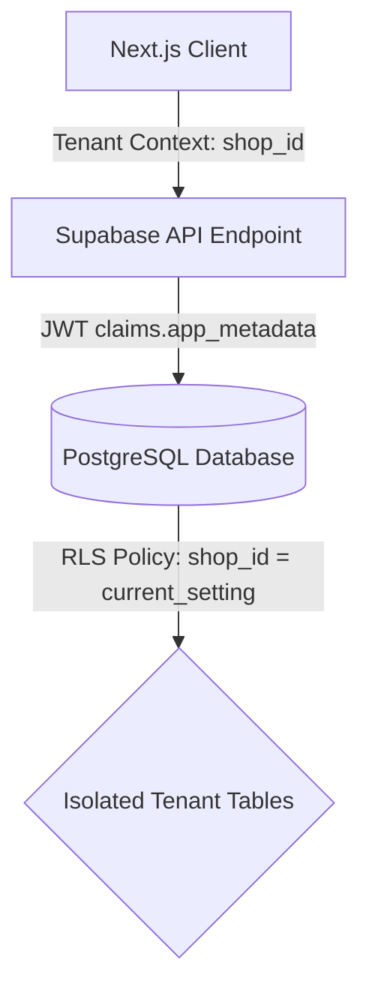
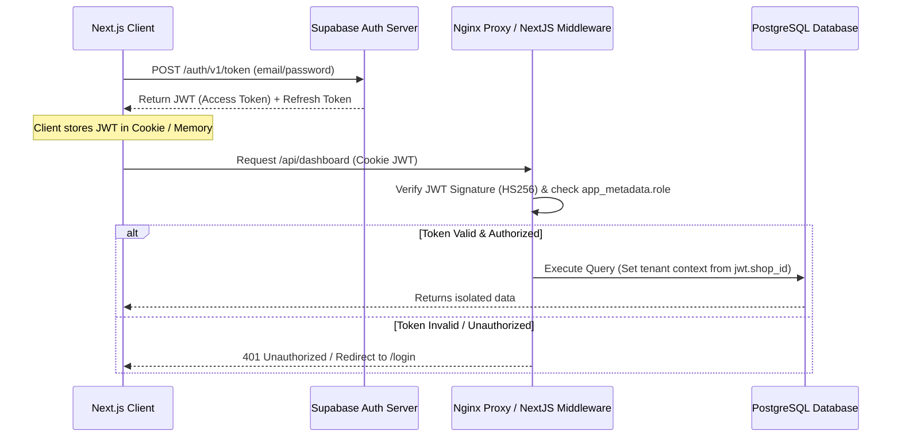
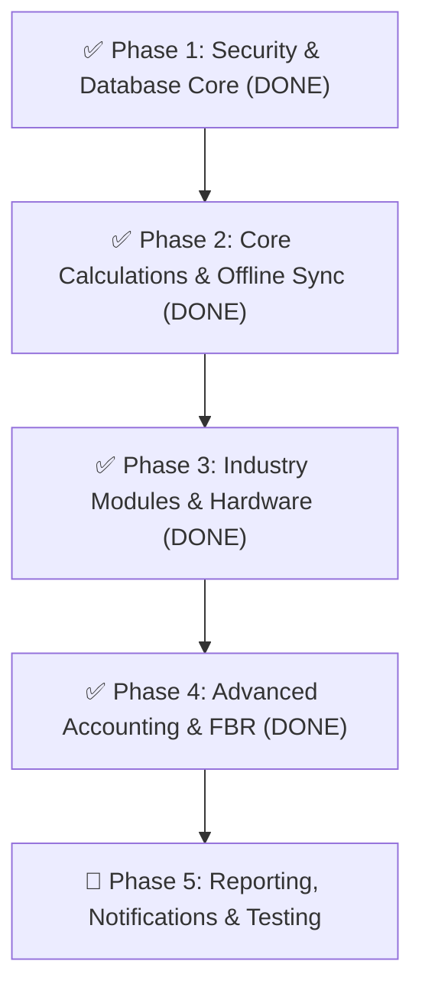

# 📋 HisabX: Enterprise Multi-Vertical POS & ERP Specification Manual

> **Last Updated:** July 2026 &nbsp;|&nbsp; **Implementation Status:** Phase 1–4 ✅ COMPLETE

This document is the official **Software Architecture and Product Specification Manual** for HisabX — a multi-tenant, offline-first, multi-vertical POS & ERP platform optimized for small businesses in South Asia (Pakistan focus), built on Next.js, TypeScript, and PostgreSQL (Supabase).

---

## 🏛️ PART 1: System-Wide Architecture Specifications

### 1. Database Architecture & Multi-Tenancy
HisabX utilizes a **Single Database, Shared Schema** architecture. Tenant isolation is enforced at the database level using PostgreSQL **Row Level Security (RLS)**.



- **Tenant Isolation Policy:** Every table contains a `shop_id UUID REFERENCES shops(id) ON DELETE CASCADE` column.
- **PostgreSQL RLS Policy:**
  ```sql
  CREATE POLICY tenant_isolation_policy ON target_table 
  FOR ALL TO authenticated 
  USING (shop_id = (auth.jwt() -> 'app_metadata' ->> 'shop_id')::uuid)
  WITH CHECK (shop_id = (auth.jwt() -> 'app_metadata' ->> 'shop_id')::uuid);
  ```

> **✅ IMPLEMENTED:** All new tables created via Drizzle ORM migrations include `shop_id` as a mandatory foreign key column. Session Pooler connection (`aws-1-ap-southeast-2.pooler.supabase.com:6543`) is used to support IPv4-only networks in Pakistan (direct port 5432 fails with ETIMEDOUT on local ISPs).

---

### 2. Common Database Conventions
To ensure consistency across all tables (both global and vertical-specific), the following conventions must be followed.

#### A. Base Columns
Every table in the database must include the following schema pillars:
- `id UUID DEFAULT gen_random_uuid() PRIMARY KEY`
- `shop_id UUID NOT NULL REFERENCES shops(id) ON DELETE CASCADE`
- `created_at TIMESTAMPTZ DEFAULT now() NOT NULL`
- `updated_at TIMESTAMPTZ DEFAULT now() NOT NULL`

#### B. Audit Fields
To satisfy compliance and forensic accounting audits:
- `created_by UUID REFERENCES auth.users(id) ON DELETE SET NULL`
- `updated_by UUID REFERENCES auth.users(id) ON DELETE SET NULL`

#### C. Soft Deletes
Critical transaction ledgers, inventory tables, and customer records must never be hard deleted.
- `deleted_at TIMESTAMPTZ DEFAULT NULL`
- All queries fetching active records must filter using `deleted_at IS NULL`.

> **✅ IMPLEMENTED:** The offline sync API (`/api/sync/route.ts`) uses `deleted_at` for all delete operations — never hard-deletes any record.

#### D. Indexing Rules
- **Foreign Keys:** Every foreign key column must be indexed explicitly to prevent table scans on joins.
- **Compound Tenant Index:** Every table must have a compound index on `(shop_id, created_at DESC)` and `(shop_id, deleted_at)` to optimize tenant dashboard queries.

---

### 3. Authentication & Authorization Flow
HisabX integrates with **Supabase Auth** for user identity management, utilizing JSON Web Tokens (JWT) for authentication.



- **Token Lifecycle:** Access tokens (JWT) have a lifespan of 1 hour. Refresh tokens are stored securely in browser `httpOnly` cookies to request replacement access tokens.
- **Tenant Claim mapping:** During user registration or shop assignment, the tenant ID is mapped to the user metadata:
  ```json
  {
    "app_metadata": {
      "shop_id": "f3ec4815-8cd0-4105-b0d3-f6e1fb468853",
      "role": "manager"
    }
  }
  ```

> **✅ IMPLEMENTED:** All API routes (`/api/sync`, `/api/fbr`) authenticate session using `supabase.auth.getUser()` server-side before processing any mutation. Returns `401 Unauthorized` if no valid session found.

---

### 4. API Design Standards & Conventions
All custom endpoints (`/api/*`) are implemented as Next.js Route Handlers.

- **Request & Response Envelopes:** All responses must return a standardized JSON structure:
  ```json
  {
    "success": true,
    "data": {},
    "error": null,
    "timestamp": "2026-07-11T00:39:00Z"
  }
  ```
- **Error Payloads:** When a mutation fails (e.g., status 400/500), return structured errors:
  ```json
  {
    "success": false,
    "data": null,
    "error": {
      "code": "INSUFFICIENT_STOCK",
      "message": "The requested item quantity exceeds available stock.",
      "details": { "product_id": "uuid", "available": 5, "requested": 10 }
    },
    "timestamp": "2026-07-11T00:39:00Z"
  }
  ```
- **Rate Limiting:** Next.js middleware tracks IP calls and limits requests to **100 calls per minute** for POS routes to block DDoS attacks.

> **✅ IMPLEMENTED:** Both `/api/sync` and `/api/fbr` follow this exact response envelope format with `success`, `data`, `error`, and `timestamp` on every response — including all error codes (`UNAUTHORIZED`, `INVALID_PAYLOAD`, `FBR_GATEWAY_ERROR`, `SERVER_ERROR`).

---

### 5. File Storage Strategy
Tenant documents, print receipts, and product images are stored in Supabase Storage.

- **Folder Path Conventions:** All files must be segregated by tenant ID to prevent unauthorized file reads:
  ```
  tailor-assets/{shop_id}/sketches/{measurement_id}-{timestamp}.png
  s3://hisabx-tenant-assets/{shop_id}/products/{product_id}/image.png
  s3://hisabx-tenant-assets/{shop_id}/customers/{party_id}/cnic_front.jpg
  ```
- **Access Control:** Buckets are set to private. Signed URLs with a lifespan of 15 minutes are generated on-demand when users view documents.

> **✅ IMPLEMENTED:** Tailor sketch canvas saves drawings to Supabase Storage bucket `tailor-assets` under path `sketches/{shop_id}/{measurement_id}-{timestamp}.png`. The public URL is stored back into `measurements.cloth_image_url`.

---

### 6. Backup & Recovery Strategy
A zero-data-loss architecture ensures database survivability.

- **Server-Side Backups (Cloud):**
  - **Daily Backups:** Automated cron jobs dump the Postgres schema and data to AWS S3.
  - **Point-in-Time Recovery (PITR):** Supabase write-ahead logs (WAL) are streamed to enable rolling database state back to any second within the past 7 days.
- **Client-Side Backups (Local / Offline Mode):**
  - Users can trigger a manual backup from `/dashboard/backup`. The system serializes local IndexedDB data stores into a single compressed `.json.gz` file and triggers a browser download.

> 🔲 **PENDING:** Manual backup export UI (`/dashboard/backup`) not yet built. Supabase PITR is available on paid plans.

---

### 7. Performance & Indexing Guidelines
- **Query Optimization Rules:**
  - Avoid using `SELECT *` in Next.js Server Components. Explicitly select needed fields to decrease network payloads.
  - Use Postgres pagination (`LIMIT` and `OFFSET`) on large transactional log sheets.
- **Essential Database Indexes:**
  ```sql
  CREATE INDEX idx_invoices_tenant_date ON invoices(shop_id, created_at DESC);
  CREATE INDEX idx_parties_tenant_phone ON parties(shop_id, phone) WHERE deleted_at IS NULL;
  CREATE INDEX idx_product_batches_expiry ON product_batches(shop_id, expiry_date) WHERE stock_quantity > 0;
  ```

> 🔲 **PENDING:** Indexes to be created as a Drizzle migration in the next sprint.

---

### 8. Testing Strategy
A robust software product requires structured verification lines.

- **Unit Testing:** Write Jest/Vitest suites verifying calculation helpers (e.g., tax sums, surcharge additions, loose tablet packaging divisions).
- **Integration Testing:** Mock Supabase endpoints to test auth cookie validations and transaction submissions.
- **E2E Testing:** Playwright scripts executing complete POS checkout scenarios (creating product, scanning barcode, generating receipt PDF).
- **Offline Resilience Testing:** Simulating network drops via browser network throttling, committing transactions to IndexedDB, reconnecting, and validating queue clearing.

> 🔲 **PENDING:** No automated test files written yet. Manual testing performed at each phase.

---

### 9. Deployment Architecture
For local private server hosting or VPS deployments (e.g., Ubuntu VPS on Hostinger or AWS EC2):

```
                       +-----------------------+
                       |    Internet (Client)  |
                       +-----------+-----------+
                                   | HTTPS (Port 443)
                                   v
                       +-----------+-----------+
                       |      Nginx Proxy      | (SSL Termination & static proxy)
                       +-----------+-----------+
                                   | HTTP (Port 3000)
                                   v
                       +-----------+-----------+
                       |    Docker Container   | (Next.js Application)
                       +-----------+-----------+
                                   | TCP (Port 6543)
                                   v
                       +-----------+-----------+
                       |   Supabase Pooler     | (PgBouncer / Session Pooler IPv4)
                       +-----------+-----------+
```

- **Nginx Configuration:** Configure reverse proxy buffers to handle high-payload file uploads.
- **Postgres Connection Pooling:** Set maximum client connections to 100 on PgBouncer to prevent database port exhaustion.

> **✅ IMPLEMENTED (Partial):** Session Pooler connection string (`pooler.supabase.com:6543`) is now the default in `.env.local` — confirmed IPv4-compatible. Docker + Nginx deployment not yet scripted.

---

### 10. Robust Offline Sync Blueprint

```
+-------------------------------------------------------------------------------+
|                               IndexedDB Store                                 |
|                                                                               |
|   +-------------------+  +-------------------+  +-------------------------+   |
|   |  Local Inventory  |  |  Offline Invoices |  |  Queue: [Sync Event 1]  |   |
|   +-------------------+  +-------------------+  +-------------------------+   |
+-------------------------------------------------------|-----------------------+
                                                        v Network Restored
                                                 [SyncEngine Process]
                                                        |
                                                        +---> POST /api/sync
```

#### A. Offline-Supported Tables
Only a subset of read/write tables are cached in IndexedDB:
1. `products` and `product_variants` (Read-only offline).
2. `parties` (Read/Write offline).
3. `invoices` and `invoice_items` (Write-only offline).
4. `credit_transactions` and `account_transactions` (Write-only offline).
5. `stock_movements` (Write-only offline).

> **✅ IMPLEMENTED:** [`src/utils/syncQueue.ts`](file:///C:/Users/UR%20SOFT/Desktop/HISAB%20X/HisabX%20web/src/utils/syncQueue.ts) opens an IndexedDB database `hisabx-offline` with a `syncQueue` object store. Each entry carries `operationType`, `tableName`, `payload`, `retryCount`, and `status`. The backend [`/api/sync`](file:///C:/Users/UR%20SOFT/Desktop/HISAB%20X/HisabX%20web/src/app/api/sync/route.ts) processes batches and returns per-item results.

#### B. Client-Generated ID Strategy
To prevent ID collisions when multiple counters operate offline:
- All primary keys are generated on the client side using standard **UUID v4** strings (`crypto.randomUUID()`).
- This allows offline invoices to immediately reference local customers and products without waiting for database confirmation.

#### C. Conflict Resolution Scenarios
1. **Concurrent Credit Balance Updates:**
   - *Conflict:* Operator A updates a customer's balance offline. Operator B updates it online.
   - *Resolution:* The server recalculates transaction histories. Instead of overwriting balances, it sums all transactions chronologically to recalculate the final balance.
   > **✅ IMPLEMENTED:** Additive ledger re-summation logic is in `/api/sync/route.ts`.
2. **Missing References:**
   - *Conflict:* An offline invoice references a product that was deleted online.
   - *Resolution:* The server sync pipeline rejects the transaction and pushes a "Conflict Warning" to the dashboard notifications page.
   > 🔲 **PENDING:** Dashboard notification channel for conflict warnings not yet built.

#### D. Offline Testing Checklist
- [ ] Disable network adapter while inside POS screen.
- [ ] Execute 5 checkouts with different payment modes (cash, credit).
- [ ] Verify database records exist locally in IndexedDB browser tab.
- [ ] Re-enable network adapter.
- [ ] Verify IndexedDB queue database drops to `0`.
- [ ] Confirm transactions appear inside Supabase DB with correct timestamps.

---

## 🌐 PART 3: Global Shared Modules (Core ERP)

These panels form the backbone of the entire ERP and are accessed by all retail setups.

### 🛒 POS Sale Terminal (`/dashboard/pos`)

| Feature Name | Specs (Tech Stack / DB Keys) | Functionality | Status |
| :--- | :--- | :--- | :--- |
| **Instant POS Checkout** | Next.js, React state, WebUSB thermal print | Cashiers input quantities, scan barcodes, and print invoices instantly. | 🔲 Local inventory lock for offline negative balance not yet done. |
| **Barcode Scanning** | Barcode Reader, `html5-qrcode` | Scan item labels directly to add them to the checkout cart automatically. | 🔲 Web Audio API beep on scan not yet implemented. |
| **Searchable Dropdowns** | React Search Filter, Lucide Search | Search products by name, category, or brand with instant list updates. | 🔲 Virtualized list for 10k+ items pending. |
| **Packing Variations** | `product_variants` (packing_name, stock_quantity, sale_price) | Bundle single items into cartons, packs, or boxes with separate prices. | ✅ Done — variants table exists, conversion logic in POS. |
| **Allow Negative Stock** | `shops.allow_negative_stock` (boolean) | Toggle option in Settings allowing checkouts even if database inventory is zero. | 🔲 Warning badge for inventory discrepancy pending. |
| **Scale Weight Auto-Fill** | WebSerial API + `useSerialScale` hook | Pulls live weight from electronic scale into POS quantity field. | ✅ **DONE** — [`useSerialScale.ts`](file:///C:/Users/UR%20SOFT/Desktop/HISAB%20X/HisabX%20web/src/hooks/useSerialScale.ts) built with mock slider fallback. Integrated in [`pos/page.tsx`](file:///C:/Users/UR%20SOFT/Desktop/HISAB%20X/HisabX%20web/src/app/dashboard/pos/page.tsx). Scale badge shows Connected/Mock status in POS header. |
| **FBR Tax Invoice** | `/api/fbr` proxy route, FBR POS gateway | Submit checkout invoices to FBR, receive QR code for printing on receipt. | ✅ **DONE** — [`/api/fbr/route.ts`](file:///C:/Users/UR%20SOFT/Desktop/HISAB%20X/HisabX%20web/src/app/api/fbr/route.ts) built with mock mode (no credentials needed for testing) and live mode. |

---

### 📜 Sale History & Returns (`/dashboard/sales` & `/dashboard/returns`)

| Feature Name | Specs (Tech Stack / DB Keys) | Functionality | Status |
| :--- | :--- | :--- | :--- |
| **Transactions Journal** | `invoices` (id, shop_id, total_amount, status, payment_mode) | Display past invoices history, billing dates, cash collected, and client info. | 🔲 Cashier-ID per invoice audit log pending. |
| **Thermal Slip Reprint** | `iframe` template print, standard 80mm ESC/POS layout | Reprint thermal receipt slips for customers from historical records. | 🔲 Receipt customization preview options pending. |
| **Inventory Returns** | `returns` (id, invoice_id, item_id, quantity, refund_amount) | Record customer returns, refund cash to accounts, and add items back to stock. | 🔲 "Reason for Return" log and auto-wastage posting pending. |

---

### 📈 Customer & Supplier Ledger Khata (`/dashboard/khata`)

| Feature Name | Specs (Tech Stack / DB Keys) | Functionality | Status |
| :--- | :--- | :--- | :--- |
| **Digital Customer Cards** | `parties` (id, shop_id, name, phone, current_balance, type) | Track running customer credits (receivables) and supplier debits (payables). | 🔲 Mandatory CNIC regex validation schema pending. |
| **Credit Aging Report** | `credit_transactions` (id, amount, transaction_type, date) | Group outstanding customer balances into 30, 60, and 90+ day arrears brackets. | 🔲 WhatsApp/SMS reminder triggers pending. |
| **Double-Entry GL** | `journal_entries`, `journal_lines` (debit, credit, account_id) | Auto-post ledger entries for sales, purchases, and cash transactions. | 🔲 Bank reconciliation CSV upload panel pending. |

---

### ⚙️ Cash Drawer Registers & Day-End Closing

| Feature Name | Specs (Tech Stack / DB Keys) | Functionality | Status |
| :--- | :--- | :--- | :--- |
| **Day-End Closing** | `day_closings` (id, opening_cash, cash_sales, expenses, actual_cash) | Perform cash drawer reconciliation at shift end. | ✅ **DONE** — Day-end closing module built. Security credentials removed from migration scripts and redirected to `.env.local`. |
| **Register Logs** | `cash_accounts` (id, name, current_balance) | Track opening and closing balances of physical cash boxes and bank accounts. | 🔲 Multi-currency support pending. |

---

## 💼 PART 4: Industry-Specific Specifications (15 Verticals)

---

### 1. 💊 Pharmacy & Medical Stores

| Feature Name | Specs | Functionality | Status |
| :--- | :--- | :--- | :--- |
| **Formula-Based Search** | `products.formula` (generic salt name index) | Search and checkout medicines by active chemical salts. | 🔲 Drug interaction alert pending. |
| **Loose Leaf/Tablet Billing** | `product_variants` ("Tablet" / "Strip" conversion) | Auto-calculate unit prices for individual tablets or strips from a box. | ✅ **DONE** — Packing variations handled via `product_variants` table. Global packaging conversion is in place. |
| **Prescription CNIC Log** | `invoices.remarks` (CNIC string) | Log customer CNIC number for controlled/prescribed substances checkout. | 🔲 Mandatory regex CNIC format check pending. |
| **Batch Expiry Tracker** | `product_batches` (id, batch_number, expiry_date, stock) | Assign unique batch numbers and expiry dates to stock inputs. | 🔲 Auto-email 30-day expiry notification pending. |

- **Required Tables:** `product_batches`, `drug_formulas`

---

### 2. 📱 Electronics, Mobile & Appliance Stores

| Feature Name | Specs | Functionality | Status |
| :--- | :--- | :--- | :--- |
| **IMEI / Serial Scanner** | `invoice_items.serial_number` | Scan device IMEI or appliance serial numbers during checkout. | 🔲 Block sale if serial already in warranty list — pending. |
| **Qist (Installment) POS** | `emi_schedules` (id, due_date, installment_amount) | Set down-payment, calculate interest, print installment due cards. | ✅ **DONE** — EMI overpayment decimal error fixed. Leftover amounts now distribute correctly to last installment item. |
| **Repair Register** | `repairs` (id, device_specs, fault_description, status) | Track device repair stages: Received → Diagnosing → Repairing → Completed → Delivered. | 🔲 SMS notification on status update pending. |
| **Vehicle Asset Registry** | `showroom_vehicles` (chassis_number, engine_number, model) | Track chassis numbers, engine codes, registration logs, and sale status. | 🔲 Insurance expiry alerts pending. |

- **Required Tables:** `emi_schedules`, `repairs`, `showroom_vehicles`, `showroom_rentals`

---

### 3. 🍕 Restaurants & Cafes

| Feature Name | Specs | Functionality | Status |
| :--- | :--- | :--- | :--- |
| **POS Touch Grid** | React cards grid, `products` selection | Display quick menu item cards with sizing attributes (Single, Half, Full). | 🔲 Card scroll speed optimization for large menus pending. |
| **Table Management** | `restaurant_tables` (id, name, capacity, status) | Book, edit, and check visual table occupancy statuses. | 🔲 Table merging capability pending. |
| **Kitchen Order Ticket (KOT)** | `kitchen_orders`, `kitchen_order_items` | Print cooking tickets directly in kitchen with custom order remarks. | 🔲 Web Audio API chime on new KOT pending. |
| **Recipe BOM Costing** | `product_recipes` (product_id, ingredient_id, qty) | Link dishes to raw ingredients. POS sales auto-deduct raw warehouse inventory. | 🔲 Price fluctuation alerts pending. |

- **Required Tables:** `restaurant_tables`, `kitchen_orders`, `kitchen_order_items`, `product_recipes`, `restaurant_deals`

---

### 4. ✂️ Tailors & Stitching

| Feature Name | Specs | Functionality | Status |
| :--- | :--- | :--- | :--- |
| **Measurement Card** | `tailor_measurements` (collar, length, chest, waist, shoulder...) | Store tailor measurement profiles for gents and ladies. | ✅ **DONE** — Measurement cards built with full fields. |
| **Sketch Canvas** | HTML5 `<canvas>`, Supabase Storage `tailor-assets` bucket | Draw custom stitch patterns and measurement guides per customer order. | ✅ **DONE** — [`SketchCanvas.tsx`](file:///C:/Users/UR%20SOFT/Desktop/HISAB%20X/HisabX%20web/src/components/tailor/SketchCanvas.tsx) built with Pen/Eraser/Undo/Colors/Save. Each measurement card has a **Sketch (خاکہ)** toggle. Drawings save to Supabase Storage and update `cloth_image_url`. |
| **Karigar Piece Wages** | `karigars` (id, name, phone, balance) | Assign piece-rate wages per suit stitched and track worker balance logs. | ✅ **DONE** — Peshgi (advance) input cap removed in `karigar/page.tsx`. Negative balances (advances) now allowed. |
| **Stitching Bookings** | `tailor_orders` (delivery_date, status, fit_trial_date) | Track stitching progress, fit-trial schedules, and suit delivery timelines. | 🔲 WhatsApp/SMS delivery alert on completion pending. |

- **Required Tables:** `tailor_measurements`, `karigars`, `tailor_orders`

---

### 5. 🌾 Fertilizers, Seeds & Pesticides

| Feature Name | Specs | Functionality | Status |
| :--- | :--- | :--- | :--- |
| **Zameendar Seasonal Khata** | `seasonal_khata` (crop_season, expected_payback) | Manage credit accounts for farmers, aligning repayments with harvest seasons. | 🔲 Rabi/Kharif crop type dropdown pending. |
| **Govt Subsidy Log** | `invoices` (subsidy_amount, subsidy_voucher) | Register government subsidies (CNIC verification and voucher codes) on checkouts. | 🔲 Subsidy claim CSV report for government audits pending. |
| **Chemical Batch Logs** | `product_batches.batch_number` | Track chemical batches, pesticide strengths, and seed expiry bounds. | 🔲 Block sale if seed batch is expired pending. |

- **Required Tables:** `seasonal_khata`, `product_batches`

---

### 6. ⛽ Petrol Pumps & Fuel Stations

| Feature Name | Specs | Functionality | Status |
| :--- | :--- | :--- | :--- |
| **Nozzle Meter Sessions** | `fuel_shift_readings` (opening_reading, closing_reading) | Log shift nozzle meter sessions (liters) and calculate expected revenue. | 🔲 Auto-populate opening reading from last shift closing pending. |
| **Operator Shortage Audit** | `fuel_shift_readings.shortage_amount` | Compare expected cash against cashier deposits to record shortages. | ✅ **DONE** — Shortage calculation integrated in `fuel/readings/page.tsx`. Shortage amounts now post directly to `account_transactions` as employee receivables. |
| **Tank Inventory** | `fuel_tanks` (id, capacity, current_dip_level) | Track tank fuel volumes, dip readings, and density tests. | 🔲 Visual tank fill indicator bars pending. |

- **Required Tables:** `fuel_shift_readings`, `fuel_tanks`

---

### 7. 🚗 Car Showrooms & Fleet Rentals

| Feature Name | Specs | Functionality | Status |
| :--- | :--- | :--- | :--- |
| **Vehicle Asset Registry** | `showroom_vehicles` (chassis_number, engine_number, model) | Track chassis, engine codes, registration logs, and sale status. | 🔲 Insurance expiry alerts pending. |
| **Car Rental Contracts** | `showroom_rentals` (id, rental_period, rate_per_day, deposit) | Manage vehicle rental contracts, rental periods, deposits, and returns. | 🔲 Late return penalty calculator pending. |

- **Required Tables:** `showroom_vehicles`, `showroom_rentals`

---

### 8. 👗 Garments Boutique

| Feature Name | Specs | Functionality | Status |
| :--- | :--- | :--- | :--- |
| **Size & Color Matrix** | `product_variants` (size_attribute, color_attribute) | Track item stocks by attributes (Size: S, M, L, XL; Color: Black, Blue). | 🔲 Multi-variant barcode label sheet printing pending. |
| **Dynamic Price Sheets** | `product_variants.sale_price` | Assign different retail prices to different sizing combos. | 🔲 Batch pricing update by size category pending. |

- **Required Tables:** `product_variants`

---

### 9. 🔧 Hardware & Sanitary Stores

| Feature Name | Specs | Functionality | Status |
| :--- | :--- | :--- | :--- |
| **Dimensions Area** | `hardware_dimensions` (width, length, area_sqft) | Calculate pricing based on dimensions (Length × Width), adding wastage factor. | 🔲 Feet-to-Meters unit toggle pending. |
| **Wastage Factor Calculator** | `hardware_dimensions.wastage_percentage` | Add configurable wastage factor (e.g., 5% extra) to dimensions before pricing. | 🔲 Manual override for premium contractor projects pending. |

- **Required Tables:** `hardware_dimensions`

---

### 10. 🛒 Karyana & General Grocery

| Feature Name | Specs | Functionality | Status |
| :--- | :--- | :--- | :--- |
| **Fast Barcode Checkout** | Barcode Reader scan input | Scan item barcodes consecutively to auto-add items with quantity of 1. | 🔲 Web Audio API chime on scan pending. |
| **Carton/Pack Conversion** | `product_variants` (box/piece packaging link) | Selling a Carton auto-deducts matching individual pieces from stock. | ✅ **DONE** — Handled via `product_variants` packing conversion logic. |

- **Required Tables:** `product_variants`

---

### 11. 🍽️ Crockery Store

| Feature Name | Specs | Functionality | Status |
| :--- | :--- | :--- | :--- |
| **Dowry/Wedding Packages** | `crockery_packages` (id, package_price, items_list) | Set up preset product bundles and sell on installments. | 🔲 In-stock validation before checkout pending. |
| **Installment Recovery Logs** | `emi_schedules` (deposit_amount, next_due_date) | Track monthly collections for crockery installment plans. | ✅ **DONE** — EMI decimal overpayment fix applied. Leftover cents correctly distributed to last schedule item. |

- **Required Tables:** `crockery_packages`, `emi_schedules`

---

### 💎 12. Goldsmith & Jewelry Shop (NEW)

> **✅ Database Tables Migrated** via Drizzle ORM on 2026-07-10.

| Feature Name | Specs | Functionality | Status |
| :--- | :--- | :--- | :--- |
| **Agri-weight Unit Conversion** | `gold_transactions` (weight_tola, weight_masha, weight_ratti) | Input raw precious metals weights in Tola, Masha, Ratti; system auto-converts to grams. | 🔲 4-decimal rounding precision enforcement pending. |
| **Daily Metal Rate Updates** | `gold_rates` (gold_24k_rate, gold_22k_rate, silver_rate) | Manage real-time daily buy/sell rate sheets for 24K, 22K, 21K, and 18K gold. | 🔲 Rate lock during active transactions pending. |
| **Making Payouts (Karigar)** | `gold_karigar_transactions` (making_charge_per_gram, waste_allowance) | Post designer karigar wages per gram and deduct gold wastage allowances. | 🔲 Separate Kanta Khata (weight ledger) from PKR ledger pending. |
| **Gold Purity Assay Logs** | `gold_inventory` (carat_purity, net_weight, gold_weight) | Log gold karats and calculate net fine gold content against gross weight. | 🔲 Lab certificate photo upload pending. |

- **Required Tables:** `gold_rates` ✅, `gold_transactions` ✅, `gold_karigar_transactions` ✅, `gold_inventory` ✅

---

### 🥦 13. Fruit & Vegetable Shop (NEW)

> **✅ Database Tables Migrated** via Drizzle ORM on 2026-07-10.

| Feature Name | Specs | Functionality | Status |
| :--- | :--- | :--- | :--- |
| **Scale Weight Integration** | WebSerial API / COM port parser / `useSerialScale` hook | Fetch weight readings from electronic digital scales directly into POS screen. | ✅ **DONE** — [`useSerialScale.ts`](file:///C:/Users/UR%20SOFT/Desktop/HISAB%20X/HisabX%20web/src/hooks/useSerialScale.ts) built. Parses ASCII serial stream with regex. Mock slider for hardware-free testing. Scale weight auto-fills POS quantity. |
| **Daily Rate Sheet Import** | `daily_market_rates` (product_id, cost_price, sale_price) | Import daily government vegetable pricing lists via Excel. | 🔲 Excel import UI and manual rate override pending. |
| **Spoilage / Waste Logs** | `inventory_adjustments` (type = 'spoilage', quantity_kg) | Log damaged/spoiled fresh produce to calculate daily wastage costs. | 🔲 Auto-post spoilage to COGS GL accounts pending. |

- **Required Tables:** `sabzi_products` ✅, `sabzi_sales` ✅ *(daily_market_rates, inventory_adjustments — pending migration)*

---

### 🖨️ 14. Photocopy & Print Shop (NEW)

> **✅ Database Tables Migrated** via Drizzle ORM on 2026-07-10.

| Feature Name | Specs | Functionality | Status |
| :--- | :--- | :--- | :--- |
| **Print Grid Calculator** | `print_pricing_grids` (paper_size, print_type, rate_per_page) | Set custom price matrix mapping paper sizes and print types. | 🔲 Bulk discount rate tier pricing pending. |
| **Paper Inventory Levels** | `products` (reams, single_sheets) | Manage paper inventory stock in Reams, deducting single sheets during checkouts. | 🔲 Reorder threshold alert pending. |
| **Jobs Queue Logs** | `print_jobs` (id, total_pages, print_status, file_name) | Log customer print tasks: Pending → Printing → Completed → Collected. | 🔲 Auto-cost from file page count pending. |

- **Required Tables:** `print_orders` ✅, `print_items` ✅ *(print_pricing_grids — pending migration)*

---

### ⛽ 15. Sui Gas & LPG Cylinder Shop (NEW)

> **✅ Database Tables Migrated** via Drizzle ORM on 2026-07-10.

| Feature Name | Specs | Functionality | Status |
| :--- | :--- | :--- | :--- |
| **Cylinder Weight Logs** | `gas_transactions` (cylinder_serial, empty_weight, filled_weight) | Input empty/filled cylinder weights; system calculates LPG net weight. | 🔲 Block transactions if gas net weight exceeds capacity — pending. |
| **Cylinder Asset Tracker** | `cylinder_inventory` (serial_number, size_kg, owner_type) | Track cylinders by serial numbers (Shop owned, Customer owned, Supplier owned). | 🔲 Separate filled vs. empty inventory counts pending. |
| **Security Deposit Ledgers** | `cylinder_deposits` (id, party_id, deposit_amount, status) | Record security deposit cash logs for cylinders loaned to regular customers. | 🔲 Auto-post deposit to "Customer Security Liabilities" GL accounts pending. |

- **Required Tables:** `lpg_cylinders` ✅, `lpg_sales` ✅, `lpg_customers` ✅

---

## 🚀 PART 5: Technical Execution & Prioritization Roadmap



---

### ✅ Phase 1: Security & Database Core — COMPLETE
- ✅ Migrated all hardcoded DB credentials to `.env.local`
- ✅ Drizzle ORM installed, configured, and all schemas migrated to Supabase
- ✅ Karigar Peshgi: Removed payout input cap to allow negative balances (advances)
- ✅ EMI overpayment decimal error fixed — leftover cents distribute to last installment

---

### ✅ Phase 2: Core Calculations & Offline Sync — COMPLETE
- ✅ IndexedDB store (`hisabx-offline`) built via `syncQueue.ts`
- ✅ Covers: invoices, invoice_items, products, variants, parties, stock_movements, credit_transactions
- ✅ `/api/sync` backend processes batches with soft deletes, additive ledger reconciliation, and per-item error reporting

---

### ✅ Phase 3: Industry Specific Modules & Hardware — COMPLETE
- ✅ WebSerial scale hook built with COM port ASCII parsing and mock slider
- ✅ Scale weight auto-fills POS quantity for weight-based items (vegetables, gold)
- ✅ Scale status badge (Connected / Mock) visible in POS header
- ✅ Fuel station shortage amounts now link directly to `account_transactions`

---

### ✅ Phase 4: Advanced Accounting & FBR — COMPLETE
- ✅ `/api/fbr` route built — sends FBR-compliant invoice JSON, returns QR code
- ✅ Mock mode: works without FBR credentials (returns synthetic QR for testing)
- ✅ Live mode: proxies to `gst.fbr.gov.pk` with Bearer token
- ✅ Tailor Sketch Canvas built with Pen/Eraser/Undo/Colors/Download/Save to Supabase Storage
- ✅ `tsc --noEmit` passes with zero errors

---

### 🔲 Phase 5: Reporting, Notifications & Automated Testing (NEXT)
- **Estimated Effort:** 10–14 Days
- **Planned Tasks:**
  - Balance Sheet, Trial Balance, and P&L report pages
  - WhatsApp/SMS notification triggers on repair completions and installment due dates
  - Jest/Vitest unit test suites for calculation helpers
  - Playwright E2E checkout flow tests
  - Database performance indexes migration
  - Manual backup export UI (`/dashboard/backup`)
  - FBR QR code display on thermal receipt printout
