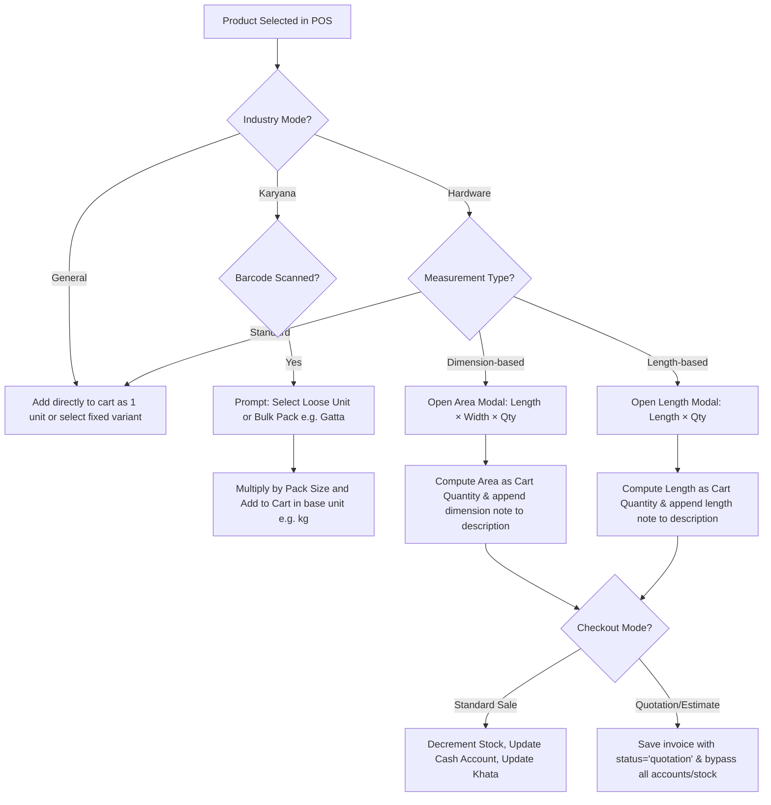

# ⚙️ Hisab X — Tri-Mode Core System Comparison (General, Karyana, Hardware)

This document provides a comprehensive technical comparison of the three specialized industry modes implemented in **Hisab X**:
1. **General Retail Store** (جنرل سٹور)
2. **Karyana (Grocery) Store** (کریانہ سٹور)
3. **Hardware & Sanitary Store** (ہارڈویئر اور سینیٹری سٹور)

---

## 📋 Summary Table of Key Features

| Features / Capabilities | General Retail | Karyana (Grocery) | Hardware & Sanitary |
| :--- | :---: | :---: | :---: |
| **Primary Unit Focus** | Standard pieces, packets | Weight/Volume (kg, ltr, gram) | Area (sq ft), Running length (ft) |
| **Bulk Packing Support** | Box / Carton | Gatta (گٹو) / Bori (بوری) | N/A (Sold by dimensions/length) |
| **Interactive Calculator** | No | No (Prompted on Barcode Scan) | **Yes** (Dimension & Length Modals) |
| **Cart Quantity Resolution** | Integer / Fractional | Weight-based Decimal | Calculated Area / Length Decimal |
| **Receipt Title Customization** | Retail Receipt | Retail Receipt | **Yes** (Quotation / Estimate / Bill) |
| **Estimate / Quotation Mode** | No | No | **Yes** (Saves as Draft, no stock change) |
| **Convert Estimate to Sale** | No | No | **Yes** (Loads quotation items back to cart) |
| **Purchase Price Weighting** | Standard | **Weighted average** per kg/ltr | Area-scaled unit cost calculation |

---

## 🤝 1. What is SAME (Shared Core Architecture)
All three modes run on a unified Next.js + Supabase client architecture, utilizing the exact same database structure and business logic hooks:

* **Database Core Schema**: All transactions, regardless of mode, write to the `invoices` and `invoice_items` tables. Inventory uses the `products` and `product_variants` tables.
* **Dual POS Layouts**: Both **Grid Mode** (visual category-based tiles) and **Search Mode** (table-based fast keyboard billing) are fully operational and toggleable across all modes.
* **Register Session Management**: The shift opening/closing float, cash register logs (`register_sessions`), and cash summary drawer remain identical.
* **Checkout Engine**: Subtotal, discount calculations, taxes, payments (Cash, Card, Split, Udhaar/Credit), and change calculations are handled by the same POS engine.
* **Bilingual UI Interface**: Full toggle capability between English and Urdu (اردو) translations is available throughout the dashboard.

---

## 🔍 2. What is DIFFERENT (Sector-Specific Abstractions)

### 🛒 A. General Retail Store
Designed for standard packaged goods, apparel, and products with fixed packing variations.
* **Fixed Box Packing**: Supports simple packing ratios (e.g., 1 Box = 12 Pieces).
* **Static Variations**: Variants (e.g. Size: Medium, Color: Blue) have fixed, predefined prices.
* **Direct Selection**: Clicking a box variant adds it directly to the cart as "1 Box" (deducting 12 single items behind the scenes) without requiring user input.
* **Standard Inventory Tracking**: Items are tracked by count.

---

### 🌾 B. Karyana (Grocery) Store
Designed for weight/volume-based inventories where goods are purchased in heavy bulk packs (bori, gatta) but sold in loose, fractional weights (grams, kilograms).
* **Barcode-first Packaging Prompt**: When purchasing or selling, scanning/selecting a product immediately prompts the user if they want to enter quantity in **Bulk Packing (Gatta/Bori)** or **Loose Units**.
* **Base Unit Auto-Conversion**: Entering bulk quantities (e.g., 2 Gattay) automatically multiplies by the pack size (e.g., 50 kg) to record the stock in base units (100 kg), avoiding inventory mismatches.
* **Weighted Average Purchase Cost**: When purchasing a bulk pack (e.g., 50 kg Gatta for Rs 5,000), the system automatically updates the base product's single unit purchase price (`purchase_price_single`) to Rs 100/kg, using a weighted average formula based on current warehouse stock.
* **Fractional Sales**: POS cart items handle floating decimal quantities (e.g., selling 0.25 kg of sugar).

---

### 🔧 C. Hardware & Sanitary Store
Designed for raw materials, construction items, pipes, wood, glass sheets, and wires that are sold based on physical dimensions (Area or Running Length), accompanied by custom quotations for builders.
* **Interactive Calculators**:
  * **Dimension Calculator (📐 Area)**: Prompted when selecting items like Glass or Plywood. Cashier inputs `Length (ft) × Width (ft) × No. of Pieces`. The system calculates the total square feet (base unit quantity) and updates the cart.
  * **Length Calculator (📏 Running Length)**: Prompted for items sold by length (e.g., PVC Pipe, Electric Cable). Cashier inputs `Length (ft) × No. of Pieces` to calculate total feet.
* **Cart Detail Suffixes**: Cart items display the exact input parameters under the name (e.g. `(4.00 × 3.00 ft × 5)`) so customers can verify how their sheet area was computed.
* **Quotation (تخمینہ) Mode**:
  * A dedicated payment mode that saves the cart as a draft (`status = 'quotation'`).
  * **Bypasses all ledger entries**: Does not decrement inventory, does not register in cash accounts, and does not post to the customer's Khata balance.
* **Convert to Sale Integration**:
  * Sales ledger features a dedicated "Quotations" subtab.
  * Clicking **Convert to Sale** retrieves the quotation, redirects the user to the POS, and automatically fills the active cart with all the items, quantities, and descriptions, allowing immediate checkout.
* **Modified Receipt Formats**:
  * Receipts print with header "Quotation / Estimate (تخمینہ)".
  * Default Urdu note at the bottom is overridden with "تخمینہ رسید (یہ بل نہیں ہے)" to prevent customer confusion with actual bills.

---

## 🛠️ Technical Implementation Visual Flow

---

## 💾 File Reference Locations
1. **POS Logic**: [pos/page.tsx](file:///c:/Users/UR%20SOFT/Desktop/HISAB%20X/HisabX%20web/src/app/dashboard/pos/page.tsx)
2. **Product Configuration**: [products/page.tsx](file:///c:/Users/UR%20SOFT/Desktop/HISAB%20X/HisabX%20web/src/app/dashboard/products/page.tsx)
3. **Purchase Panel**: [purchase/page.tsx](file:///c:/Users/UR%20SOFT/Desktop/HISAB%20X/HisabX%20web/src/app/dashboard/purchase/page.tsx)
4. **Sales Ledger**: [sales/page.tsx](file:///c:/Users/UR%20SOFT/Desktop/HISAB%20X/HisabX%20web/src/app/dashboard/sales/page.tsx)
5. **Print Layout**: [ReceiptTemplate.tsx](file:///c:/Users/UR%20SOFT/Desktop/HISAB%20X/HisabX%20web/src/components/ReceiptTemplate.tsx)
